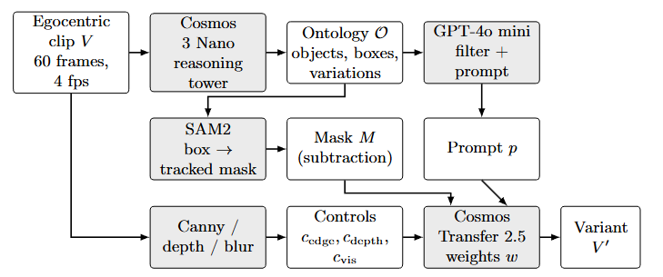
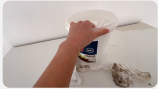
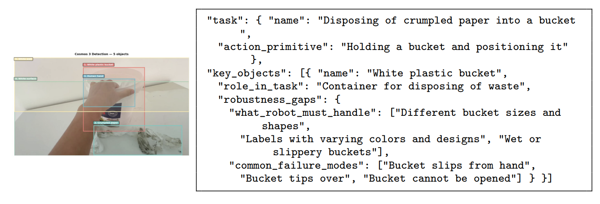

# AIPR 2026 paper: Synthetic Video Generation for Robot Learning Using World Foundation Models

Working repository for the AIPR 2026 manuscript (Springer LNCS proceedings, final paper due 22 October 2026 via Springer Meteor). Authors: Shrey Jha, Skyler Saucedo, Frank Tanner (Innodata).

**Current manuscript: the 21 October revision** (`oct-21/`), the "first draft-revisions" Google Docs export of 21 October 2026, typeset word for word in LNCS as `oct-21/AIPR 2026 Paper-updated.pdf` (also `.md` and `.docx`), with every reference moved off arXiv to a verified first source. The full text is reproduced in Section 4 below. What was done on 20 and 21 October and what the authors still owe before submission is in `oct-21/oct-21-status-and-todo.md`. Draft 7 (`skyler-first-draft/`) and its review remain for reference.

## 1. Directory structure

```
.
├── claude-drafts/                 drafts 1 to 6 and their LaTeX sources
│   ├── draft-1/                   compiled draft 1 (main.pdf) with its sections, figures, refs.bib
│   ├── draft-2/                   compiled draft 2 (main-v2.pdf)
│   ├── draft-3/                   compiled draft 3 (main.pdf)
│   ├── draft-4-skyler/            draft 4: section ideations in Markdown, several variants per section
│   ├── draft-5/                   draft 5 PDF, word-for-word transcription, analysis, shore-up list, figures/
│   ├── draft-6/                   draft 6 Markdown (draft 5 structure, confirmed numbers, LNCS citations), figures/
│   ├── paper/                     LaTeX source of draft 1 (LNCS); scripts/leakage_metric.py
│   ├── paper2/                    LaTeX source of draft 2 (slide-sequence outline)
│   ├── paper3/                    LaTeX source of draft 3; build.sh
│   └── paper3v2/                  LaTeX copy of draft 3 reserved for typesetting; build.sh
├── policy-vs-data-amount/         data-scaling claims compiled from the six reference papers
│   ├── data/                      one CSV per paper (EgoScale, LingBot-VLA, pi0, Lin et al., MimicGen, FieldGen)
│   ├── figures/                   policy_vs_data_amount.{pdf,png} (the paper's Fig. 1) and the two half figures
│   ├── make_plots.py              draws the figures from the CSVs; writes figures/fits.json
│   └── README.md                  claims table, figures, our fits, caveats
├── references/                    the six reference papers (arXiv PDFs)
├── review/                        analyses of the source material
│   ├── images/                    24 slide renders and 25 images extracted from the deck; _media-index.csv
│   ├── leakage/                   masked color-difference measurement on the bucket clip; mask coverage check
│   ├── answers-from-shrey-notes.md  transcription of Shrey's answers to the open items
│   ├── assumptions.md             working assumptions and their status
│   └── reference-abstracts.md     how the six reference abstracts are built
├── skyler-first-draft/            draft 7 (18 October)
│   ├── AIPR 2026 Paper-draft-7.pdf  the Google Docs export
│   ├── main.pdf                   draft 7 typeset in LNCS, word for word
│   ├── paper7/                    LaTeX source of main.pdf (main.tex, figures/, build.sh)
│   ├── draft-7-review.md          analysis and shore-up list for draft 7
│   ├── review/                    the review as .tex, .pdf and .docx
│   └── build-review.sh            builds the review into the three formats
├── oct-19/                        Skyler's 19 October export, transcribed; oct-19-revised.md (uncited refs removed,
│                                  citations renumbered, reasoner named consistently); oct-19-diff.md; figures/
├── oct-21/                        the 21 October revision (current)
│   ├── Shrey et al AIPR 2026 - first draft-revisions.pdf  the Google Docs export
│   ├── Instructions+for+Authors+PDF.pdf  Springer's LNCS author instructions
│   ├── shrey-refs                 Shrey's reference audit (its numbering is not the manuscript's)
│   ├── AIPR 2026 Paper-updated.{md,docx,pdf}  the revision word for word in LNCS, verified non-arXiv references
│   ├── updated/                   LaTeX source (main.tex), build.sh, build/
│   ├── figures/                   the seven figures used by the LaTeX and the markdown
│   └── oct-21-status-and-todo.md  what was done on 20 and 21 October, reference verification table, to-do list
├── answers-from-shrey.pdf         Shrey's answers, including the Cosmos 3 Nano ontology instruction
├── prompt-for-cosmos-transfer.txt the GPT-4o mini prompt-writer instruction
├── technical-details.md           every number used in the drafts, with source and confidence
├── SynthethicVideoGenerationForWorldFoundationModels-Review.md  slide-by-slide review of the deck
├── CLAUDE.md                      writing rules for the manuscript
└── README.md                      this file
```

Not in the repo (ignored): the original `.pptx` deck, embedded `.mp4` clips, `.zip` archives for Overleaf, and LaTeX build directories.

## 2. Drafts at a glance

| Draft | Where | Form | What it is |
|---|---|---|---|
| 1 | `claude-drafts/paper/`, `claude-drafts/draft-1/main.pdf` | LNCS LaTeX, 19 pp | Full paper with corrected numbers, four appendices |
| 2 | `claude-drafts/paper2/`, `claude-drafts/draft-2/main-v2.pdf` | LNCS LaTeX, 12 pp | Slide-sequence outline using the deck's own numbers |
| 3 | `claude-drafts/paper3/`, `claude-drafts/draft-3/main.pdf` | LNCS LaTeX, 9 pp | Draft 1's structure and bibliography with the talk's narrative and imagery |
| 4 | `claude-drafts/draft-4-skyler/` | Markdown | Section ideations reviewed with Skyler one section at a time |
| 5 | `claude-drafts/draft-5/` | Google Docs PDF, 10 pp | Skyler's draft; transcribed word for word, analysed, shore-up list |
| 6 | `claude-drafts/draft-6/` | Markdown | Draft 5's structure with the confirmed numbers, numbered citations with URLs, the combined data-scaling figure, a schema-complete Fig. 5 JSON |
| 7 | `skyler-first-draft/` | Google Docs PDF, 12 pp; LNCS PDF, 11 pp | Draft 5 with Fig. 1, the reference list and part of the background paragraph adopted from draft 6 |
| 8 | `oct-19/` | Google Docs PDF, 12 pp; Markdown | Skyler's 19 October export. `oct-19-revised.md` removes the six never-cited references, renumbers citations by first appearance and names the reasoner as Cosmos 3 Nano throughout |
| 9 | `oct-21/` | Google Docs PDF, 10 pp; LNCS PDF, 10 pp; DOCX; Markdown | Current. The 21 October revision word for word in LNCS; all 21 references on verified first sources (proceedings pages, DOIs, NVIDIA Research pages), no arXiv links |

## 3. Building

MiKTeX is installed per user and is not on PATH; each `build.sh` sets PATH to the MiKTeX binaries plus the system directories (the MiKTeX format builder aborts otherwise).

```
bash oct-21/updated/build.sh                 # current manuscript: PDF (pdflatex) and DOCX (pandoc) into oct-21/
bash skyler-first-draft/paper7/build.sh      # draft 7 in LNCS, writes skyler-first-draft/main.pdf
bash skyler-first-draft/build-review.sh      # the draft 7 review as .tex, .pdf and .docx (pandoc + pdflatex)
bash claude-drafts/paper3v2/build.sh         # the LaTeX copy reserved for typesetting the final paper
python policy-vs-data-amount/make_plots.py   # regenerates Fig. 1 from the CSVs
```

---

## 4. Current manuscript: the 21 October revision, word for word

Transcribed from `oct-21/Shrey et al AIPR 2026 - first draft-revisions.pdf`. Text, captions and the authors' own notes are as written; the only changes are LNCS formatting (unnumbered abstract, figures numbered 1 to 7 in order, title-case headings) and the reference list, where every arXiv link has been replaced by the venue page or DOI verified on 21 October. Dollar amounts are written as USD here; the PDF and DOCX keep the draft's dollar signs. Figure images are those in `oct-21/figures/`.

## Synthetic Video Generation for Robot Learning Using World Foundation Models

Shrey Jha (ORCID 0009-0003-5044-4187), Skyler Saucedo (ORCID 0009-0005-7005-7736), and Franklin Tanner (ORCID 0009-0003-6814-2291)

Innodata. Corresponding author email: [VERIFY: corresponding author email]

### Abstract

Training successful humanoid robotic manipulation policies within the space of Physical AI are bottlenecked by real-world data limitations in quantity and diversity of environment. Achieving acceptable completion scores for even the most straightforward tasks may require tens of thousands of hours of training data. The training data must include sufficient diversity for different objects, surfaces, and lighting to prevent model overfitting and promote generalization. In this paper, we describe a pipeline that leverages World Foundation Models from the NVIDIA Cosmos, along with Large Language Models like OpenAI's GPT-4o mini to generate variations of real egocentric video clips while keeping the recorded actions, scaling a single video into hundreds of permutations. Our method uses NVIDIA Cosmos 3 Nano to produce an Ontology of each clip, the task of each object's role, and plausible variations, along with GPT-4o mini to write a prompt to generate scene permutations. Our method employs traditional Computer Vision techniques like Boundary detection and Image Segmentation, using Canny Edge detection coupled with Segment Anything 2 (SAM2) to locate the objects we wish to permute, while Cosmos Transfer 2.5 renders the items maintaining realism within the video. This paper describes our process and findings, where structured reasoning about a scene produces robust realistic permutations. We outline limitations and provide best practices for leveraging these tools, demonstrating that this powerful and economical approach is scalable when solving problems in robot learning.

### 1 Introduction

Training humanoid robots to perform everyday household tasks requires large-scale egocentric data collection. Where humanoid robotic policy training and effectiveness are quantified, the consensus within the Physical AI community is that more training data is required, on the order of tens of thousands of hours, and that the diversity of objects within the space (defined in the Ontology) matter for policy robustness. As such, the mean acceptable score, defined as the robot's ability to successfully complete the task it was trained on, scales logarithmically with the hours of egocentric video [1]. Zheng et al, authors of Egoscale, claim over 20,854 hours of egocentric video were used for pre-training their VLA, with upper limits of achieving a mean task acceptable score of 0.71. π0 pretrains on more than 10,000 hours of robot data to perform similar tasks [2]. LingBot-VLA pretrains on about 20,000 hours from nine dual-arm platforms, with success rates still rising at that scale [3].

Lin et al. collected 40,000 demonstrations and found that a single-task policy's generalization follows a power law in the number of training environments and objects [4]. And while over 20k hours of video may be needed for a single task, an hour of egocentric video costs anywhere between 3 to 25 USD, so a 20,000+ hours for a single task becomes price prohibitive and economically infeasible for startups and academia labs.

While there are labs addressing this bottleneck, only a handful of solutions offer practical support. MimicGen can simulate 50,000 samples from 200 real human demonstrations by replaying trajectory segments in new object poses, but in simulation and for robot trajectories, not video [6].

We propose a method that can effectively increase the amount the amount of trainable data, where a world foundation model reads the first frame of an egocentric video clip and provides a structured ontology of the scene. Leveraging classical computer vision techniques, we identify the items within the ontology and permute their attributes (color, texture, location), effectively creating video variants that describe the same task but provide the diversity a policy needs to learn tasks concerning dexterous hand motions within common environments, like living rooms, kitchens, and office spaces.

#### 1.1 Background

World foundation models (WFMs) are large-scale artificial intelligence systems trained to understand, simulate, and predict the physical world, including how objects move, interact, and follow the laws of physics [7]. NVIDIA Cosmos consists of three models: Predict forecasts future frames from text, an image or a video [8]; Transfer adapts a video across environments under multi-control conditioning on depth, segmentation, edge and blurred-RGB maps [9, 10]; Reason is a vision-language model for physical scene understanding [11]. Cosmos 3 folds the three models into one, with an autoregressive subnetwork that reasons about a scene and a diffusion-based subnetwork that generates video, audio, and actions conditioned on that reasoning [12].

### 2 Method



*Fig. 1. The Pipeline*

Figure 1 shows the pipeline we're using to permute the ontological objects within an egocentric video.

First, the original Egocentric video clip (V) is prepared with NVIDIA's Cosmos Curate. Curate applies TransNetV2 shot-boundary detection, splitting a 29 min video of egocentric data into 116 individual 15-second clips, downsampled to 4 fps at 854x480. Curate uses TransNetV2, a small convolutional neural network trained to detect scene transitions. Curate is fast and accurate on standard shot-detection benchmarks [15]. The first frame of each clip is passed to the reasoning tower of Cosmos 3 Nano [12, 16], a vision-language model that returns a structured description of the task, task-relevant objects with bounding boxes and their roles in the task, their current appearance and state, and the variations that are plausible for the task. This structured understanding (scene, objects, attributes, actions) of the observed scene is what we define as the Ontology. We feed the Ontology (structured JSON) to GPT-4o mini [17] to write a text prompt for Cosmos Transfer for variant video generation.

Four guidance maps are generated to preserve item edge, depth, color, and texture. Segmentation masks of all items are generated using SAM2 [18] to maintain item integrity while preserving the task at hand. Finally, Cosmos Transfer [10, 19] renders a synthetic variant (V') of the video with the same task, action, and ontology of items, but with directed permutations to item attributes to increase visual diversity.

#### 2.1 Reasoning with Structured Ontologies



*Fig. 2. Sample egocentric video, a person wipes a countertop with towel and a bucket.*

As shown in Figure 2, our example video consists of a white bucket on a white countertop, and the task is defined as follows: A human must use a wash cloth from the bucket to clean a countertop. If we wish to train a robot policy on this cleaning task, we will need to augment portions of the video to increase the amount of training data to improve our average task completion score. If we decide to change the color of the bucket, countertop, or rags, does that permutation affect the outcome of the robot training policy? Whichever model is used, it must learn to associate objects with the broader actions and physical context they participate in. Not just what they look like, but how they behave in the task. This is why reasoning with structured ontologies is critical: we ask a model to understand the scene, objects, states, materials, lighting, and actions before anything else is varied, so that the permutations proposed for an object are ones that are physically plausible for the given task.



*Fig. 3. Reasoning output for the scene with object detection bounding boxes, along with JSON Ontology.*

Cosmos 3 Nano receives the first frame of the clip and a fixed instruction and returns a structured JSON record that defines the observed Ontology. Our pipeline asks for up to ten task-relevant objects, each with bounding boxes, and each object has the following: its role in the task, its current appearance (color, material, texture, condition, size), its current state (position, orientation, interaction with hands) and candidate variations among seven dimensions (color and appearance, material and texture, size and shape, state and position, condition, interaction, brand and style). A parallel block records scene-level variations (lighting, viewpoint, room style, time of day, clutter) and a final block states what training on this clip could potentially miss. Reasoning takes about 130 seconds per clip on one A100.

#### 2.2 From Ontology to Generation-Ready Prompts

In this step, we use OpenAI's GPT-4o mini [17] to prepare the prompt for Cosmos Transfer. We leverage GPT-4o mini for its exceptional speed and cost, averaging about 0.1 cents per 15-second clip. Additionally, GPT-4o mini provides a reliable structured JSON output and adheres to the Cosmos caption schema. Lastly, GPT-4o mini is one of the most available LLMs in the market currently. It should be noted that we did not run a comprehensive comparison against other Frontier models at the time.

From our work with this process, three prompt Engineering Principles were discovered:

1. Repeat target attributes: "solid blue countertop", "vivid blue color". More repetition of the changed attribute helps reinforce the change. A single mention of "blue" is one token competing with everything else in the 150 word caption; repeating the attribute in different context puts more of the prompt's attention mass on the property to be modified.
2. Explicitly preserve unchanged elements: "Bucket and paper towels retain their original appearance". This preservation clause reinforces continuity and protects non-target objects. Prior to enforcing this clause, we observed evidence of data leakage (bucket turning blue despite prompting the color change of the counter.)
3. Describe the result, not the change: to change the countertop color, the prompt should say, "a person cleaning a solid blue countertop", not "change white countertop to blue..." We conjecture this is because the model was trained on descriptive video captions rather than edit instructions, placing imperative prompts outside its training distribution.

#### 2.3 Guiding the Rendering

Before any object attributes are applied, we send Cosmos Transfer four control modalities from the source clip. Each control modality comes with tunable parameters to decide how strong the variant is rendered.

1. Edge detection: We use Canny edge detection provided by OpenCV [20].
2. Depth: The depth control is monocular depth video provided by DepthAnything V2 [21], and it provides an emergent layer of pseudo-3-dimensional object spatial positioning.
3. Color for lighting: maintaining overall color alette and continuity as we adjust light parameters. We use a bilateral bluir input RGB frames.
4. Segmentation Mask: All ontological objects are identified pixel-by-pixel. This provides clearly defined classification to which pixels the model can change. If two or more objects spatially relate or overlap, or if there is occlusion, we can render the object in question without affecting the neighboring objects in the scene.

### 3 Results

Eight recordings of first-person videos of household chores were used to generate realistic permutation variants. Tasks were captured egocentrically with a head-mounted camera and include counter wiping, cloth folding, bed making, and cable wrapping. Each task ranges from 4 minutes to 8 minutes in duration. Our studies ran on Google Collab Pro+ Notebooks (see appendix for source code) on an A100 80 GB. For Cosmos Reason, the average reasoning time was 130 seconds per clip. Transfer renders averaged about 20 minutes. And Predict2 renderings took about 3.5 minutes. LLM inference by Chat GPT-4o mini only took a few seconds per clip. Every variant was inspected to see how it compared to the matched source.


*Fig. 4. Converting white countertop to blue, rag to blue, bucket to blue and varying the skin color of the human.*

Figure 4 shows that the resultant variant permutes the color of the Ontological objects, while maintaining the hand pose, bucket and table geometry. We observed that the cleaning motion observed in the before video is maintained by the variant, frame by frame. We also observed that the background wall and lighting has changed, adding more entropy as desired.


*Fig. 5. Adding stuffing to a chair pillow*

We see that adding complexity to objects can sometimes add unintended consequences to the variant scene. As observed in Figure 5, we task the data collector to stuff a throw pillow for a chair. Employing the pipeline to produce variants, our only request was that the color of the pillow change to blue. The variant not only changed the pillow blue but also changed the background chairs blue as well. We found that poor image segmentation results are the cause here, suggesting the need to fine-tune Canny edge-gradient parameters.


*Fig. 6. Directional Reversal Experiment (find better example showing spaghetti)*

We did observe some limitations in this process, particularly when requesting permutations in the physics of the scene. In Figure 6, the data collector is taking a phone charger and winding the USB cord around the wall plug in a clockwise direction (with respect to the wall plug). Next, we ask the pipeline to wind the cord in the opposite direction, counterclockwise. Surprisingly, the resultant variant was unable to maintain this ask, the spooling wire looked like spaghetti, with the cord gaining linear mass and length at times. The hands do in fact maintain the same orientation as the original video, but the variant fails to maintain the physics, violating conservation of mass and continuity.


*Fig. 7. Some examples of variants ... maybe we can find a better example?*

### 4 Closing the Gap

From 3, 10-minute video examples, we used our workflow to create 116 clips to generate 72 variations per clip, producing 8,352 synthetic video variations, or about 35 hours of video from 29 minutes of source data. The number of permuted variants depends upon the number of Ontological objects available to change, along with what physical attributes are within the current limit of the NVIDIA World Model suite. One 10-minute video became 4 hours without a new scene or room generated. It should be noted that at the time of publication, the authors have not quantified how much of this synthetic data is useful.

Considering the current market rate for raw egocentric data is 3 - 25 USD per hour, we find that this process can quickly scale a sparse dataset into one with sufficient hours and,diversity, while maintaining the overall physics of the scene. For every hour processed with our pipeline, we spend 96 USD for GPU cloud instance costs (80 A100-hours at 20 minutes per clip) and 0.12 USD in token costs for LLM. For practitioners and academics who have a limited budget for training robot policies, this workflow provides a cohesive and practical solution.

### 5 Conclusion

We describe a multi-model pipeline on NVIDIA Cosmos that turns a real, limited first-person dataset into task-grounded synthetic training variant clips for humanoid robotic policy training. This workflow provides a scalable solution for academics and practitioners who need more egocentric video to increase an average task completion score. We demonstrate how the workflow is capable of changing appearance for simpler scenes. However, more work must be done for complex scenes. Additionally, action-level changes (multiple tasks executed within the video) remain unsolved. Lastly, more questions need to be explored, such as does structured reasoning about a scene produce better variations than random augmentation? Overall, we have explored NVIDIA Cosmos's models and their current capacity for synthetic video generation for ego centric household data.

### References

1. Zheng, R., Niu, D., Xie, Y., Wang, J., Xu, M., Jiang, Y., Castañeda, F., Hu, F., Tan, Y.L., Fu, L., Darrell, T., Huang, F., Zhu, Y., Xu, D., Fan, L.: EgoScale: Scaling Dexterous Manipulation with Diverse Egocentric Human Data. Technical report, NVIDIA (2026). https://research.nvidia.com/labs/gear/egoscale/
2. Black, K., Brown, N., Driess, D., et al.: π0: A Vision-Language-Action Flow Model for General Robot Control. In: Proceedings of Robotics: Science and Systems (RSS) XXI (2025). doi: 10.15607/RSS.2025.XXI.010. https://roboticsproceedings.org/rss21/p010.html
3. Wu, W., Lu, F., Wang, Y., Yang, S., Liu, S., Wang, F., et al.: A Pragmatic VLA Foundation Model. Technical report, Robbyant (2026). https://technology.robbyant.com/lingbot-vla
4. Lin, F., Hu, Y., Sheng, P., Wen, C., You, J., Gao, Y.: Data Scaling Laws in Imitation Learning for Robotic Manipulation. In: International Conference on Learning Representations (ICLR) (2025). https://proceedings.iclr.cc/paper_files/paper/2025/hash/88b7b2c896506daabc8d3fd587055167-Abstract-Conference.html
5. Wang, W., Ye, K., Zhou, X., Chen, T., Min, C., Zhu, Q., Yang, X., Luo, P., Shen, Y., Yang, Y., Yao, M., Mu, Y.: FieldGen: From Teleoperated Pre-Manipulation Trajectories to Field-Guided Data Generation. Project page (2025). https://fieldgen.github.io/
6. Mandlekar, A., Nasiriany, S., Wen, B., Akinola, I., Narang, Y., Fan, L., Zhu, Y., Fox, D.: MimicGen: A Data Generation System for Scalable Robot Learning using Human Demonstrations. In: Proceedings of the 7th Conference on Robot Learning (CoRL). Proceedings of Machine Learning Research, vol. 229, pp. 1820-1864. PMLR (2023). https://proceedings.mlr.press/v229/mandlekar23a.html
7. NVIDIA, Agarwal, N., Ali, A., et al.: Cosmos World Foundation Model Platform for Physical AI. Technical report, NVIDIA (2025). https://research.nvidia.com/publication/2025-01_cosmos-world-foundation-model-platform-physical-ai
8. NVIDIA: Cosmos-Predict2: A Suite of Diffusion-based World Foundation Models Available in 2B and 14B. Hugging Face model card (2025). https://huggingface.co/nvidia/Cosmos-Predict2-2B-Video2World
9. NVIDIA, Abu Alhaija, H., Alvarez, J., et al.: Cosmos-Transfer1: Conditional World Generation with Adaptive Multimodal Control. Technical report, NVIDIA (2025). https://research.nvidia.com/labs/cosmos-lab/cosmos-transfer1/
10. NVIDIA, Ali, A., Bai, J., et al.: World Simulation with Video Foundation Models for Physical AI. Technical report, NVIDIA (2025). https://research.nvidia.com/publication/2025-09_world-simulation-video-foundation-models-physical-ai
11. NVIDIA, Azzolini, A., Bai, J., et al.: Cosmos-Reason1: From Physical Common Sense to Embodied Reasoning. Technical report, NVIDIA (2025). https://research.nvidia.com/labs/cosmos-lab/cosmos-reason1/
12. NVIDIA: Cosmos 3: Omnimodal World Models for Physical AI. Technical report, NVIDIA (2026). https://research.nvidia.com/labs/cosmos-lab/cosmos3/
13. Zhang, L., Rao, A., Agrawala, M.: Adding Conditional Control to Text-to-Image Diffusion Models. In: Proceedings of the IEEE/CVF International Conference on Computer Vision (ICCV), pp. 3813-3824 (2023). doi: 10.1109/ICCV51070.2023.00355
14. Esser, P., Chiu, J., Atighehchian, P., Granskog, J., Germanidis, A.: Structure and Content-Guided Video Synthesis with Diffusion Models. In: Proceedings of the IEEE/CVF International Conference on Computer Vision (ICCV), pp. 7312-7322 (2023). doi: 10.1109/ICCV51070.2023.00675
15. Souček, T., Lokoč, J.: TransNet V2: An Effective Deep Network Architecture for Fast Shot Transition Detection. In: Proceedings of the 32nd ACM International Conference on Multimedia (MM), pp. 11218-11221. ACM (2024). doi: 10.1145/3664647.3685517
16. NVIDIA: Cosmos3-Nano. Hugging Face model card (2026). https://huggingface.co/nvidia/Cosmos3-Nano
17. OpenAI: GPT-4o mini: Advancing Cost-Efficient Intelligence (2024). https://openai.com/index/gpt-4o-mini-advancing-cost-efficient-intelligence/
18. Ravi, N., Gabeur, V., Hu, Y.T., et al.: SAM 2: Segment Anything in Images and Videos. In: International Conference on Learning Representations (ICLR) (2025). https://proceedings.iclr.cc/paper_files/paper/2025/hash/45c1f6a8cbf2da59ebf2c802b4f742cd-Abstract-Conference.html
19. NVIDIA: Cosmos-Transfer2.5: A Suite of Diffusion-based World-to-World Models. Hugging Face model card (2025). https://huggingface.co/nvidia/Cosmos-Transfer2.5-2B
20. Canny, J.: A Computational Approach to Edge Detection. IEEE Transactions on Pattern Analysis and Machine Intelligence PAMI-8(6), 679-698 (1986). doi: 10.1109/TPAMI.1986.4767851
21. Yang, L., Kang, B., Huang, Z., Zhao, Z., Xu, X., Feng, J., Zhao, H.: Depth Anything V2. In: Advances in Neural Information Processing Systems (NeurIPS) 37 (2024). https://proceedings.neurips.cc/paper_files/paper/2024/hash/26cfdcd8fe6fd75cc53e92963a656c58-Abstract-Conference.html

---

## 5. Supporting tables

The numbers behind every draft, with source and confidence, are in `technical-details.md`. The measured leakage result for the counter-wiping clip is in `review/leakage/README.md`. The data-scaling claims compiled for the data-scaling figure (removed from the manuscript on 21 October; see Appendix A), with our fits, are in `policy-vs-data-amount/README.md`. The list of what to fix in draft 7 before submission, with replacement text, is `skyler-first-draft/draft-7-review.md`. The reference verification table, the Springer requirements that apply to us, and the list of what the authors still owe before submission are in `oct-21/oct-21-status-and-todo.md`.

## 6. What changed on 20 and 21 October

- **EgoScale wording.** The reviewing editor flagged that EgoScale does not claim 20,854 hours per task. A full read confirmed it: the hours are a shared pretraining corpus over 6,015 tasks, per-task robot data is 100 demonstrations, and 0.71 is the completion score at the largest scale tested, not a ceiling. The 21 October revision fixed "needed per task" but still says "upper limits of ... 0.71" and "over 20k hours of video may be needed for a single task". Replacement text is in `oct-21/oct-21-status-and-todo.md`, Section 4.2.
- **Frank's question on "an emergent property of VLAs".** Reference [8] (the Predict2 model card) does list physics failures but says nothing about emergence, and Cosmos Transfer is a diffusion video model, not a VLA. The right source is the Cosmos platform paper, Sec. 5.3.2 and Sec. 9. The sentence was removed in the 21 October revision. The repo's records say the recovered Predict2 cable prompt asked for winding with the block fixed, not a reversal, and that both runs produced no visible motion; Shrey needs to confirm whether the "spaghetti" run exists.
- **Springer LNCS requirements** read from `oct-21/Instructions+for+Authors+PDF.pdf`: corresponding author with mandatory email, keywords, reference list matching the text exactly, DOIs encouraged, Disclosure of Interests statement, alt text for figures, signed license-to-publish, 6 to 11 pages for a short paper.
- **References.** All 21 entries moved off arXiv. Corrections to Shrey's audit: TransNet V2 is in ACM Multimedia 2024 with a DOI; pi0 is in the RSS 2025 proceedings with a DOI; the "OpenReview" hash for Lin et al. was the ICLR proceedings file id. Seven works (EgoScale, LingBot-VLA, FieldGen, the four Cosmos reports) have no peer-reviewed venue and are cited as technical reports or project pages. Every URL was fetched on 21 October; the OpenAI page blocks automated requests but is the canonical URL.
- **Open items for the authors** (full list in `oct-21/oct-21-status-and-todo.md`, Section 4): corresponding author email and marking; keywords; references 5, 13 and 14 are listed but no longer cited; Disclosure of Interests; whether the data-scaling figure (Appendix A) and the JSON ontology figure return; alt text; the EgoScale sentences; the cost-per-hour source and units; "3, 10-minute video examples" versus eight recordings; the Fig. 6 skin-colour caption; the missing appendix the Results section points to; the typos preserved word for word ("alette", "bluir", "Collab", "and,diversity", "the amount the amount").

---

## Appendix A. The data-scaling figure removed on 21 October

Draft 7 and the 19 October revision opened with this figure as Fig. 1, cited in the introduction's argument that policy performance rises with hours of data and with the diversity of environments and objects. The 21 October revision dropped it (its figures run 2, 3, 4, 6, 7, 8, 9 in the source document, with 1 and 5 missing). It is kept here because it is the one visual that supports the introduction's scaling argument, and because the numbers in it were compiled and plotted by us from the five papers, so the figure is ours to reuse. Source CSVs, the plotting script and the caveats are in `policy-vs-data-amount/`; regenerate with `python policy-vs-data-amount/make_plots.py`.


*Policy performance against hours of data in five papers. (a) EgoScale: average task completion score on five dexterous tasks after pretraining on 1k to 20k hours of egocentric human video, with 100 robot demonstrations per task held fixed; values read from Fig. 5 of EgoScale; the dashed line is our log-linear fit, not one reported by EgoScale. (b) LingBot-VLA: average success and progress rate over 25 tasks on three dual-arm robots after pretraining on 3k to 20k hours of robot data, read off its Fig. 5. (c) pi0: average task progress over six tasks against hours of fine-tuning data, for the pretrained model, from scratch, and Diffusion Policy, read off its Fig. 11. (d) Lin et al. 2025, Mouse Arrangement: normalized score on unseen environments and objects against the number of training environments, objects, or environment-object pairs, drawn from the published power-law fits. (e) FieldGen: success rate, mean of four pick tasks, against wall-clock collection time for teleoperation and for FieldGen.*

The data points and fits behind the figure (from `policy-vs-data-amount/data/` and `policy-vs-data-amount/figures/fits.json`):

| Panel | Source | Data | Our fit or reading |
|---|---|---|---|
| (a) EgoScale | Zheng et al. 2026, Fig. 5 right | 0.30, 0.45, 0.48, 0.57, 0.71 at 1k, 2k, 4k, 10k, 20k hours | score = -0.53 + 0.123 ln(hours), R² = 0.96. EgoScale itself fits a log-linear law to validation loss (R² = 0.998), not to the score |
| (b) LingBot-VLA | Wu et al. 2026, Fig. 5 | success and progress rates at 3k, 6k, 13k, 20k hours, read off the plot | success = -0.60 + 0.095 ln(hours), R² = 0.82 |
| (c) pi0 | Black et al. 2025, Fig. 11 | task progress at 1, 5, 10 hours of fine-tuning data, read off the plot | no fit; pretrained pi0 reaches 0.87 at 10 hours |
| (d) Lin et al. | Lin et al. 2025, published power laws | objects: 1 - 0.826 x^-0.697; environments: 1 - 0.827 x^-0.466; env-object pairs: 1 - 1.263 x^-0.683 | at 32: objects 0.93, pairs 0.88, environments 0.84 |
| (e) FieldGen | Wang et al. 2025 | success at 4 to 20 minutes of collection, Diffusion Policy and RDT-small | at 20 min: FieldGen 0.98 / 0.94, teleoperation 0.65 / 0.56 |

What the figure supports, and what it does not: the hours-versus-score panels show a log-linear trend with no saturation in the tested range, which is the premise of the paper's cost argument. They do not show that 20k hours are needed per task; in EgoScale the hours are shared pretraining and the per-task data is fixed. Panel (d) is the strongest support for the pipeline, because it shows that diversity of environments and objects, not repeated demonstrations, is what moves generalization, and diversity is what the pipeline produces. If the figure returns to the manuscript, the caption above is the corrected one; the draft 7 caption said "three papers" for five panels and did not say the fit was ours.
