# Review: "Synthetic Video Generation for Robot Learning Using World Foundation Models"

**Source deck:** `SynthethicVideoGenerationForWorldFoundationModels.pptx` (24 slides, 39 MB, last modified 2026-10-15)
**Authors on deck:** Shrey Jha, Skyler Saucedo, Frank Tanner (Innodata)
**Venue on deck:** AIPR Workshop
**Extracted assets:** `review/images/` (24 slide renders as `slideNN.png`, 25 embedded images, 8 embedded videos, one JPEG-XR background). Original-to-new filename mapping is in `review/images/_media-index.csv`.

This document does two things. First, it breaks down every slide: what is on it, what the embedded media shows, and what the speaker notes say. Second, it records what a paper drawn from this deck can and cannot claim, where the deck contradicts itself, and which numbers need a source before they go into a manuscript. Slide text and notes are quoted verbatim, typos included, so nothing is silently rewritten.

---

## Part A. Slide-by-slide breakdown

### Slide 1. Title

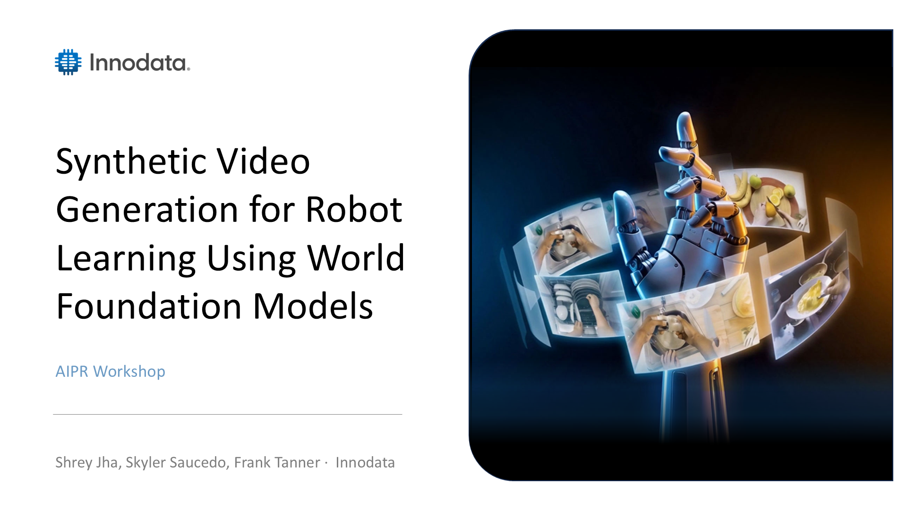

**On-slide text**
- Synthetic Video Generation for Robot Learning Using World Foundation Models
- AIPR Workshop
- Shrey Jha, Skyler Saucedo, Frank Tanner · Innodata

**Embedded media**
- `innodata-logo-dark.png` (logo, reused on most slides)
- `title-hero-robot-hand.jpeg` (stock-style render of a robotic hand surrounded by egocentric kitchen frames)

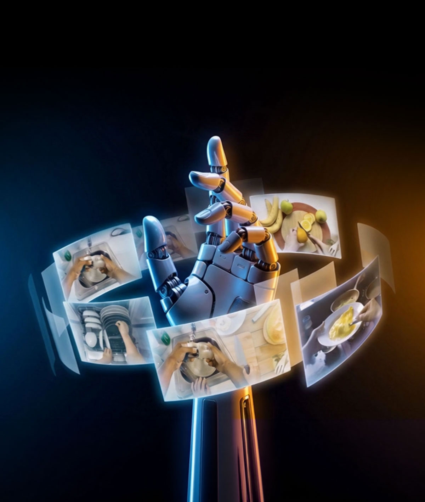

**Speaker notes (verbatim)**
> Thanks everyone for being here. My name is Shrey and Jha and today I am doing a presentation on Syntethic Video Generation using World Foundation Models. I want to give special thanks to Frank Tanner and Skylar Saucedo for their mentorship throughout this process. I want to start with the problem we are trying to solve. Imagine you are trying to train a robust robotics model given only 2-3 hrs of real world ego centric data. The issue is you can't feasibly generate every single case for diverse enough training data. Im going to talk about how Nvidia cosmos's family of models can be used to help scale a limited amount of data.

**Review notes**
- The notes frame the problem as "2-3 hrs of real world ego centric data". Slide 24 says 116 clips and slide 7 implies 15-second clips. 116 clips at 15 s is about 29 minutes, not 2 to 3 hours. One of these is wrong, or the clips are longer than 15 s. `[VERIFY: total duration and clip count of the real dataset]`
- "Skylar" in the notes vs "Skyler" on the slide. Confirm spelling for the author list.
- The hero image is decorative. It should not appear in the paper.

---

### Slide 2. Main Points

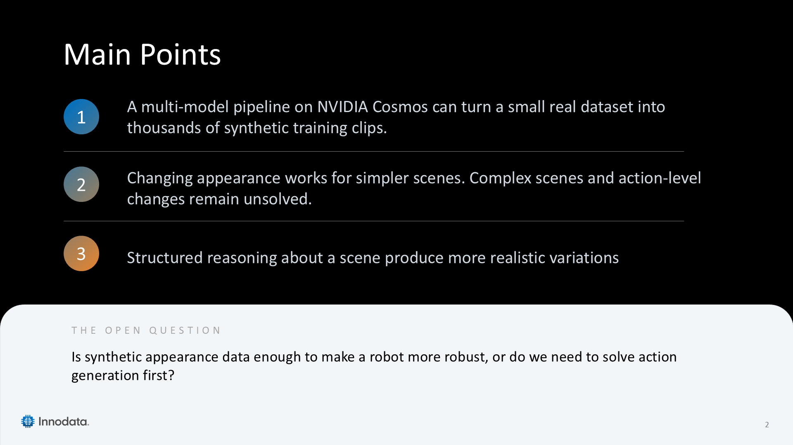

**On-slide text**
1. A multi-model pipeline on NVIDIA Cosmos can turn a small real dataset into thousands of synthetic training clips.
2. Changing appearance works for simpler scenes. Complex scenes and action-level changes remain unsolved.
3. Structured reasoning about a scene produce more realistic variations
- THE OPEN QUESTION: Is synthetic appearance data enough to make a robot more robust, or do we need to solve action generation first?

**Speaker notes (verbatim)**
> I want to give a roadmap for this presentation. I'm going to start by introducing nvidia cosmsos which is a multi model pipeline that can turn a small real video dataset ino thousands of synthehic training clips. I'm why these modles struggle with more complex scenes and action focused tasks. Finally, Im going to demonstrate how structured reasoning about a scence produces better variations th

**Review notes**
- Point 3 is truncated relative to slide 19, which reads "...produces better variations than random augmentation." Subject-verb agreement is also off ("reasoning ... produce").
- Point 1 says "can turn ... into thousands". Slide 18 lists "Scale to greater than 100 clips" as unfinished work, and slide 24 gives 8,120 as a projection (116 × 70). The deck has not generated thousands of clips. The paper must state this as capacity, not as a result.
- Point 3 is the central claim of novelty. Nowhere in the deck is "random augmentation" actually run as a baseline. This is a claim without a comparison. Either run domain randomization as a baseline or soften the claim to a qualitative argument.
- The notes are an unfinished draft (cut off mid-sentence).

---

### Slide 3. What We Started With

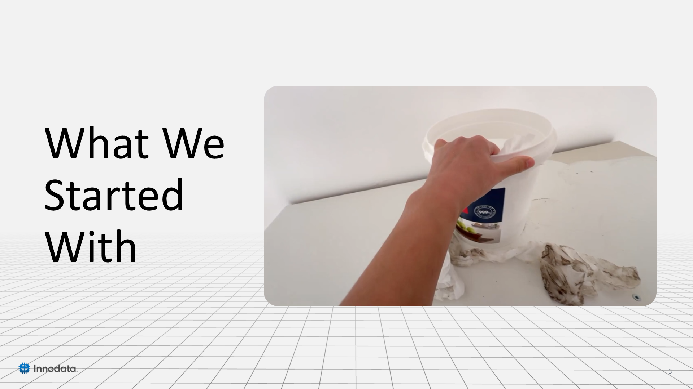

**On-slide text**
- What We Started With

**Embedded media**
- `video-original-bucket-cleaning.mp4` (original egocentric clip, poster `poster-original-bucket-cleaning.png`). The frame shows a hand holding a white plastic bucket with a label over a white laminate countertop, with crumpled dirty paper towels on the surface.
- `bg-grid-light.png` background.


**Speaker notes (verbatim)**
> Here's a clip of what we started with: a person wiping down a table with a bucket and a rag. The question is, for this task, iost this scene alone enough to train a robust robotic policy model. A robot trained only on this might break the moment you changed the color of the surface or swapped the bucket for a different one. Therefore, if we ever want to train an effective household robot. We need a way to scale this one clip using permutations of objects and actions observed.

**Review notes**
- The task is described here as "wiping down a table with a bucket and a rag". The ontology on slide 8 labels the same clip "Disposing of crumpled paper into a bucket". The visible material is crumpled paper towel, not a rag. The paper needs one consistent task description for this running example.
- This clip is the anchor example for the entire deck (slides 3, 4, 6, 8, 9, 10, 11, 13). It is a good candidate for Figure 1 in the paper.

---

### Slide 4. What We Created

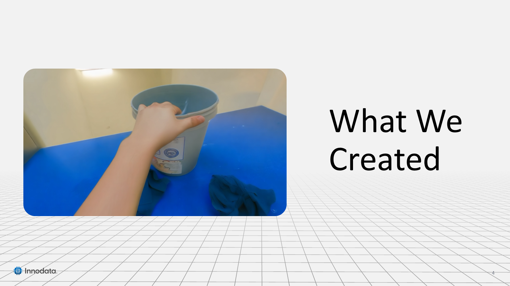

**On-slide text**
- What We Created

**Embedded media**
- `video-generated-counter-blue-clean.mp4` (poster `poster-generated-counter-blue.png`). Countertop is now solid blue. Bucket has become grey-blue. The paper towels have become blue cloth. Wall is beige rather than white, and a ceiling light fixture is visible that is not in the original.

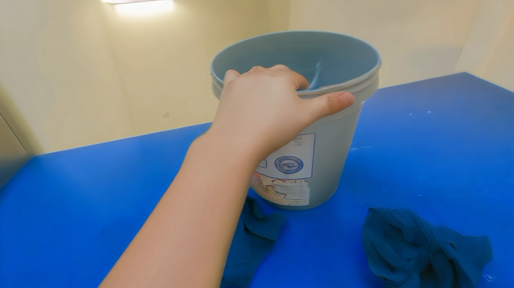

**Speaker notes (verbatim)**
> From that same clip, here is an example of a clip that our pipeline produced. Attempting to change the only the color of the countertop to blue, the model at parts struggles. As this clip plays, look at the wall - the color has changed completely from the original one. Furthermore, the blue bleeds into the rag. I'll get into exactly where and even why these models struggle with these clips. But the key point is we went from one version of this scene to a  plausible variations without recording any new video.

**Review notes**
- The notes are honest that the wall and rag changed when only the countertop was targeted. The bucket also changed color, and the lighting changed. Slide 13 later presents this same output as the model performing "simple Aesthetic variations fairly well". The paper should present it as a partial success with named leakage, which is what the notes already do.
- This is the strongest piece of evidence in the deck that the subtraction mask (slides 10, 11) did not fully constrain generation. The paper must either show a run where the mask held, or report leakage as a finding. `[VERIFY: was the subtraction mask active for this specific output?]`

---

### Slide 5. What is Nvidia Cosmos?

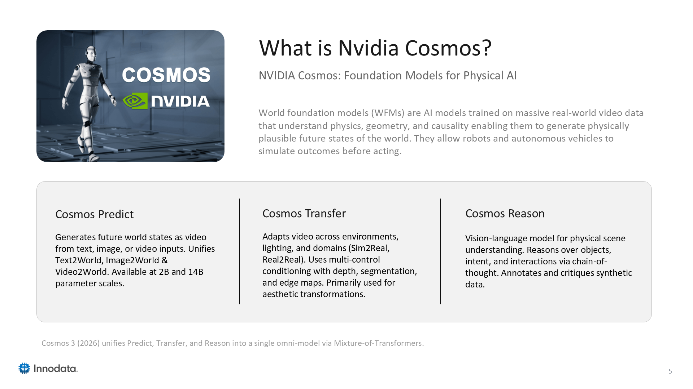

**On-slide text**
- What is Nvidia Cosmos?
- NVIDIA Cosmos: Foundation Models for Physical AI
- World foundation models (WFMs) are AI models trained on massive real-world video data that understand physics, geometry, and causality enabling them to generate physically plausible future states of the world. They allow robots and autonomous vehicles to simulate outcomes before acting.
- **Cosmos Predict**: Generates future world states as video from text, image, or video inputs. Unifies Text2World, Image2World & Video2World. Available at 2B and 14B parameter scales.
- **Cosmos Transfer**: Adapts video across environments, lighting, and domains (Sim2Real, Real2Real). Uses multi-control conditioning with depth, segmentation, and edge maps. Primarily used for aesthetic transformations.
- **Cosmos Reason**: Vision-language model for physical scene understanding. Reasons over objects, intent, and interactions via chain-of-thought. Annotates and critiques synthetic data.
- Cosmos 3 (2026) unifies Predict, Transfer, and Reason into a single omni-model via Mixture-of-Transformers.

**Embedded media**
- `cosmos-nvidia-banner.png` (NVIDIA marketing image).

**Speaker notes (verbatim)**
> Read from the slides. We primarily focus on the Cosmos Transfer and Reason

**Review notes**
- This slide is background and maps to the Related Work section. Every factual statement here needs a citation: the Cosmos technical report, the Cosmos Transfer paper, the Cosmos Reason paper, and whatever NVIDIA has published on Cosmos 3. `[CITATION NEEDED ×4]`
- "Understand physics, geometry, and causality" is NVIDIA's marketing language. The paper should attribute it ("NVIDIA describes...") or drop it. The deck's own results (slides 14 to 16) argue against taking it at face value.
- "Primarily used for aesthetic transformations" is the authors' characterization, not NVIDIA's. Fine as an observation, but phrase it as one.
- Which versions were used? Cosmos Transfer 1 or 2? Cosmos Reason 1 or 2? Which parameter count? The paper's experimental setup needs exact model identifiers and checkpoints. `[VERIFY: model versions and checkpoints]`
- The NVIDIA banner image should not be in the paper.

---

### Slide 6. So, How Did We Use World Foundation Models?

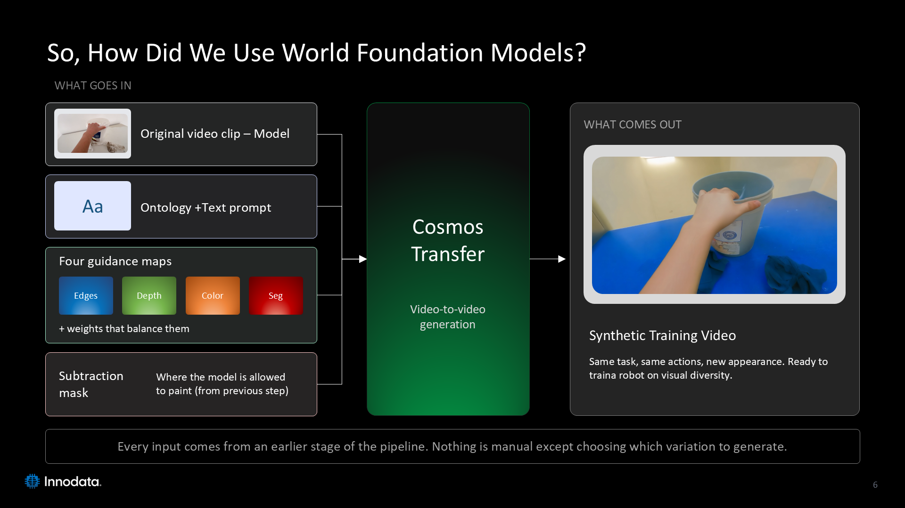

**On-slide text**
- WHAT GOES IN
  - Original video clip – Model
  - Ontology +Text prompt
  - Four guidance maps: Edges, Depth, Color, Seg; + weights that balance them
  - Subtraction mask: Where the model is allowed to paint (from previous step)
- Cosmos Transfer: Video-to-video generation
- WHAT COMES OUT: Synthetic Training Video. Same task, same actions, new appearance. Ready to traina robot on visual diversity.
- Every input comes from an earlier stage of the pipeline. Nothing is manual except choosing which variation to generate.

**Embedded media**
- `video-original-bucket-cleaning.mp4` (input thumbnail)
- `video-generated-counter-blue-clean.mp4` (output thumbnail)
- `innodata-logo-white.png`

**Speaker notes (verbatim)**
> We started with an Original Video clip that we produced using cosmos curate. We then fed this clip into Cosmos Reason to generate an ontology of the strucutured understanding of the scne being observed and fed that in to gpt 4 mini to create at ext prompt for comso transfer. More on these Ontologies in the next slide. Finally we generated 4 masks to preserve edges depth color and then even segment the clip with a subtraction mask.

**Review notes**
- This is the system diagram. It is the right content for the paper's Figure 2, redrawn.
- The slide lists four guidance maps plus a separate subtraction mask (five inputs). Slide 10 lists four maps with "Mask" as the fourth and no "Seg". The pipeline description is inconsistent between slides 6 and 10. The paper needs one definitive list. In Cosmos Transfer terms the control branches are typically vis (blurred RGB), edge, depth, and seg. "Color" on these slides almost certainly means the vis/blur branch. Use the model's own terminology in the paper.
- "Original video clip – Model" has a stray word.
- Notes say the original clip was "produced using cosmos curate". Cosmos Curate is a data curation and annotation pipeline, not a capture tool. Clarify what Curate did (clipping? captioning? filtering?). `[VERIFY: role of Cosmos Curate]`
- Notes say "gpt 4 mini"; slide 9 says "GPT-4o mini". Standardize.
- "Nothing is manual except choosing which variation to generate" is a strong automation claim. Slide 11 says control weights were tuned by hand. Reconcile.

---

### Slide 7. Part 1: Reasoning driven with Structured Ontologies

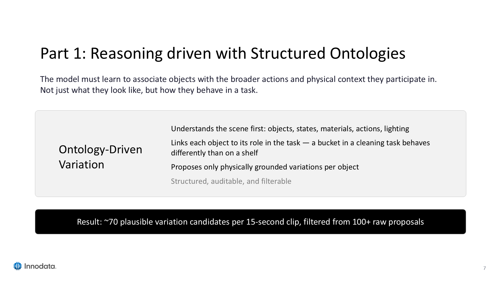

**On-slide text**
- The model must learn to associate objects with the broader actions and physical context they participate in. Not just what they look like, but how they behave in a task.
- Ontology-Driven Variation
  - Understands the scene first: objects, states, materials, actions, lighting
  - Links each object to its role in the task — a bucket in a cleaning task behaves differently than on a shelf
  - Proposes only physically grounded variations per object
  - Structured, auditable, and filterable
- Result: ~70 plausible variation candidates per 15-second clip, filtered from 100+ raw proposals

**Speaker notes (verbatim)**
> This is where our approach really separates itself. The standard technique in robotics is domain randomization — you randomly swap colors, textures, lighting and hope the model learns to generalize. The problem is it has zero understanding of the scene. Our approach is fundamentally different. We use structured ontologies. The ontology captures the relationship between the object, its state, the task being performed, and the physical constraints of the environment. The model does not just identify this is a bucket or this is a rag but that is a cleaning bucket or a cleaning rag.That's what makes the proposed variations physically grounded rather than random.

**Review notes**
- "~70 plausible variation candidates per 15-second clip, filtered from 100+ raw proposals" is the key number for the method. It needs: how many clips this was measured over, what the filter was (GPT-4o mini per slide 9 notes), and what fraction was rejected. "100+" is too vague for a table. `[VERIFY: exact proposal and acceptance counts, averaged over how many clips]`
- The notes contrast against domain randomization. This is the right framing for Related Work (cite Tobin et al. 2017 and follow-ups). But "fundamentally different" needs an experiment to back it. Without a domain-randomization baseline, the paper can argue the difference but cannot demonstrate it.
- "Proposes only physically grounded variations" is contradicted by the need to filter 30% of proposals. Phrase as "proposes variations grounded in task context, which a second model then filters".

---

### Slide 8. Ontology Structure — What Cosmos Reason Produces

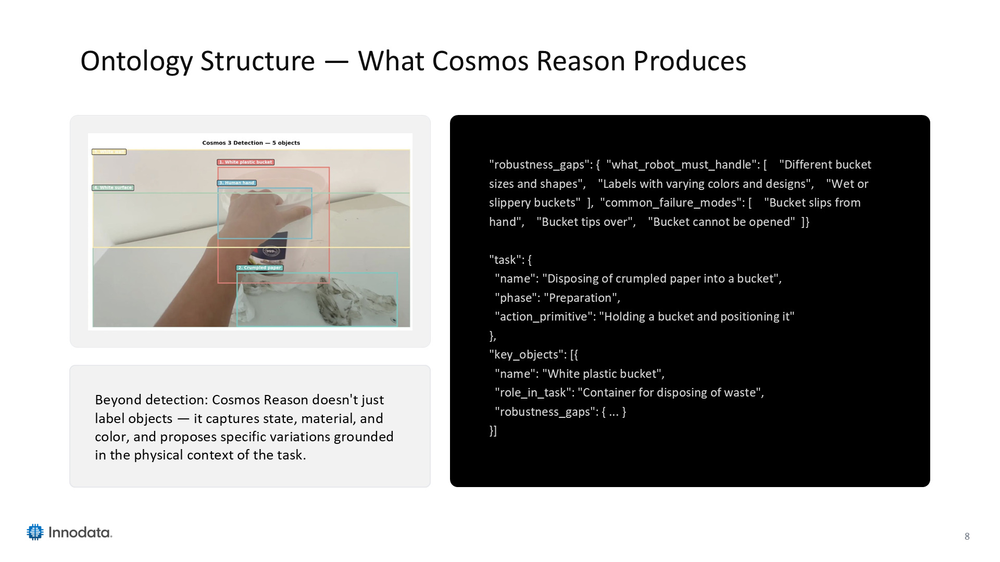

**On-slide text (JSON excerpt)**
```json
"robustness_gaps": {
  "what_robot_must_handle": [
    "Different bucket sizes and shapes",
    "Labels with varying colors and designs",
    "Wet or slippery buckets"
  ],
  "common_failure_modes": [
    "Bucket slips from hand",
    "Bucket tips over",
    "Bucket cannot be opened"
  ]
}
"task": {
  "name": "Disposing of crumpled paper into a bucket",
  "phase": "Preparation",
  "action_primitive": "Holding a bucket and positioning it"
},
"key_objects": [{
  "name": "White plastic bucket",
  "role_in_task": "Container for disposing of waste",
  "robustness_gaps": { ... }
}]
```
- Beyond detection: Cosmos Reason doesn't just label objects — it captures state, material, and color, and proposes specific variations grounded in the physical context of the task.

**Embedded media**
- `cosmos-reason-detection-boxes.png`: a frame with five labeled bounding boxes (0. White wall, 1. White plastic bucket, 2. Crumpled paper, 3. Human hand, 4. White surface). The image header reads "Cosmos 3 Detection — 5 objects".

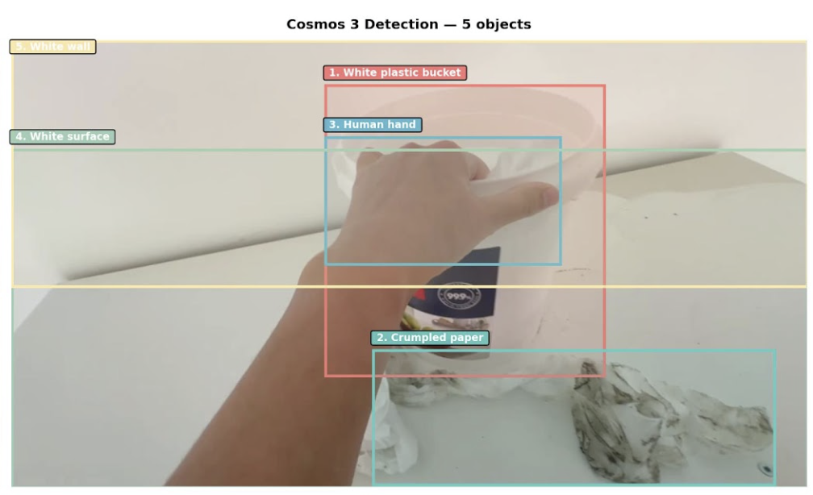

**Speaker notes (verbatim)**
> Here's an example of an ontology that Cosmos Reason produced. Notice how the model identifies robustness gaps and failure models such as the bucket tipping over. This is an example o an action level variation that is more suited for cosmos predict. ON the other had, the model proposed variations like buckets having different colors, designs sizes and shapes which are more suited for cosmos transfer.

**Review notes**
- The slide title credits Cosmos Reason, but the image is captioned "Cosmos 3 Detection". Slide 18 says Cosmos 3 tooling is "very early" and is a future direction. Which model produced the boxes? If Cosmos 3 was used for detection, the paper's method section must say so and the "future work" framing changes. `[VERIFY: which model produced the detections and the ontology]`
- The ontology's task name ("Disposing of crumpled paper into a bucket") does not match the narrative ("wiping down a table"). This matters because the entire argument is that task context grounds the variations. If the task was mis-identified, the grounding is to the wrong task.
- "Bucket cannot be opened" is a failure mode for a lidded bucket; this bucket is open. It is a small sign that the ontology contains hallucinated entries. The paper should quantify how often entries are implausible, or at least acknowledge it.
- The notes make a useful distinction: appearance variations go to Transfer, action-level variations (bucket tips over) would need Predict. The paper should make this routing explicit as part of the method, since it explains why only appearance was attempted.
- The full ontology schema should go in an appendix. The paper needs the complete JSON schema, not an excerpt.

---

### Slide 9. From Ontology to Generation-Ready Prompts

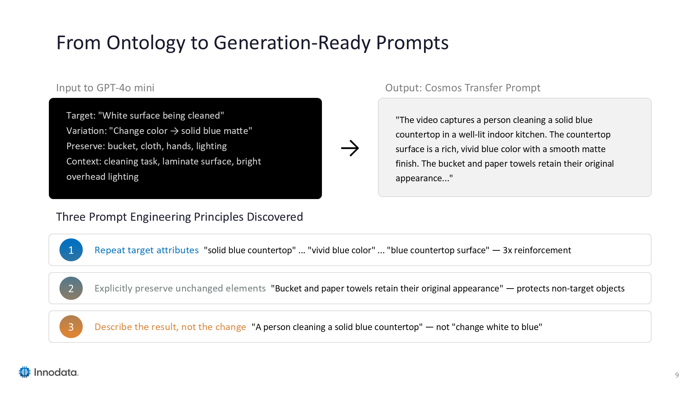

**On-slide text**
- Input to GPT-4o mini
  - Target: "White surface being cleaned"
  - Variation: "Change color → solid blue matte"
  - Preserve: bucket, cloth, hands, lighting
  - Context: cleaning task, laminate surface, bright overhead lighting
- Output: Cosmos Transfer Prompt
  > "The video captures a person cleaning a solid blue countertop in a well-lit indoor kitchen. The countertop surface is a rich, vivid blue color with a smooth matte finish. The bucket and paper towels retain their original appearance..."
- Three Prompt Engineering Principles Discovered
  1. Repeat target attributes: "solid blue countertop" ... "vivid blue color" ... "blue countertop surface" — 3x reinforcement
  2. Explicitly preserve unchanged elements: "Bucket and paper towels retain their original appearance" — protects non-target objects
  3. Describe the result, not the change: "A person cleaning a solid blue countertop" — not "change white to blue"

**Speaker notes (verbatim)**
> Now we need to turn that structured ontology into a prompt the video generation model can use. We feed the ontology into GPT-4o mini, which writes the prompt in the exact format Cosmos Transfer expects. Look at the example: we want to change a white countertop to solid blue. On the right is the output. Through experimentation we discovered three prompt engineering principles that aren't documented anywhere. First, repeat the target attribute multiple times — "solid blue countertop," "vivid blue color," "blue countertop surface." The model needs that reinforcement. Second, explicitly name what should stay the same — "bucket and paper towels retain their original appearance." Without that, the model might change them too. Third, describe the result, not the change. Say "a person cleaning a solid blue countertop," not "change white to blue." There's also an important filtering step here. GPT-4o mini rejects physically implausible variations before they reach cosmos transfer.

**Review notes**
- The three prompt principles are the most paper-ready contribution in the deck, but they are presented as discovered without evidence. Each one is testable with a small ablation: same clip, same controls, prompt with and without the principle, compare output. Even 5 clips × 3 ablations with a human preference score would turn this from anecdote into a result.
- The input says "Preserve: ... cloth" and the output says "paper towels". The prompt itself was already inconsistent about what the object is. And the output on slide 4 did change the paper towels. So principle 2 demonstrably did not hold in the showcased example. The paper must address this.
- "Aren't documented anywhere" is a claim about the literature. Either cite a search or drop it. Repeating attributes and describing the result are well-known diffusion prompting heuristics.
- The GPT-4o mini filtering step (reject implausible variations) is mentioned only in the notes. It belongs in the method section with the rejection criteria and the rejection rate (ties to the "100+ to ~70" number on slide 7).
- The GPT-4o mini system prompt should be in the appendix.

---

### Slide 10. Part 2: How We Guide the Model

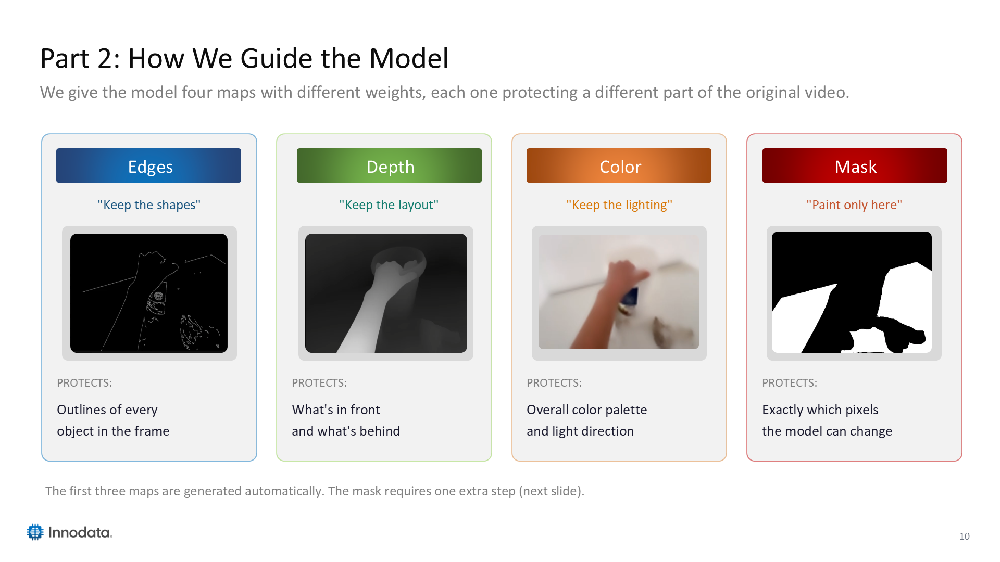

**On-slide text**
- We give the model four maps with different weights, each one protecting a different part of the original video.
- **Edges** "Keep the shapes" PROTECTS: Outlines of every object in the frame
- **Depth** "Keep the layout" PROTECTS: What's in front and what's behind
- **Color** "Keep the lighting" PROTECTS: Overall color palette and light direction
- **Mask** "Paint only here" PROTECTS: Exactly which pixels the model can change
- The first three maps are generated automatically. The mask requires one extra step (next slide).

**Embedded media**
- `control-edges.png` (Canny-style edge map of the bucket frame)
- `control-depth.png` (greyscale depth map)
- `control-color-blur.png` (heavily blurred RGB frame; this is the vis control)
- `control-mask-binary.png` (black/white mask; white regions are the countertop surface with hand, bucket and paper subtracted)
- `video-counter-blue-control-seg.mp4` (the segmentation control video)

| Edges | Depth | Color (vis) | Mask |
|---|---|---|---|
| 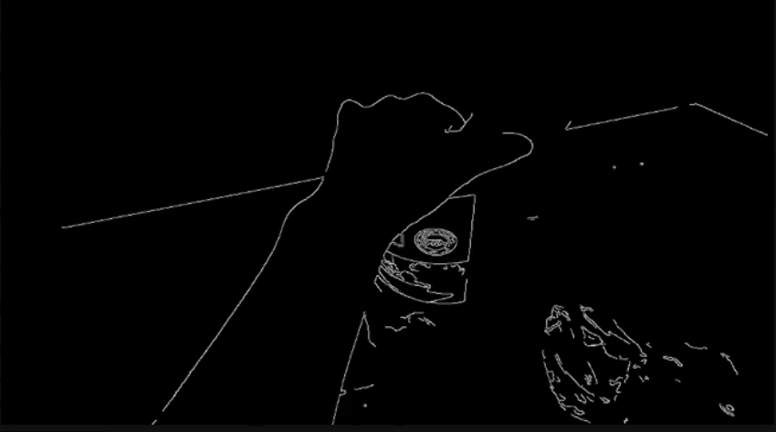 | 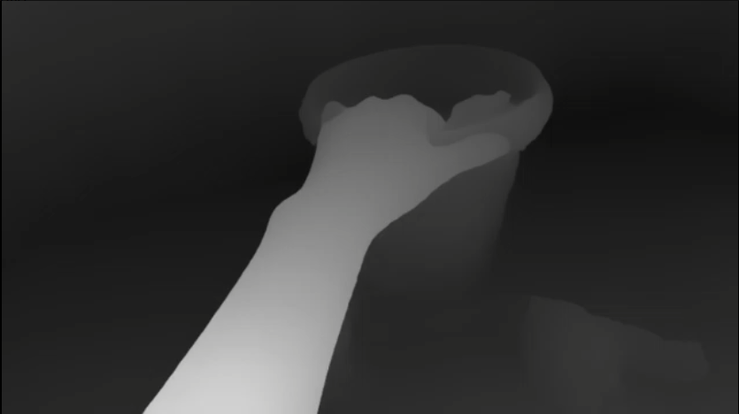 | 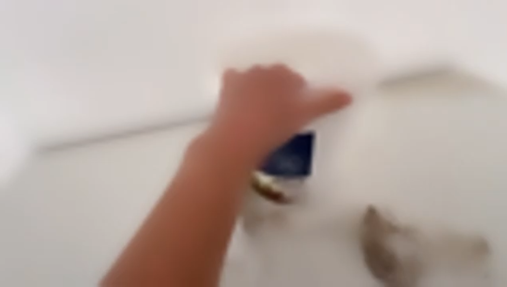 | 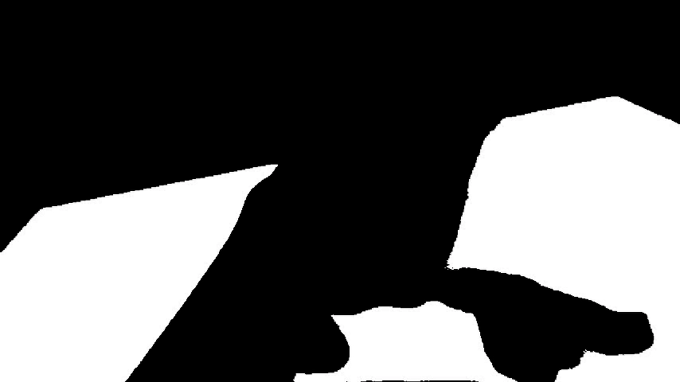 |

**Speaker notes (verbatim)**
> Before I show you this — think about it for a second. If you wanted to repaint a countertop in a video but leave the bucket sitting on it completely alone, what would the model need to know? We give it four maps, each one protecting a different part of the original video. Edges — think of it like a tracing of every outline in the frame. It locks the shapes so the bucket stays a bucket. Depth preserves the 3D layout — what's in front, what's behind — so nothing floats or sinks into the surface. Color keeps the overall lighting and palette consistent so it still looks like the same room. And the mask tells the model exactly which pixels it's allowed to change. Think of it like painter's tape. The first three maps are generated automatically. The mask needs one extra step, which I'll show you next.

**Review notes**
- Good figure material. The four-panel control strip should be a paper figure, with the original frame added as a fifth panel.
- Terminology: "Color" is the vis (blurred RGB) control in Cosmos Transfer. The paper should use the model's names (vis, edge, depth, seg) and explain the intuition in the caption.
- The embedded video is named `..._control_seg`, so a segmentation control was used, yet this slide does not list "Seg". Slide 6 does. Resolve the count: were there four control branches plus a spatial mask, or four total?
- No weights are given anywhere. The paper needs the actual control weights, the guidance scale, number of diffusion steps, resolution, frame count, and seed handling. `[VERIFY: all generation hyperparameters]`
- "Generated automatically": by what? Which depth estimator, which edge detector, which segmenter? Cosmos Transfer ships its own preprocessors (DepthAnything, Canny, SAM2/GroundingDINO). Name them with versions.

---

### Slide 11. Tuning the Maps and Building the Mask

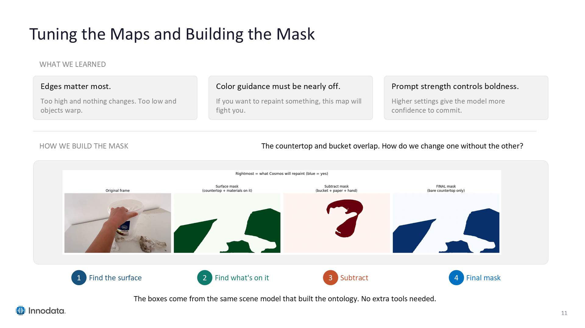

**On-slide text**
- WHAT WE LEARNED
  - Edges matter most. Too high and nothing changes. Too low and objects warp.
  - Color guidance must be nearly off. If you want to repaint something, this map will fight you.
  - Prompt strength controls boldness. Higher settings give the model more confidence to commit.
- HOW WE BUILD THE MASK: The countertop and bucket overlap. How do we change one without the other?
  1. Find the surface
  2. Find what's on it
  3. Subtract
  4. Final mask
- The boxes come from the same scene model that built the ontology. No extra tools needed.

**Embedded media**
- `mask-construction-strip.png`: four panels captioned "Original frame", "Surface mask (countertop + materials on it)", "Subtract mask (bucket + paper + hand)", "FINAL mask (bare countertop only)", with a header "Rightmost = what Cosmos will repaint (blue = yes)".

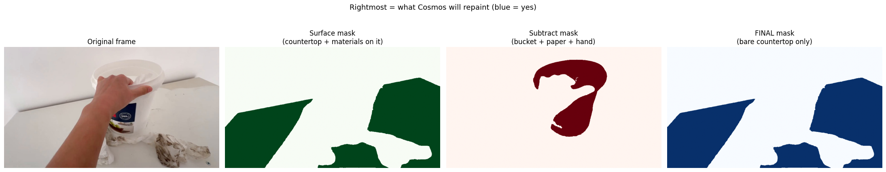

**Speaker notes (verbatim)**
> Start at the top: three quick findings from experimenting with the maps. Edges is the big one, use the tracing paper analogy. Color guidance is counterintuitive, pause on it briefly. Then move down to the image strip. Walk through left to right: here is the original frame, here is where the model found the surface, here is where it found the objects on top, and here is the final mask showing only the bare countertop in blue. That blue area is the only place the model is allowed to paint. Everything else is protected. End with: and the bounding boxes come from the same scene model we already ran for the ontology. No extra step.

**Review notes**
- The three tuning findings are qualitative ("too high", "nearly off", "higher settings"). The paper needs the values. A small sweep table (edge weight ∈ {…}, vis weight ∈ {…}) with one output frame each would be the natural Figure/Table.
- "Color guidance must be nearly off" is the most useful practical finding and is counterintuitive. It deserves an explicit explanation in the paper: the vis branch conditions on the original colors, so it directly opposes a recoloring prompt.
- The strip shows polygon masks, not boxes. The slide says "the boxes come from the same scene model". So the pipeline is: scene model → boxes → some segmenter → masks. The segmenter is unnamed. `[VERIFY: how boxes became pixel masks]`
- "No extra tools needed" is contradicted if a segmenter was involved.
- The subtract mask (red panel) covers bucket, paper and hand, but the hand's forearm region in the final mask still shows some blue near the bottom edge. Worth checking whether the mask was per-frame or propagated, and how it handles motion.
- The final mask appears to be a single frame. For video, was the mask computed per frame, or tracked? This affects temporal consistency and should be stated.

---

### Slide 12. Our Results (section divider)

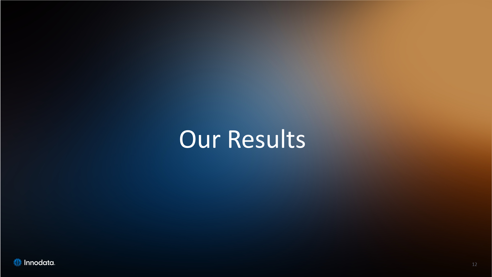

**On-slide text**
- Our Results

**Embedded media**
- `bg-section-gradient.jpeg` (blue-to-amber gradient background), `innodata-logo-white.png`

**Review notes**
- Divider. No content.

---

### Slide 13. Simple aesthetic variation (success case)

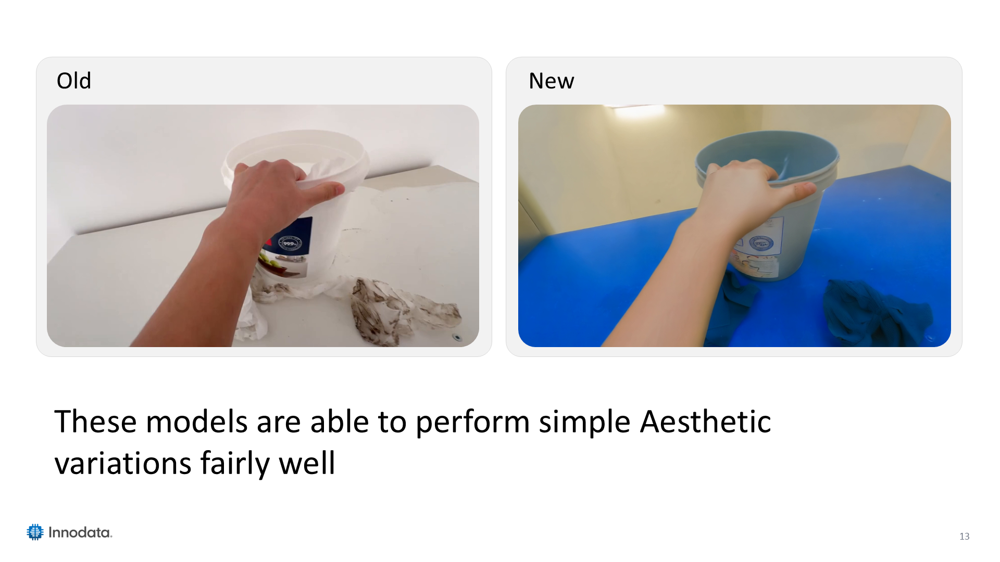

**On-slide text**
- Old / New
- These models are able to perform simple Aesthetic variations fairly well

**Embedded media**
- `result-bucket-old.png` (original frame)
- `result-bucket-new-blue.png` (generated frame)

| Old | New |
|---|---|
|  |  |

**Speaker notes:** none.

**Review notes**
- Same output as slide 4. Comparing the two frames: countertop white → blue (intended); paper towels white → blue cloth (unintended); bucket white → grey-blue (unintended); wall white → beige (unintended); a ceiling light now appears (unintended); hand skin tone shifted lighter (unintended); bucket label changed (unintended). Hand pose and bucket geometry are preserved (intended).
- Calling this "fairly well" is generous. A fair description: geometry and action are preserved, the target recolor succeeded, and color leaked to every other surface despite the mask and the preservation prompt. That is a real and reportable finding about the limits of masked Cosmos Transfer. The paper is stronger if it says so.
- No quantitative measure. At minimum, report a masked color-difference metric (mean ΔE inside vs outside the mask) across clips. That one number would make the leakage claim precise.

---

### Slide 14. Multi-texture scene (failure case)

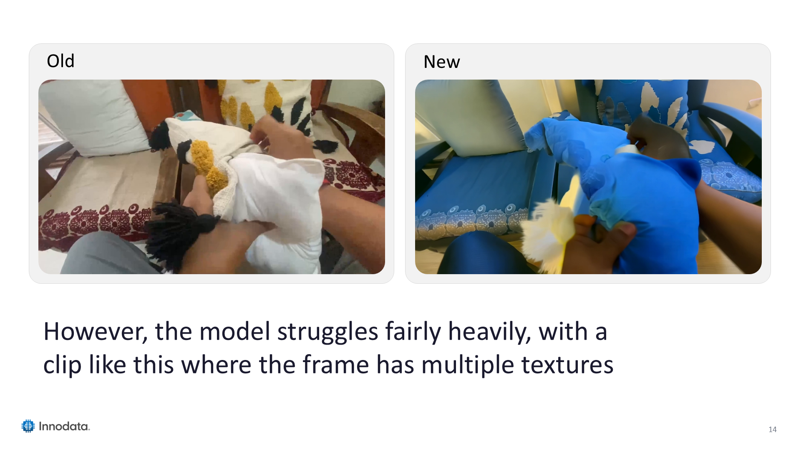

**On-slide text**
- Old / New
- However, the model struggles fairly heavily, with a clip like this where the frame has multiple textures

**Embedded media**
- `result-pillows-old.png` (hands folding a white cloth among patterned cushions and a wooden chair)
- `result-pillows-new-blue.png` (nearly every surface has become blue; cushion patterns partly survive as blue-on-blue; wooden chair frame is now dark grey-blue; hands preserved)

| Old | New |
|---|---|
| 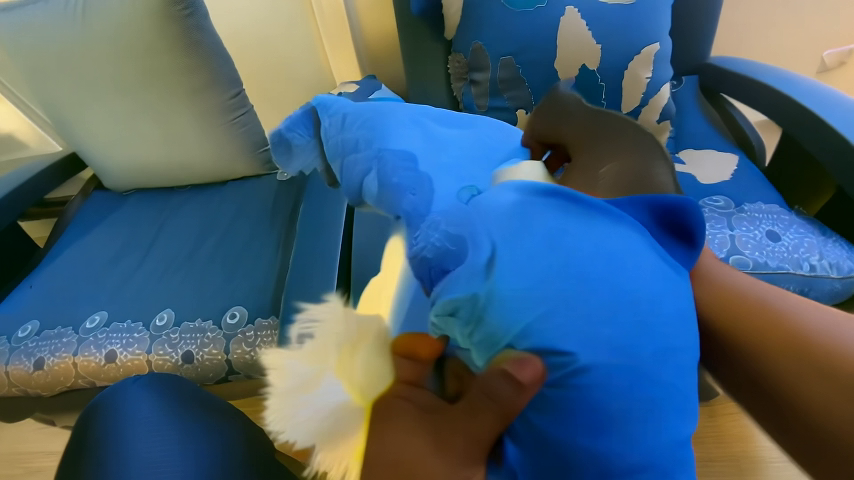 | 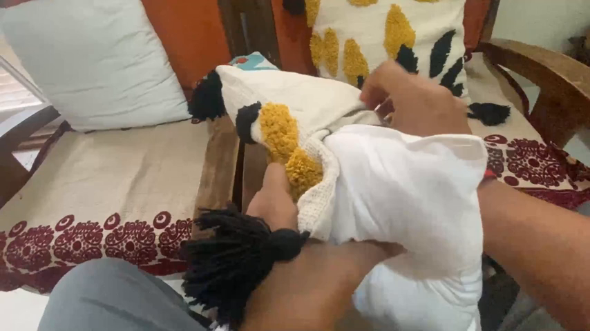 |

**Speaker notes:** none.

**Review notes**
- What was the target variation here? The slide does not say. Without the prompt and the mask, the reader cannot tell whether "everything blue" was a failure of masking, of prompting, or an intentional global recolor. `[VERIFY: prompt and mask for this example]`
- "Multiple textures" is offered as the explanation. An alternative explanation is that the mask covered a large fraction of the frame, or that no mask was used. The paper should test which.
- Good failure-case figure if annotated.

---

### Slide 15. Physics-minded task (Cosmos Predict attempt)

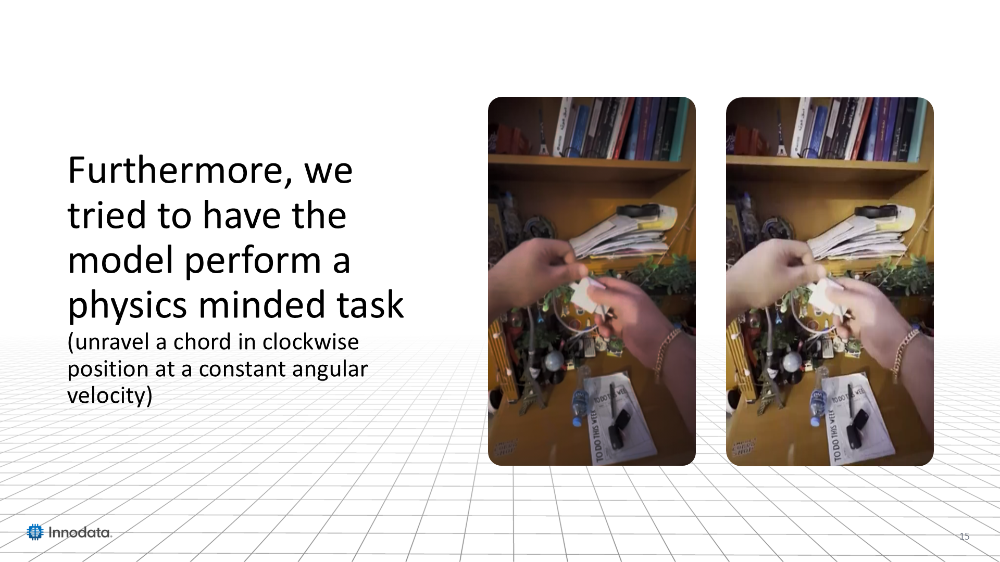

**On-slide text**
- Furthermore, we tried to have the model perform a physics minded task (unravel a chord in clockwise position at a constant angular velocity)

**Embedded media**
- `video-shelf-clip-original.mp4` (poster `poster-shelf-clip-original.png`): two hands holding a coiled white cable in front of a cluttered shelf with books and a to-do list.
- `video-cord-right-holds-left-wraps.mp4` (poster `poster-cord-unwrap-predict.png`): the generated video. The poster frame is visually near-identical to the original.

| Original | Generated |
|---|---|
| 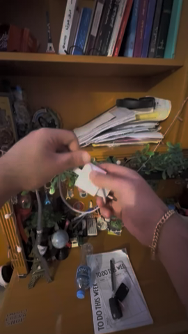 | 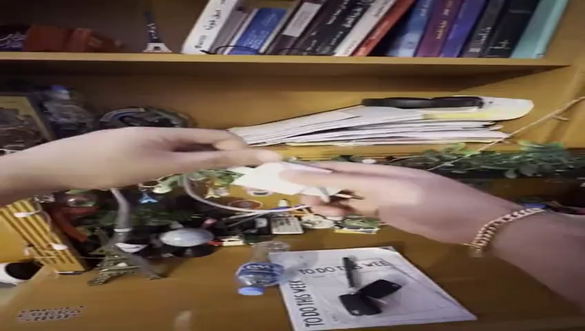 |

**Speaker notes:** none.

**Review notes**
- "chord" should be "cord".
- This is the only action-level experiment in the deck, and it is the one that motivates the open question on slides 2 and 19. It gets one sentence and no outcome statement. The paper needs: which model (Predict? Transfer with an action prompt?), the exact prompt, the conditioning frames, and a description of what the output did (nothing visible changed in the poster frame; did the cord move at all over the clip?). `[VERIFY: model, prompt, and observed behavior]`
- The file name `right_holds_left_wraps_coupled` suggests a structured action prompt ("right hand holds, left hand wraps"). That naming scheme hints at an action vocabulary that is never described. If one exists, it is method content.
- Also the slide says "unravel" while the file name says "wraps". Which direction was requested?

---

### Slide 16. More Results

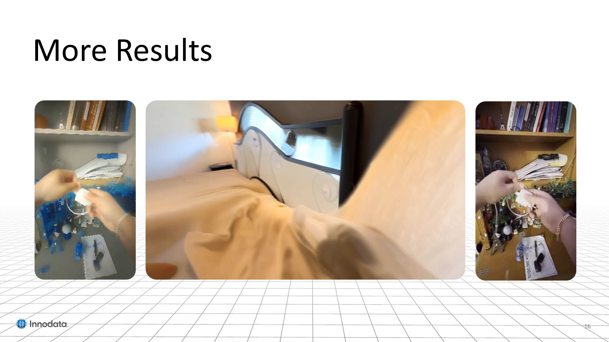

**On-slide text**
- More Results

**Embedded media (left to right on slide)**
- `video-shelf-clip-transfer.mp4` (poster `poster-shelf-clip-transfer-blue.png`): the shelf scene with blue bleeding across the shelf objects, cable and desk; hands preserved.
- `video-fixing-bed-rug-texture.mp4` (poster `poster-bed-rug-texture.png`): a bed with a tan blanket and a dark headboard; the frame is heavily motion-blurred and the hand region is smeared.
- `video-paper-rotation-wind.mp4` (poster `poster-paper-rotation-wind.png`): appears identical to the original shelf clip.

| Shelf, Transfer (blue) | Bed/rug texture | Paper rotation (wind) |
|---|---|---|
|  |  |  |

**Speaker notes:** none.

**Review notes**
- No captions, no prompts, no verdicts. As a paper figure this is unusable until each panel has: source clip, target variation, model, and a one-line outcome.
- The left panel is another instance of global color leakage. The middle panel shows severe spatial warping and blur, which is the failure mode slide 11 attributes to low edge weight. The right panel's file name ("paper_rotation_wind") suggests an attempted action/physics variation (paper rotating in wind) that produced no visible change. Each of these is a distinct failure mode and should be named as such.
- The paper would benefit from a failure taxonomy: (a) color leakage outside the mask, (b) geometric warping, (c) no-op on action prompts. All three are present in this deck.

---

### Slide 17. Closing the Gap & Future Directions (section divider)


**On-slide text**
- Closing the Gap & Future Directions

**Review notes**
- Divider.

---

### Slide 18. What's Next

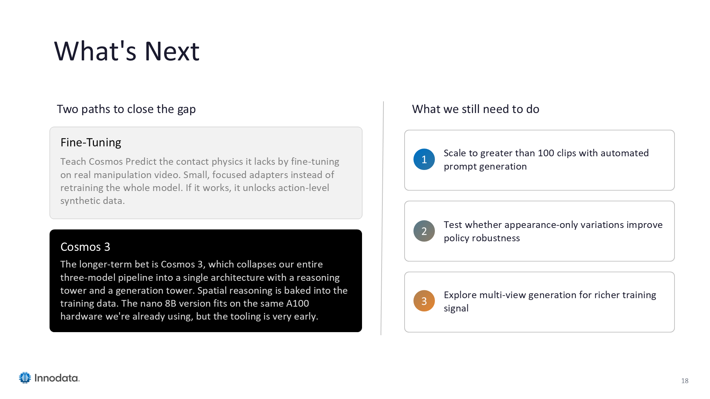

**On-slide text**
- Two paths to close the gap
  - **Fine-Tuning**: Teach Cosmos Predict the contact physics it lacks by fine-tuning on real manipulation video. Small, focused adapters instead of retraining the whole model. If it works, it unlocks action-level synthetic data.
  - **Cosmos 3**: The longer-term bet is Cosmos 3, which collapses our entire three-model pipeline into a single architecture with a reasoning tower and a generation tower. Spatial reasoning is baked into the training data. The nano 8B version fits on the same A100 hardware we're already using, but the tooling is very early.
- What we still need to do
  1. Scale to greater than 100 clips with automated prompt generation
  2. Test whether appearance-only variations improve policy robustness
  3. Explore multi-view generation for richer training signal

**Speaker notes (verbatim)**
> Two minutes max on this slide. Left side: two bets we are making. LoRA is the near-term play, Cosmos 3 is the longer-term architecture shift. Right side: the honest to-do list. The number one priority is actually training a robot on this data and measuring if it helps, because right now everything is qualitative. Be upfront about that. The yellow bar at the bottom is your honesty moment. Don't skip it. Audiences respect researchers who name their limitations clearly.

**Review notes**
- The notes say "right now everything is qualitative". This is the single most important sentence in the deck for the paper. It sets the ceiling: the paper is a systems/method paper with qualitative results and an honest limitations section, not an empirical paper. Writing it as anything else would invite rejection.
- "Scale to greater than 100 clips" directly contradicts "thousands of synthetic training clips" on slides 2 and 19. The paper must say how many synthetic clips were actually generated. `[VERIFY: number of synthetic clips actually produced]`
- The notes reference a "yellow bar at the bottom" that does not exist on the rendered slide. The limitations callout was removed or never built. For the paper, the limitation belongs in the text regardless.
- "Three-model pipeline" (Reason, GPT-4o mini, Transfer) plus Curate and whatever segmenter was used. Count the components consistently.
- "Cosmos 3 ... reasoning tower and a generation tower ... nano 8B" needs a citation.
- Hardware: A100 is mentioned here and on slide 24. The paper needs GPU count, memory, and wall-clock per clip.

---

### Slide 19. Key Takeaways

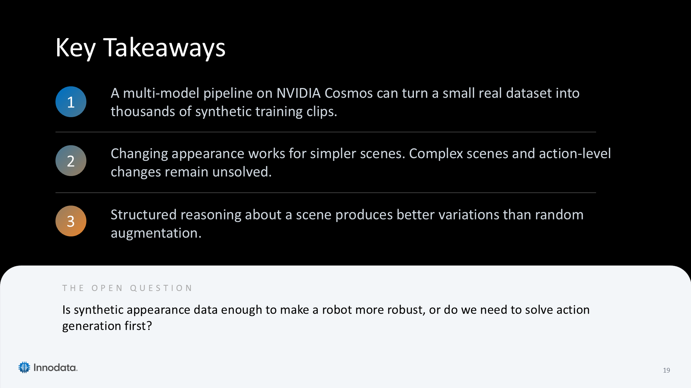

**On-slide text**
1. A multi-model pipeline on NVIDIA Cosmos can turn a small real dataset into thousands of synthetic training clips.
2. Changing appearance works for simpler scenes. Complex scenes and action-level changes remain unsolved.
3. Structured reasoning about a scene produces better variations than random augmentation.
- THE OPEN QUESTION: Is synthetic appearance data enough to make a robot more robust, or do we need to solve action generation first?

**Speaker notes (verbatim)**
> Three takeaways, read slowly. One: scale. Two: the boundary. Three: reasoning beats randomness. Then the open question. Read it, pause, and let it sit. This is what the audience carries into lunch. Do not rush this slide. If you only have 30 seconds left, skip takeaway three and go straight to the question. The question is more important than any individual takeaway because it invites the audience to think rather than just receive.

**Review notes**
- Same three points as slide 2 with point 3 completed. See slide 2 notes on points 1 and 3.
- "Reasoning beats randomness" was never tested. Either becomes a hypothesis in the paper's discussion or gets a baseline experiment.
- The open question is a good closing sentence for the paper's conclusion.

---

### Slide 20. Questions?

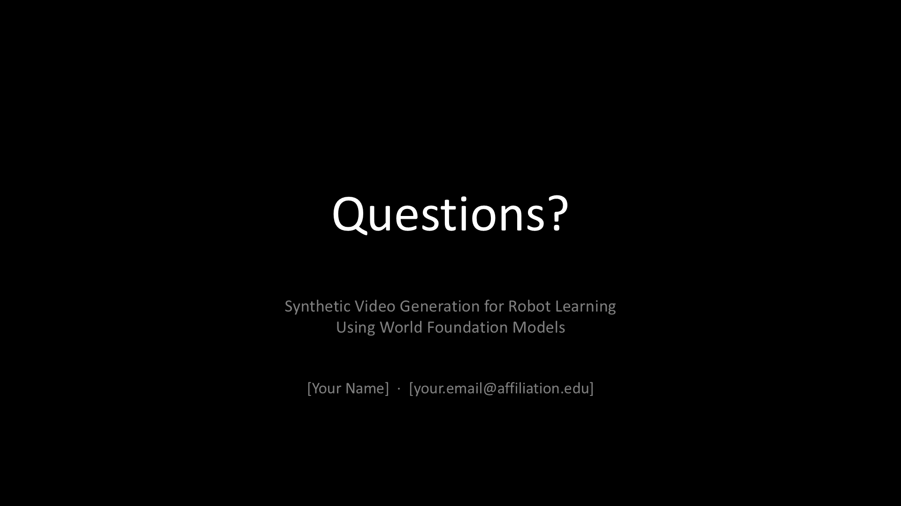

**On-slide text**
- Questions?
- Synthetic Video Generation for Robot Learning Using World Foundation Models
- [Your Name] · [your.email@affiliation.edu]

**Review notes**
- Template placeholder left in. Replace before presenting.

---

### Slide 21. Innodata boilerplate


**On-slide text**
- Innodata is a global data engineering company. We believe that data and AI are inextricably linked. That's why we're on a mission to help the world's leading technology companies and enterprises drive Generative AI / AI innovation. We provide a range of transferable solutions, platforms, and services for Generative AI /AI builders and adopters. In every relationship, we honor our 35+ year legacy delivering the highest quality data and outstanding outcomes for our customers.
- CONFIDENTIAL & PROPRIETARY INFORMATION. Contains proprietary information which is the property of Innodata and must not be made available to, or copied, or used by anyone outside the company without its written authorization. Copyright© Innodata 2026

**Embedded media**
- `bg-grid-dark-closing.png`, `innodata-logo-closing.png`

**Review notes**
- A confidentiality footer on a deck for a public workshop is contradictory. Remove it or confirm with legal that the content is cleared for publication. The same question applies to the paper: confirm the clips, prompts and ontology schema are cleared for release.

---

### Slide 22. The Data Bottleneck in Robot Learning (appendix / draft)

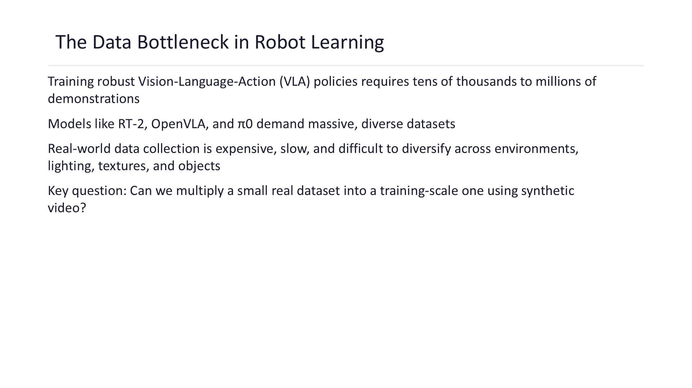

**On-slide text**
- Training robust Vision-Language-Action (VLA) policies requires tens of thousands to millions of demonstrations
- Models like RT-2, OpenVLA, and π0 demand massive, diverse datasets
- Real-world data collection is expensive, slow, and difficult to diversify across environments, lighting, textures, and objects
- Key question: Can we multiply a small real dataset into a training-scale one using synthetic video?

**Review notes**
- Different template (no logo, no page number). Slides 22 to 24 look like backup or an earlier draft. They were not in the spoken flow but they contain the paper's introduction almost verbatim.
- "Tens of thousands to millions of demonstrations" needs sources: Open X-Embodiment, RT-2, OpenVLA, π0 papers. `[CITATION NEEDED ×4]`
- This slide is the paper's opening paragraph.

---

### Slide 23. So, how did we do it? (draft diagram)

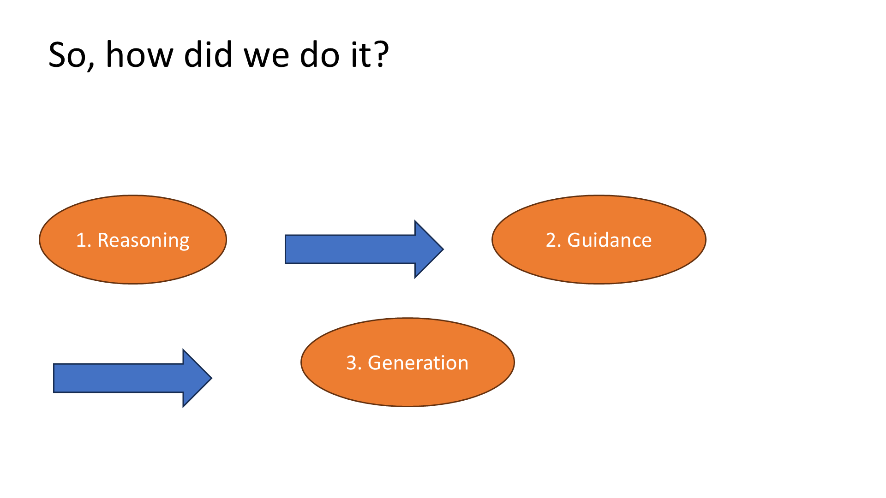

**On-slide text**
- So, how did we do it?
- 1. Reasoning → 2. Guidance → 3. Generation

**Review notes**
- Rough draft of the pipeline overview. Superseded by slide 6. The three-stage naming (Reasoning, Guidance, Generation) is cleaner than anything on slide 6 and is a good section structure for the method.

---

### Slide 24. Cost–Benefit: Synthetic vs. Real-World Data (appendix)

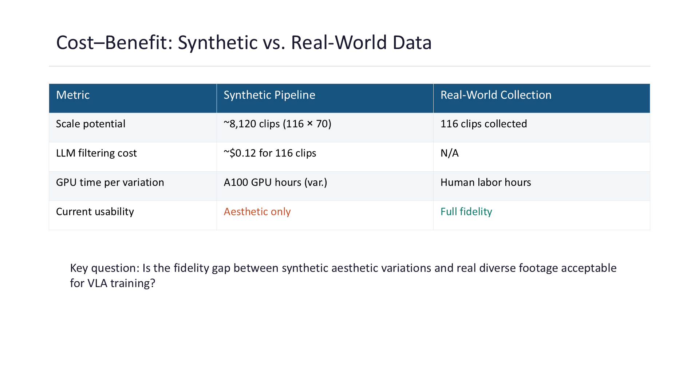

**On-slide table**

| Metric | Synthetic Pipeline | Real-World Collection |
|---|---|---|
| Scale potential | ~8,120 clips (116 × 70) | 116 clips collected |
| LLM filtering cost | ~$0.12 for 116 clips | N/A |
| GPU time per variation | A100 GPU hours (var.) | Human labor hours |
| Current usability | Aesthetic only | Full fidelity |

- Key question: Is the fidelity gap between synthetic aesthetic variations and real diverse footage acceptable for VLA training?

**Review notes**
- This is the only slide with hard numbers, and it was cut from the talk. These numbers are the backbone of the paper's experiments section.
- 116 real clips, ~70 variations per clip, 8,120 potential synthetic clips. "Potential" is the operative word; see slide 18.
- "$0.12 for 116 clips" of GPT-4o mini filtering. Report tokens in and out, and the price per million tokens used, so the number is reproducible.
- "A100 GPU hours (var.)" is a placeholder. The paper needs a real number: seconds per clip at a stated resolution and frame count, on a stated number of A100s. This is also the number that decides whether the cost argument holds. `[VERIFY: generation time per clip]`
- "Aesthetic only" vs "Full fidelity" is a fair summary and should survive into the paper's limitations.

---

## Part B. Cross-cutting findings

### B1. Inconsistencies to resolve before writing

| # | Where | Conflict |
|---|---|---|
| 1 | Slides 1 notes vs 7 vs 24 | "2-3 hrs" of data vs 116 clips × 15 s (~29 min) |
| 2 | Slides 2, 19 vs 18, 24 | "Thousands of clips" claimed; "scale to >100" still to do; 8,120 is a projection |
| 3 | Slides 3 notes vs 8 | Task is "wiping a table" vs ontology says "disposing crumpled paper into bucket" |
| 4 | Slides 6 vs 10 | Four maps + separate mask (five) vs four maps with mask as the fourth; "Seg" appears only on slide 6 but a seg control video is embedded on slide 10 |
| 5 | Slide 6 notes vs 9 | "gpt 4 mini" vs "GPT-4o mini" |
| 6 | Slide 8 title vs image | "Cosmos Reason produces" vs image header "Cosmos 3 Detection" |
| 7 | Slide 9 input vs output | Preserve "cloth" vs prompt says "paper towels" |
| 8 | Slide 9 principle 2 vs slide 4/13 | Preservation prompt did not preserve the towels, bucket, or wall |
| 9 | Slide 11 text vs image | "Boxes" vs polygon masks; segmenter unnamed; "no extra tools" |
| 10 | Slide 6 vs 11 | "Nothing is manual" vs hand-tuned control weights |
| 11 | Slide 15 text vs file name | "unravel" vs "wraps" |
| 12 | Slide 18 notes | References a "yellow bar" limitations callout that is not on the slide |
| 13 | Slide 21 vs venue | Confidential footer on a public workshop deck |

### B2. Numbers inventory

Every number in the deck, with its status.

| Number | Source slide | Status |
|---|---|---|
| 116 real clips | 24 | Needs total duration, capture device, resolution, fps, subjects, tasks |
| 15-second clips | 7 | Conflicts with "2-3 hrs"; verify |
| ~70 variations per clip | 7, 24 | Needs: averaged over how many clips, std dev |
| 100+ raw proposals per clip | 7 | Too vague; needs exact count |
| ~8,120 synthetic clips | 24 | Projection only; report actual count generated |
| ~$0.12 LLM filtering cost | 24 | Needs token counts and unit price |
| A100 GPU hours (var.) | 24 | Placeholder; needs measurement |
| 2B / 14B (Predict) | 5 | Background; cite |
| 8B nano (Cosmos 3) | 18 | Background; cite |
| "3x reinforcement" | 9 | Heuristic; untested |

### B3. What the deck supports as paper claims

Claims the evidence in the deck can support, phrased at the strength the evidence allows:

1. A pipeline that chains a scene-reasoning VLM, an LLM prompt writer with plausibility filtering, and a multi-control video-to-video diffusion model can produce appearance variations of egocentric manipulation clips while preserving hand pose and object geometry. (Supported by slides 4, 13.)
2. Masked, multi-control conditioning does not reliably confine edits to the target region in the current Cosmos Transfer configuration; color leaks to non-target surfaces in every shown example. (Supported by slides 4, 13, 14, 16. This is a negative finding and it is reportable.)
3. Vis (color) control weight must be near zero for recoloring tasks because it conditions on the source colors. Edge weight trades off between no-change and geometric warping. (Supported qualitatively by slide 11; needs values.)
4. Task-contextual ontologies yield a large candidate set of variations per clip at negligible LLM cost. (Supported by slides 7, 24; needs exact counts.)
5. Action-level variation via the same models produced no observable change in the attempted cases. (Supported by slides 15, 16; needs an explicit description.)

Claims the deck does not support and the paper should not make:
- That structured reasoning beats random augmentation (no baseline).
- That the data is "ready to train a robot" (no policy was trained).
- That thousands of clips were generated (only a projection).
- That the pipeline is fully automatic (weights were hand-tuned).

### B4. Suggested mapping from deck to paper sections

| Paper section | Source slides | Gaps to fill |
|---|---|---|
| Introduction | 22, 1 notes, 3 notes | Citations for VLA data scale; one consistent running example |
| Related Work | 5, 7 notes | Cosmos papers; domain randomization; video editing with ControlNet-style conditioning; LLM-driven augmentation |
| Method: Reasoning | 7, 8 | Which model produced the ontology; full schema; plausibility filter criteria |
| Method: Guidance | 10, 11 | Control names in model terminology; preprocessors; mask construction and propagation; weight values |
| Method: Generation | 6, 9 | Exact model versions; prompt template; GPT-4o mini system prompt; hyperparameters |
| Experiments | 13, 14, 15, 16, 24 | Actual clip counts; leakage metric; weight sweep; per-example prompt and outcome; GPU time |
| Limitations | 18 notes, 24 | Qualitative-only; no policy evaluation; leakage; action no-op |
| Conclusion | 19 | Open question as closing |
| Appendix | 8, 9 | Ontology schema, prompt templates, full control strips per example |

### B5. Figure candidates already in hand

| Candidate figure | Files | Needs |
|---|---|---|
| Fig. 1: original vs generated (bucket) | `result-bucket-old.png`, `result-bucket-new-blue.png` | Annotate leakage regions |
| Fig. 2: pipeline diagram | redraw from slide 6 / 23 | Vector redraw |
| Fig. 3: control strip | `control-edges.png`, `control-depth.png`, `control-color-blur.png`, `control-mask-binary.png` + original frame | Add original; consistent crop |
| Fig. 4: mask construction | `mask-construction-strip.png` | Re-export at print resolution; relabel "boxes" |
| Fig. 5: failure cases | `result-pillows-*.png`, `poster-shelf-clip-transfer-blue.png`, `poster-bed-rug-texture.png`, `poster-paper-rotation-wind.png` | Prompts and captions per panel |
| Fig. 6 (optional): ontology excerpt | from slide 8 text | Typeset as listing |

Video files are in `review/images/video-*.mp4` for frame extraction. For the paper, extract matched frames at the same timestamps from each original/generated pair rather than relying on the poster frames, which were chosen for the slides.

### B6. Open items only the authors can answer

1. Exact Cosmos model versions and checkpoints (Reason, Transfer, and whether Cosmos 3 was used for detection).
2. Role of Cosmos Curate.
3. Which segmenter turned boxes into masks, and whether masks were per-frame or tracked.
4. Control weights, guidance scale, steps, resolution, frames, seeds.
5. Number of synthetic clips actually generated, and over how many source clips.
6. Total real-data duration and capture setup.
7. Prompt and mask for every shown example (slides 13 to 16).
8. Whether any domain-randomization baseline exists or can be run.
9. GPU wall-clock per clip.
10. Clearance to publish clips, prompts, and the ontology schema.
