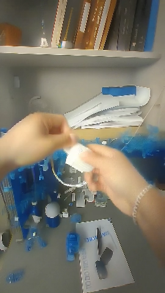
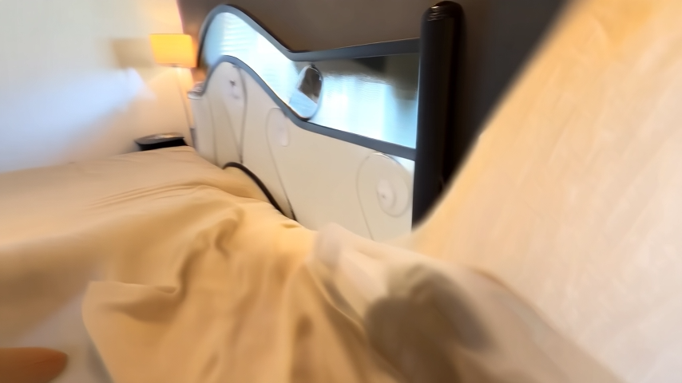
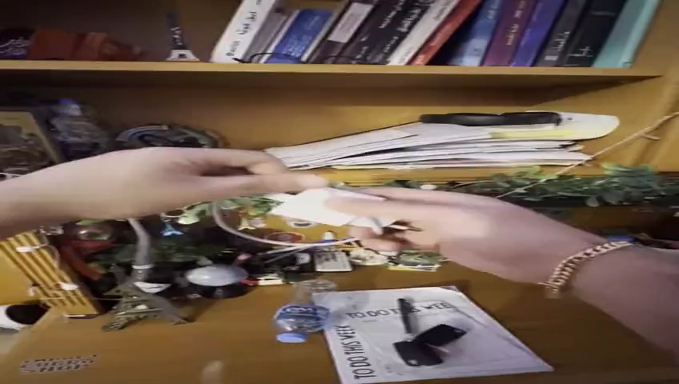

# Draft 4: Results (revised)

Draft 3's structure (Setup, Appearance Variation, Measuring Leakage, Action-Level Variation) with a practical Setup, the count from 8 recordings to synthetic clips, and the four deck images Skyler selected, each described in the text and captioned. Image files are the deck extractions in `review/images/` and `paper3/figures/`; figure numbers are placeholders for typesetting. All numbers are from `technical-details.md`. Written 2026-10-17.

---

## 4 Results

**Setup.** One person recorded 8 egocentric videos of household chores with a handheld camera, about 10 minutes each: wiping a counter, folding cloth on a bed, making a bed, and wrapping a charger cable at a desk. TransNetV2 [transnetv2], as packaged in Cosmos Curate, split the recordings at shot boundaries into 116 clips. Each clip was trimmed to at most 15 s and downsampled to 4 fps at 854 x 480, so that a complete manipulation action fits within the frame window that Cosmos Transfer renders in one pass. Everything downstream ran on a single A100 80 GB through Google Colab Pro+, using the public checkpoints of Cosmos 3 Nano, Cosmos Transfer 2.5, Cosmos Predict2 2B and SAM2, together with an API key for GPT-4o mini. Reasoning on the first frame of a clip takes about two minutes and produces the ontology, the bounding boxes and the candidate variations. Filtering and prompt writing for all 116 clips cost about 0.12 USD. A Transfer render takes 20 minutes, of which about two are spent computing the control maps, and a Predict2 render takes 3.5 minutes. The control weights (edge 0.5, depth 0.2, vis 0.025, seg 0.175), the guidance scale of 4 and the 35 denoising steps were fixed for every render after the sweep described in Sec. 3.

Table 1 traces the count from the recordings to the renders. The reasoning stage admits 72 variations per clip on average, so the 116 clips are capacity for 8,352 synthetic clips, which is about 35 hours of candidate video from 29 minutes of source. In duration this is a 72-fold multiplier: one 10-minute recording becomes about 4 hours of candidate video with no new room and no new recording. We rendered 64 of these variants, about six for each of 10 source clips, which amounts to 16 minutes of synthetic video at about 21 GPU-hours, and we rendered two Predict2 clips. At these rates the full 8,352 would take about 2,800 A100-hours, and a reader with N clips should budget N x 72 x 20 minutes for a complete render and N x 2 minutes for reasoning. Evaluation is by inspection of matched source and variant frames and by the masked color-difference measurement of Sec. 4.2, which needs only the source video, the rendered video and the tracked mask video. No policy was trained on the output.

**Table 1.** From 8 recordings to synthetic clips.

| Stage | Count | Duration | Factor | Status |
|---|---|---|---|---|
| Recordings | 8 | about 80 min | | recorded |
| Clips after TransNetV2, trim and downsample | 116 | about 29 min | 14.5 per recording | measured |
| Admissible variations (72 per clip) | 8,352 | about 35 h | 72x in duration | capacity |
| Transfer renders | 64 (10 source clips) | 16 min | 6.4 per clip | rendered |
| Predict2 renders | 2 | 12 s | | rendered |

### 4.1 Appearance Variation

Fig. 1 shows the running example. In the source frame a hand grips a translucent white bucket with a blue label above a white countertop, and a crumpled grey rag lies on the counter at the lower right. The prompt asked for a solid blue matte countertop and named the bucket, the paper towels and the lighting as preserved. In the rendered frame the countertop is a saturated matte blue, the hand holds the bucket in exactly the same pose, and the bucket keeps its shape, its position and its circular label. The variant is therefore a demonstration of the same wiping action on a different surface, which is what the pipeline was built to produce. Every unintended change is also visible in the same frame. The bucket has become an opaque grey-blue rather than translucent white. The rag has become a blue cloth. The wall behind the counter has warmed from white to beige, the skin of the hand is lighter, and a bright ceiling fixture has appeared at the top of the frame that the source does not contain.

**Fig. 1.** Counter-wiping clip, matched frames. Left: the source, a white bucket held over a white counter with a grey rag. Right: the variant rendered for the blue-countertop prompt. The countertop recolor is the intended edit, and the hand pose, bucket geometry and motion are preserved. The grey-blue bucket, the blue rag, the beige wall, the lighter hand and the new ceiling light were not asked for; the prompt named each of them as preserved.

Fig. 2 shows what happens when the target shares the frame with several textures. The source frame of the cloth-folding clip shows two hands folding a white cloth on a bed, with a pillow printed in yellow and black behind it, cushions in a red and white pattern to either side, and a wooden chair at the right edge. The prompt asked for a cobalt blue blanket on the left side of the bed and listed the white cloth, the patterned pillow, the headboard and a brass ornament as preserved. The render turned nearly every surface blue. The cushions, the chair, the bedding and the cloth in the hands are all blue, the pillow's print survives only as a blue-on-blue relief, and a patch of white and yellow remains where the yellow of the pillow was. The hands keep their pose and the geometry of the bed and chair is intact, but the one object the prompt targeted, a blanket on the left, cannot be distinguished from the recolor that covers everything else. Where the counter clip leaks at the edges of its target, a frame with many textures fails almost completely.

**Fig. 2.** Cloth-folding clip, matched frames. Left: the source, with a yellow and black pillow, red and white cushions and a white cloth in the hands. Right: the variant rendered for a prompt that targeted a single cobalt blanket. The cushions, chair, bedding and cloth are all blue and the pillow print survives as relief. Hand pose and scene geometry are retained. Multi-texture scenes fail more completely than the single-surface case of Fig. 1.

Fig. 3a and 3b show two further Transfer renders that complete the picture. In the desk clip (Fig. 3a) the prompt asked for a blue painted desk with a matching blue shelf and named the walls, the cable and the lighting as preserved. The desk and shelf are blue, but so are the papers stacked on the shelf, the small objects in front of them, the sheet on the desk and the cable in the person's hands; the blue has spread from the target surfaces onto everything resting on or near them. In the bed-making clip (Fig. 3b) the prompt asked for a navy rug beside the bed. The render returned the correct beige bedspread and the dark headboard with its ornate white panel, but the bedspread is streaked and smeared, the arm at the lower right has become a blurred shape with no fingers, and no rug is visible. This is the shape-collapse failure that bounds the edge weight from below in Table 3, appearing on a new clip at the weight that held on the counter clip. In every render, the geometry and the hand motion of the source are retained to the degree the edge and depth controls enforce them, and in every render color is applied beyond the target. A reader trying this should expect the behavior of Fig. 1 on a single large uniform surface and the behavior of Fig. 2 and Fig. 3a as soon as the target shares the frame with several textures or carries objects.

**Fig. 3.** Further renders. (a) Desk clip, blue-desk prompt: the blue spreads from the desk and shelf onto the papers, the shelf objects, the sheet on the desk and the cable. (b) Bed-making clip, navy-rug prompt: the bedspread color is right, the surfaces smear, the arm warps and no rug appears, the edge-weight lower-bound failure of Table 3. (c) Predict2 forecast for the paper-rotation prompt, discussed in Sec. 4.3: the sheet with the black objects on it lies where it did in the conditioning frame.

### 4.2 Measuring Leakage

To put a number on the unintended change, we compare source and variant frame by frame in CIELAB and split the per-pixel CIE76 distance ΔE by the tracked mask M. Pixels inside M are the countertop the prompt targeted; pixels outside are the bucket, rag, hand and wall it said to preserve. A ΔE of about 2 is just noticeable and 10 is an unmistakable change. The script takes three videos (source, variant, mask) and returns the mean ΔE inside and outside the mask per frame, the chroma-only distance in the a and b channels, and the fraction of protected pixels above a threshold, so it runs on any render for which the mask was kept. Table 2 gives the result for the counter clip of Fig. 1, the one render with a usable tracked mask. The target moved by a mean ΔE of 75, so the recolor worked. The protected region moved by 35, and 95 percent of its pixels moved by more than 10. The chroma-only distance, 24 in the protected region against 68 in the target, shows that the change outside the mask is a change of color and not of exposure. The spatial pattern matches what Fig. 1 shows by eye: the rag and the bucket, which touch the target, change almost as much as the countertop does, and the wall changes less but visibly. The gap between the two per-frame curves is stable across the 60 frames, and the protected curve never approaches zero. The segmentation control at weight 0.175 and the prompt's preservation clause were the two mechanisms for containment, both of them soft, and together they held back about half of the edit.

The measurement covers one clip because the tracked masks retained for the desk and cloth-folding renders cover under 1 percent and about 2 percent of the frame, against roughly half for the furniture and blanket regions they were meant to mark; with masks that empty the inside-outside split is meaningless. If those are the masks Transfer received, then the segmentation control carried no information for those two renders, and the whole-frame recolors of Figs. 2 and 3a follow directly. We have not confirmed whether they are, and we report the observation rather than the conclusion. The practical lesson holds either way: a pipeline that depends on a tracked mask needs a coverage check before rendering, and ours did not have one.

**Table 2.** Masked color difference for the counter-wiping variant of Fig. 1 over 60 frames; each region covers about half the frame. The protected region changes by almost half as much as the target, and nearly all of it changes visibly.

| | Target (inside M) | Protected (outside M) |
|---|---|---|
| Mask coverage (fraction of frame) | 0.50 | 0.50 |
| Mean ΔE | 75.5 | 34.8 |
| Std of per-frame mean ΔE | 4.0 | 7.2 |
| Mean chroma-only ΔE | 68.2 | 24.2 |
| Pixels with ΔE above 10 (percent) | | 94.5 |
| Pixels with ΔE above 20 (percent) | | 65.3 |

### 4.3 Action-Level Variation

Two action variations from the ontology were run through Cosmos Predict2 [cosmospredict2] with 35 denoising steps at 848 x 480, producing 93 frames at 16 fps. The first asked the model to wind a charger cable around its block one loop at a time with the block held fixed in the left hand. The second asked for a sheet of paper on the desk to rotate 90 degrees while the three objects lying on it stay in place. Both prompts state what moves, what stays fixed and how the moving part stays physically attached, and the cable prompt points the model at the input frames as the reference motion. Fig. 4 shows the cable result as the conditioning frame beside a forecast frame. The scene is a cluttered desk and shelf: a row of books above, a stack of papers, a potted plant, a miniature Eiffel Tower, a water bottle, and a sheet headed "To do this week" with a black charger block resting on it, while two hands hold a white charger and its cable in the middle of the frame. The two frames are indistinguishable. The cable hangs in the same loop, the hands are in the same position, and nothing on the desk has moved. Fig. 3c shows the paper-rotation forecast with the same outcome: the sheet and the objects on it lie exactly where they did in the conditioning frame. In both cases the model held the scene stable, which is a form of success for a world model, and did not perform the action, which was the only thing we asked of it. We did not fine-tune Predict2, and a reader who needs action-level variants from it should expect to.

**Fig. 4.** Cosmos Predict2 output for the cable-wrapping prompt. Left: the conditioning frame, two hands holding a white charger and cable in front of a cluttered shelf. Right: a frame from the 93-frame forecast. The scene is reproduced and the cable, the hands and the objects on the desk have not moved.

---

## Notes

- **Image to file mapping.** Fig. 1: `review/images/result-bucket-old.png` and `result-bucket-new-blue.png` (slide 13). Fig. 2: `result-pillows-old.png` and `result-pillows-new-blue.png` (slide 14; the deck stored this pair in reverse order and the names here are corrected). Fig. 3: `paper3/figures/s16_left.png`, `s16_middle.png`, `s16_right.png` (slide 16). Fig. 4: `review/images/poster-cord-unwrap-predict.png` and `paper3/figures/s15_generated.png` (slide 15). The two slide 15 stills and `s16_right.png` are visually the same frame of the desk scene, which is the point of Figs. 3c and 4.
- **Fig. 3c placement.** Draft 3 put the paper-rotation still in the "where the renders fail" strip; here it stays in Fig. 3 for layout but is discussed in Sec. 4.3. If the typeset page allows, move it into Fig. 4 as a third panel.
- **Reader-directed sentences.** There are three ("should budget", "should expect" twice). That is the limit before the section reads as a tutorial.
- **The 72-fold figure** is tied to "candidate" or "capacity" at every mention; the 64 renders are the only synthetic video that exists.
- **Open items that touch this section.** A7 (whether the near-empty masks were the ones Transfer received) decides whether Figs. 2 and 3a are described as leakage or as rendering without a mask. The raw proposal count behind the 72 is still unknown.
