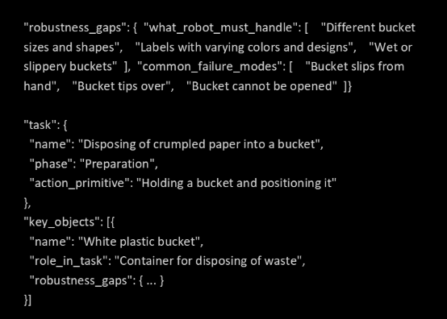
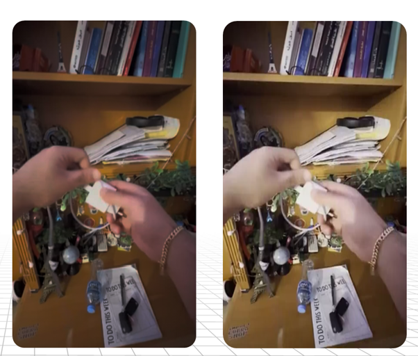

<!--
Word-for-word transcription of "AIPR 2026 Paper-draft-5.pdf" (10 pages, Google Docs export), made 2026-10-18.
Spelling, punctuation, spacing, placeholders and TODO notes are reproduced exactly as they appear in the PDF.
The running head "S. Jha et al." appears at the top of every page and is shown once below.
Figures are the images embedded in the PDF, extracted to figures/. Text visible inside an image is given
in a collapsed "Text inside the image" block after it so that the body stays the paper's own words.
Page boundaries are marked with HTML comments.
-->

<!-- page 1 -->

*S. Jha et al.*

2026 AIPR Paper

# SYNTHETIC VIDEO GENERATION FOR ROBOT LEARNING USING WORLD FOUNDATION MODELS

## 1. Abstract:

Training successful humanoid robotic manipulation policies within the space of PhysicalAI are bottlenecked by real-world data limitations in size and diversity of environment. Achieving acceptable completion scores for even the most straightforward tasks costs tens of thousands of hours of egocentric data, and with that, there is a sufficient drive for diversity for different objects, surfaces, and lighting to prevent model overfitting. We describe a pipeline that leverages Vision Action Language models like NVIDIA Cosmos, along with Large Language Models like OpenAI's mini-4o to generate variations of real egocentric clips while keeping the recorded actions, scaling a single video into hundreds of permutations.

Our method uses NVIDIA Cosmos 3 Nano to produce the Ontology of each clip, the task of each object's role, and plausible variations, along with OpenAI’s Mini-4o to write our prompt to generate scene permutations. Our methodology employs traditional Computer Vision techniques like Boundary detection and Image Segmentation, using Canny Edge detection coupled with Segment Anything 2 (SAM2) to locate the objects we wish to permute, while Cosmos Transfer 2.5 renders the items maintaining realism within the video. This paper describes our process and findings, where structured reasoning about a scene produces robust realistic permutions. We outline limitations and provide best practices for leveraging this, demonstrating that this powerful and economical approach is scalable when solving problems in robot learning.

## 2. Introduction:

Training humanoid robots to perform everyday household tasks requires a large-scale egocentric data collection. Where humanoid robotic policy training and effectiveness are quantified, the consensus within the PhysicalAI community is that more training data is required, on the order of tens of thousands of hours, and that the diversity of objects within the space (defined as the Ontology) matter for policy robustness. As such, the mean acceptable score, defined as the robot’s ability to successfully complete the task it was trained on, scales logarithmically with the hours of egocentric video. [cite EgoScale].Authors of Egoscale claim over 20,000+ hours of egocentric video are needed per task, with upper limits of achieving a mean task acceptables score of 0.71. Pi0 pretrains on more than 10,000 hours of robot data [pi0] to perform similar tasks.  LingBot-VLA on about 20,000 hours from nine dual-arm platforms, with success rates still rising at that scale [NEW lingbotvla];

<!-- page 2 -->


Figure 1 - show the log-linear scaling plots that show that lots of data is needed

<details>
<summary>Text inside the image (transcriber's note)</summary>

Header: "EgoScale: Scaling Dexterous Manipulation with Diverse Egocentric Human Data"

Left panel: "Human Validation Loss vs Training Steps"; x axis "Training Steps (×1000)"; y axis "Human Validation Loss (MSE)". Legend: 1k hrs, 2k hrs, 4k hrs, 10k hrs, 20k hrs.

Middle panel: "Scaling Law: Optimal Loss vs Data Amount"; x axis "Human Data Amount (hours, log scale)"; y axis "Human Validation Loss (MSE)"; fitted line labelled "L = 0.024 - 0.003 · ln(D)".

Right panel: "Policy Performance vs Data Amount"; x axis "Human Data Amount (hours)"; y axis "Avg. Task Completion Score"; bars 1k 0.30, 2k 0.45, 4k 0.48, 10k 0.57, 20k 0.71.
</details>

Lin et al. collected 40,000 demonstrations and found that a single-task policy's generalization follows a power law in the number of training environments and objects, that additional demonstrations in the same environment stop helping past a threshold, and that 32 environments with one object each were enough for 90 percent success in rooms and on objects never seen [NEW lin2025scaling].

And while over 20k hours of video are needed for a single task, an hour of egocentric video costs anywhere between 3 to 15 USD, so a 20,000+ hours for a single task becomes price prohibitive and economically infeasible for startups and academia labs.

While there are labs addressing this bottleneck, only a handful of solutions offer practical support. MimicGen multiplies 200 human demonstrations into 50,000 by replaying trajectory segments in new object poses, but in simulation and for robot trajectories, not video [NEW mimicgen]. FieldGen, a field-guided data generation framework that enables scalable collection, provides a meaningful solution, but provides only a 2.47x increase over a 2hr training example.

We propose a method that effectively x10 the amount of trainable data, where  a World foundation model reads a portion of an egocentric video clip and provides a structured ontology of the video. Leveraging classical Computer Vision techniques, we identify the items within the ontology and permute their attributes (color, texture, location), effectively creating video variants that describe the same task but provide diversity inference models need to perform tasks concerning dextrous hand motions within common environments, like living rooms, kitchens, etc…

Background? - Description of World Language Models?

[figure - provide diagram of process]

<!-- page 3 -->


Figure 2 - The Pipeline: you will need to define this better

<details>
<summary>Text inside the image (transcriber's note)</summary>

Row 1: "Egocentric clip V, 60 frames, 4 fps" → "Cosmos 3 Nano reasoning tower" → "Ontology O: objects, boxes, variations" → "GPT-4o mini filter + prompt".

Row 2: "SAM2 box → tracked mask" → "Mask M (subtraction)"; below the GPT-4o mini box: "Prompt p".

Row 3: "Canny / depth / blur" → "Controls c_edge, c_depth, c_vis" → "Cosmos Transfer 2.5 weights w" → "Variant V′". Arrows also run from Mask M and Prompt p into the Cosmos Transfer 2.5 box, and from the clip down to the SAM2 and Canny boxes.
</details>

## 3. Method

Figure 2 shows the pipeline we’re using to permute the ontological objects within an egocentric video.

First, the original Egocentric video clip (V) is prepared with NVIDIA’s Cosmos Curate. Curate applies TransNetV2 shot-boundary detection, splitting a 10 min video of egocentric data into 116 individual 15-second clips, downsampled to 4 fps at 854x480. Curate uses TransNetV2, a small convolutional neural network trained to detect scene transitions; it's fast and accurate on standard shot-detection benchmarks. [site reference]

The first frame of each clip is passed to the reasoning stack of Cosmos Predict, a Vision Language Model that returns a structured description of the task, task-relevant objects with bounding boxes and their roles in the task, their current appearance and state, and the variations that are plausible for the task.

Next, the clip is fed to Cosmos Reason, a Vision-Language-Action (VLA) model that provides a structured understanding (scene, objects, attributes, actions) of the observed scene which we define as the Ontology. We feed the Ontology (structured JSON) to GPT-4o mini, an LLM that writes a text prompt for Cosmos Transfer for variant video generation.

Four guidance maps are generated to preserve item edge, depth, color, and texture. Segmentation masks of all items are provided using SAM2 to maintain item integrity while preserving the task at hand. Finally, Cosmos Transfer renders a synthetic variant (V’) of the

<!-- page 4 -->

video, same task, action, and ontology of items, but with permutations to item attributes to increase visual entropy and diversity.

### 3.1 - Reasoning with Structured Ontologies


Figure 3 - Sample egocentric video

As seen in Figure 3, our example video consists of a white bucket on a white countertop, and the task is defined as follows: A human must use a wash cloth from the bucket to clean a countertop. If we wish to train a robot on this task, we will need to augment portions of the video to increase the amount of training data to improve our average task completion score. If we decide to change the color of the bucket, countertop, or rags, how does this affect the outcome of the robot training policy? Whichever model is used, it must learn to associate objects with the broader actions and physical context they participate in. Not just what they look like, but how they behave in the task. This is why reasoning with structured ontologies is critical: we ask a model to understand the scene, objects,states, materials, lighting, and actions before anything else is varied, so that the permutations proposed for an object are ones that are physically plausible for the given task.


Figure 4 - Scene with object detection bounding boxes, along with JSON structured Onotology.

<details>
<summary>Text inside the image (transcriber's note)</summary>

Header artifact at top left: "4    S. Jha et al."

Over the detection image (small): "Cosmos 3 Detection - 5 objects".

JSON panel:

```
"task": { "name": "Disposing of crumpled paper into a bucket",
  "action_primitive": "Holding a bucket and positioning it" },
"key_objects": [{ "name": "White plastic bucket",
  "role_in_task": "Container for disposing of waste",
  "robustness_gaps": {
    "what_robot_must_handle": ["Different bucket sizes and shapes",
      "Labels with varying colors and designs", "Wet or slippery buckets"],
    "common_failure_modes": ["Bucket slips from hand",
      "Bucket tips over", "Bucket cannot be opened"] } }]
```
</details>

<!-- page 5 -->

[@TODO - NEED TO TIGHTEN THIS UP]

Proposes only physically grounded variations per object
Structured, auditable and filterable metadata. Cosmos Reason captures state, material, color, and propose specific variations grounded in the physical context of the task.

Result -> 70 Plausible variants per 15 second clip, filtered from 100+ raw proposals.

Cosmos reasoning receives the first frame of the clip and a fixed instruction and returns a structured JSON record that defines the observed Ontology. Our pipeline asks for up to ten task-relevant objects, each with bounding boxes, and each object has the following: its role in the task, its current appearance (color, material, texture, condition, size), its current state (position, orientation, interaction with hands,) and candidate variations among seven dimensions (color and appearance, material and texture, size and shape, state and position, condition, interaction, brand and style.). A parallel block records scene-level variations (lighting, viewpoint, room style, time of day, clutter _ and a final block states what training on this clip could potentially miss.



Figure 5 - Sample JSON Ontology.. May be overkill and not needed

<details>
<summary>Text inside the image (transcriber's note)</summary>

```
"robustness_gaps": {  "what_robot_must_handle": [    "Different bucket
sizes and shapes",   "Labels with varying colors and designs",   "Wet or
slippery buckets"  ],  "common_failure_modes": [    "Bucket slips from
hand",   "Bucket tips over",   "Bucket cannot be opened"  ]}

"task": {
  "name": "Disposing of crumpled paper into a bucket",
  "phase": "Preparation",
  "action_primitive": "Holding a bucket and positioning it"
},
"key_objects": [{
  "name": "White plastic bucket",
  "role_in_task": "Container for disposing of waste",
  "robustness_gaps": { ... }
}]
```
</details>

<!-- page 6 -->

### 3.2 - From Ontology to Generation-Ready Prompts

In this step, we use OpenAI’s GPT-4o mini to prepare the prompt for Cosmos Transfer. We leverage GPT-4o mini for its exceptional speed and cost, averaging about 0.1 cents per 15-second clip. Additionally, GPT-4o provides a reliable structured JSON output and adheres to the Cosmos caption schema. Lastly, GPT-4o is one of the most available LLMs in the market currently. It should be noted that we did not run a comprehensive comparison against other Frontier models at the time.

From our work with this process, three prompt Engineering Principles were discovered:

1. Repeat target attributes: “solid blue countertop”, “vivid blue color”. More repetition of the changed attribute helps reinforce the change. A single mention of “blue” is one token competing with everything else in the 150 word caption; repeating the attribute in different contests puts more of the prompt’s attention mass on the property that has to change.
2. Explicitly preserve unchanged elements “Bucket and paper towels retain their original appearance”. This preservation clause reinforces continuity and protects non-target objects. Prior to enforcing this clause, we observed evidence of data leakage (bucket turning blue despite prompting the color change of the counter.)
3. Describe the result, not the change … if you want the countertop to change color, say, “a person cleaning a solid BLUE counter top”, not “change white countertop to blue…” Why? Cosmos Transfer was trained on captions of videos, not on edit instructions, so “change the white countertop to blue” is out of distribution and names two colors where only one should appear.

### 3.3 - Guiding the Rendering

Before any object attributes are applied, we send Cosmos Transfer four control modalities from the source clip, each control modality comes with tunable parameters to decide how strong the variant is rendered.

1. Edge detection: We use Canny edge detection provided by OpenCV. We choose Canny over Sobel or Laplacian due to the models robustness and ability to clearly distinguish edges in poor lighting conditions. Successful edge detection is important since if the edges are not clearly defined, object geometry could warp during clip permutation.
2. Depth: The depth control is monocular depth video provided by DepthAnything V2, and it provides an emergent layer of pseudo-3-dimensional object spatial positioning. As we permute object attributes, it's important to maintain persistent object ordering within the variant output.
3. Color for lightning: maintaining overall color palette and continuity as we adjust light parameters.
4. Segmentation Mask: All ontological objects are identified pixel-by-pixel. This provides clearly defined classification to which pixels the model can change. If two or more

<!-- page 7 -->

objects spatially relate or overlap, or if there’s occlusion, we can render the object in question without affecting the neighboring objects in the scene.

## 4. Results

Thousands of clips of first person videos of household chores we used as we set out to address our question: Can we generate realistic permutation variants from raw egocentric data to train humanoid robots on household chores? Tasks were captured egocentrically with a head-mounted camera and include counter wiping, cloth folding, bed making, and cable wrapping. Each task ranges from 4-8mins in total time. Our studies ran on Google Colab Pro+ Notebooks (see appendix for source code) on a A100 80 GB. Per clip, average reasoning time was 130 seconds, Transfer renders averaged about 20 minutes, and Predict2 renderings took about 3.5 minutes. LLM inference by Chat GPT 4o mini only took a few seconds per clip. Every variant was inspected to see how it compared to the matched source.


Figure 6 - Converting white countertop to blue, rag to blue, bucket to blue and varying the skin color of the human.

<details>
<summary>Text inside the image (transcriber's note)</summary>

Panel labels: "Old" (left), "New" (right).
</details>

Figure 6 shows that the resultant variant permutes the color of the Ontological objects, while maintaining the hand pose, bucket and table geometry. We observed that the cleaning motion observed in the before video is maintained by the variant, frame by frame. We also observed that the background wall and lighting has changed, adding more entropy as desired.

<!-- page 8 -->


Figure 7 - Adding stuffing to a chair pillow

<details>
<summary>Text inside the image (transcriber's note)</summary>

Panel labels: "Old" (left), "New" (right).
</details>

We see that adding complexity to objects can sometimes add unintended consequences to the variant scene. As observed in Figure 7, we task the data collector to stuff a throw pillow for a chair. Employing the pipeline to produce variants, our only request was that the color of the pillow change to blue. The variant not only changed the pillow blue, but also changed the background chairs blue as well. We found that poor image segmentation results are the cause here, furthering the need to fine-tune Canny edge-gradient parameters.



Figure 8 - Directional Reversal Experiment

<!-- page 9 -->

We did observe some limitations in this process, particularly when requesting permutations in the physics of the scene. In Figure 8, the data collector is taking a phone charger and winding the USB cord about the wall plug in a clockwise direction (with respect to the wall plug.) Next, we ask the pipeline to wind the cord in the opposite direction, counterclockwise. Surprisingly, the resultant variant was unable to maintain this ask, the spooling wire looked like spaghetti, with the cord gaining linear mass and length at times. The hands do in fact maintain the same orientation as the original video, but the variant fails to maintain the physics, violating conservation of mass and continuity. We believe this is an emergent property of VLAs struggling to fully understand the physical world.


Figure 9 - Some examples of variants … maybe we can find a better example?

## 5. Closing the gap

From 3, 10-minute video examples, we used our workflow to create 116 clips to generate 72 variations per clip, producing 8,352 synthetic video variations, or about 35 hours of video from 29 minutes of source data.  The number of permuted variants depends upon the number of Ontological objects available to change, along with what physical attributes are within the current limit of the NVIDIA World Model suite. One 10-minute video became 4 hours without a new scene or room generated.

Considering the current market rate for raw egocentric data is 8 - 15 USD per hour, we find that this process can quickly scale a sparse dataset into one with sufficient hours, diversity, while maintaining the overall physics of the scene. For every hour processed with our pipeline, we spend 1.20 USD in GPU cloud instance costs and 0.12 in token costs for LLM. For practitioners and academics who have a limited budget for training robot policies on humanoids, this workflow provides a cohesive and practical solution.

@TODO - Add a table that sows cost in time, money, etc…

<!-- page 10 -->

## 6. Conclusion

We describe a multi-model pipeline on NVIDIA Cosmos that can turn a real, limited first-person  dataset into thousands of synthetic training clips for humanoid robotic training policy. This workflow provides a scalable solution for academics and practitioners who need more egocentric video to increase the average task completion score. We demonstrate how the workflow is capable of changing appearance for simpler scenes, however more work must be done for complex scenes. Additionally, action-level changes  (multiple tasks executed within the video) remain unsolved. Lastly, more questions need to be explored, such as does structured reasoning about a scene produce better variations than random augmentation?

## 7. References

[https://github.com/DepthAnything/Video-Depth-Anything](https://github.com/DepthAnything/Video-Depth-Anything)

https://arxiv.org/pdf/2406.09414
