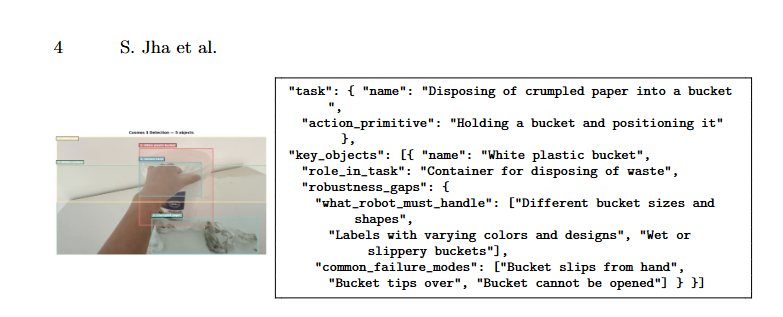

<!--
Draft 6, 2026-10-18. Built on draft 5's section and figure order. Figure 1 replaced by our own
plots (policy-vs-data-amount/). Accuracy fixes from draft-5/draft-5-analysis.md Sec. 4.1, consistency
fixes from Sec. 5, register per CLAUDE.md. Citations are numbered in order of first appearance,
Springer LNCS style. [VERIFY: ...] marks a fact that needs Shrey's confirmation before typesetting.
-->

# Synthetic Video Generation for Robot Learning Using World Foundation Models

Shrey Jha, Skyler Saucedo, Frank Tanner
Innodata [VERIFY: affiliations, emails, ORCIDs]

## Abstract

Robot manipulation policies are bottlenecked by real-world data. Acceptable completion scores on even simple household tasks have been reached only with tens of thousands of hours of egocentric video, and the policies need that footage to vary in objects, surfaces and lighting rather than repeat one room. We describe a pipeline that uses NVIDIA Cosmos world foundation models and the GPT-4o mini language model to generate appearance variations of real egocentric clips while keeping the recorded actions. Cosmos 3 Nano reads each clip and writes an ontology: the task, each object's role in it, and the variations that are plausible for that role. GPT-4o mini filters the candidates and writes the generation prompt. Segment Anything 2 (SAM2) turns the ontology's bounding boxes into tracked masks of the surface to repaint, and Cosmos Transfer 2.5 renders the variant under edge, depth, color and segmentation guidance. From 116 clips the reasoning stage admits 72 variations per clip, capacity for about 8,000 synthetic clips at 20 GPU-minutes each; we rendered 64. Single-surface recolors keep hand pose, object shape and motion, but the edit leaks outside its mask: on the counter-wiping clip the protected region shifts by a mean CIE76 ΔE of 35 against 75 for the target, cluttered scenes recolor wholesale, and action-level changes with Cosmos Predict2 produce no motion. We report the process, the guidance weights and prompt rules that made it work, and the limits a policy trained on this data would inherit.

**Keywords:** Synthetic data, World foundation models, NVIDIA Cosmos, Egocentric video, Robot learning

## 1 Introduction

Training robots to perform everyday household tasks requires large-scale egocentric data collection. Where policy training and effectiveness have been quantified, the consensus is that more training data is required, on the order of tens of thousands of hours, and that the diversity of objects, surfaces and rooms in that data matters for how well a policy generalizes. EgoScale pretrains on 20,854 hours of egocentric human video and finds average task completion on a dexterous hand rising from 0.30 at 1k hours to 0.71 at 20k hours, with no sign of saturation; its action-prediction loss falls log-linearly with hours [1]. π0 pretrains on more than 10,000 hours of robot data to perform similar tasks [2]. LingBot-VLA pretrains on about 20,000 hours from nine dual-arm platforms, with success rates still rising at that scale [3].


**Fig. 1.** Why more data, and which data, drawn from the numbers reported in five papers. (a) Task completion on a dexterous hand against hours of egocentric human pretraining video [1]; the dashed line is our log-linear fit (R² = 0.96). (b) Success and progress rate over 25 tasks against hours of robot pretraining data [3], values read off that paper's Fig. 5. (c) Task progress against hours of fine-tuning data for the pretrained π0, the same architecture from scratch, and Diffusion Policy [2], values read off that paper's Fig. 11. (d) Generalization to unseen rooms and objects against the number of training environments, objects and environment-object pairs, from the power-law fits reported by Lin et al. [4]. (e) Success rate against wall-clock collection time for teleoperation and for FieldGen [6]. Axes for hours and counts are logarithmic; the metrics differ between panels and are not comparable across them.

Fig. 1 draws these results from the published numbers rather than reproducing any one paper's figure. In every study that varies hours (Fig. 1a to c), performance is still rising at the largest amount tried, and it grows roughly linearly in the logarithm of hours: each doubling of data buys a fixed increment, about 0.085 in task completion for EgoScale by our fit, and the next increment costs twice as much. Fig. 1d shows what the hours have to contain. Lin et al. collected 40,000 demonstrations and found that a single-task policy's generalization follows a power law in the number of training environments and objects, that additional demonstrations in the same environment stop helping past a threshold, and that 32 environments with one object each were enough for 90 percent success in rooms and on objects never seen [4]. FieldGen's equal-time comparison (Fig. 1e) shows the other lever, collection time per demonstration, which is where the generation methods below operate.

At that scale the cost is the obstacle. An hour of egocentric video costs about 8 to 15 USD in collector pay [VERIFY: source of the rate; if it is Innodata's own collection experience, say so and cite nothing], so 20,000 hours is 160,000 to 300,000 USD before anyone has found that many different rooms, and the scaling result says the next hour in the same room is close to worthless. For startups and academic labs the figure is prohibitive.

Some labs address the bottleneck by generating data rather than recording it. MimicGen multiplies fewer than 200 human demonstrations into over 50,000 by replaying trajectory segments in new object poses, but in simulation and for robot trajectories, not video [5]. FieldGen automates the approach phase of a demonstration and raises the fraction of collection time spent acquiring data 2.47-fold; it saves operator time, not environments [6].

We propose a method that multiplies the duration of trainable footage by up to 72 for appearance, in which a world foundation model reads the first frame of an egocentric clip and provides a structured ontology of the scene. Using the ontology's bounding boxes and four control signals derived from the clip (edges, depth, a blurred color map and a tracked segmentation mask), we identify the items in the ontology and permute their attributes (color, material, texture), creating video variants that describe the same task but provide the diversity a policy needs for dexterous hand motions in common environments such as living rooms and kitchens.

World foundation models are video generators trained on large video corpora to respect physics, geometry and causality well enough to serve as simulators for robots [7]. NVIDIA Cosmos releases three families: Predict forecasts future frames from text, an image or a video [8]; Transfer adapts a video across environments under multi-control conditioning on depth, segmentation, edge and blurred-RGB maps [9, 10]; Reason is a vision-language model for physical scene understanding [11]. Cosmos 3 folds the three into one model with a reasoning tower and a generation tower [12]. Transfer descends from ControlNet [13] and Gen-1 [14], which steer a frozen diffusion model with structure maps. The data problem is the one behind RT-2 [15], OpenVLA [16] and π0 [2], all trained on the Open X-Embodiment pool [17]. Domain randomization [18] is the standard way to add appearance diversity in simulation and is deliberately blind to semantics; ROSIE [19] and GenAug [20] let a language model decide what to vary and inpaint the result into robot images. We keep that premise, move it to video, where the edit must survive a moving hand, and make the decision explicit as a schema.


**Fig. 2.** The pipeline. Every input to the renderer is produced by an earlier stage: the ontology and prompt by the reasoning model and the language model, the guidance maps by the preprocessors shipped with Transfer, and the mask by SAM2 from the ontology's boxes.

## 2 Method

Fig. 2 shows the pipeline we use to permute the ontological objects within an egocentric video.

First, the source recordings (V) are prepared with NVIDIA's Cosmos Curate. Curate applies TransNetV2 shot-boundary detection [21], splitting the eight recordings, about 80 minutes of egocentric footage, into 116 clips of at most 15 seconds, downsampled to 4 fps at 854x480. TransNetV2 is a small convolutional network trained to detect scene transitions; it is fast and accurate on standard shot-detection benchmarks [21].

The first frame of each clip is passed to the reasoning tower of Cosmos 3 Nano [12, 22], a vision-language model that returns a structured description of the task, the task-relevant objects with bounding boxes and their roles in the task, their current appearance and state, and the variations that are plausible for the task. We call this structured JSON record the ontology. We feed the ontology to GPT-4o mini [23], a language model that filters the proposed variations and writes a text prompt for Cosmos Transfer.

Four guidance videos derived from the source clip preserve edges, depth, overall color and the region to repaint. SAM2 [24] converts the ontology's bounding boxes into masks tracked across the clip; subtracting the masks of the objects resting on the target surface from the mask of the surface itself leaves only the region to change. Finally, Cosmos Transfer 2.5 [10, 25] renders a synthetic variant (V') of the video with the same task, actions and inventory of objects, but with permuted item attributes that add appearance diversity.

### 2.1 Reasoning with Structured Ontologies


**Fig. 3.** The running example: a frame from a real clip in which a person wipes a counter with a bucket and paper towels.

As seen in Fig. 3, our example video consists of a white bucket on a white countertop, and the task is to use a cloth from the bucket to clean the countertop. To train a robot on this task we need to augment portions of the video to increase the amount and the diversity of training data. Changing the color of the bucket, the countertop or the rags changes what a policy sees but not what it must do. Whichever model is used, it must learn to associate objects with the broader actions and physical context they participate in: not just what they look like, but how they behave in the task. Reasoning with structured ontologies serves that end. We ask a model to understand the scene, objects, states, materials, lighting and actions before anything is varied, so that the permutations proposed for an object are ones that are physically plausible for the given task.



**Fig. 4.** Reasoning output for the running example: five task-relevant objects with bounding boxes from Cosmos 3 Nano, and an excerpt of the bucket's record in the JSON ontology. The task name is wrong (the clip shows wiping, not disposal) and "bucket cannot be opened" is implausible for an open bucket; the filter stage exists to catch such entries. [VERIFY: rebuild the image without the cropped page header.]

The reasoner proposes variations conditioned on each object's role and records them as structured, auditable and filterable metadata: state, material, color, and candidate variations grounded in the physical context of the task. Across the 116 clips, 72 variations per clip on average survive the plausibility filter of Sec. 2.2 [VERIFY: raw proposal count per clip; the deck says over 100].

Cosmos 3 Nano receives the first frame of the clip and a fixed instruction and returns a structured JSON record that defines the observed ontology. Our pipeline asks for up to ten task-relevant objects, each with a bounding box, and for each object the model fills in its role in the task, its current appearance (color, material, texture, condition, size), its current state (position, orientation, interaction with hands) and candidate variations along seven dimensions (color and appearance, material and texture, size and shape, state and position, condition, interaction, brand and style). A parallel block records scene-level variations (lighting, viewpoint, room style, time of day, clutter), and a final block states what training on this clip alone would miss. Reasoning takes about 130 seconds per clip on one A100.

```json
{
  "location": {
    "room_type": "small domestic kitchen or utility area with a white laminate countertop against a bare white wall",
    "setting": "indoor, residential",
    "time_of_day": "daytime, no window visible",
    "lighting_condition": "bright, diffuse overhead indoor lighting with soft shadows",
    "room_style": "plain, modern, minimal"
  },
  "task": {
    "name": "Disposing of crumpled paper into a bucket",
    "description": "A person holds a white plastic bucket above a countertop on which used, crumpled paper towels lie, positioning the bucket to collect the paper.",
    "phase": "Preparation",
    "action_primitive": "Holding a bucket and positioning it",
    "difficulty": "easy",
    "typical_duration_seconds": 15
  },
  "key_objects": [
    {
      "rank": 1,
      "name": "White plastic bucket",
      "bbox_2d": [405, 167, 750, 775],
      "is_primary": true,
      "role_in_task": "Container for disposing of waste",
      "current_appearance": {
        "color_description": "white, slightly translucent plastic with a dark blue rectangular label",
        "rgb": [0.93, 0.93, 0.91],
        "hex": "#EDEDE8",
        "material": "polypropylene plastic",
        "texture": "smooth, matte",
        "condition": "used, light scuffs, label intact",
        "size_estimate": "about 20 cm in diameter and 20 cm tall"
      },
      "current_state": {
        "position_on_surface": "held above the countertop, not resting on it",
        "height_above_surface": "about 5 to 10 cm",
        "orientation": "upright, rim tilted slightly toward the camera",
        "interaction_state": "grasped at the rim by the right hand",
        "task_completion_phase": "before disposal"
      },
      "variations": {
        "color_and_appearance": ["solid blue", "solid red", "solid grey", "translucent clear", "faded and sun-bleached", "glossy finish"],
        "material_and_texture": ["HDPE plastic", "galvanized steel", "silicone collapsible"],
        "size_and_shape": ["small 3 liter pail", "large 20 liter bucket", "square-profile bucket"],
        "state_and_position": ["resting on the countertop", "tilted toward the paper", "half full of paper"],
        "condition": ["new", "cracked rim", "wet outside", "label peeling"],
        "interaction": ["grasp at the rim with fingers inside", "grasp the wire handle from above", "slippery when wet"],
        "brand_and_style": ["hardware-store generic", "cleaning-supply bucket with wringer"]
      },
      "robustness_gaps": {
        "what_robot_must_handle": ["Different bucket sizes and shapes", "Labels with varying colors and designs", "Wet or slippery buckets"],
        "common_failure_modes": ["Bucket slips from hand", "Bucket tips over", "Bucket cannot be opened"],
        "edge_cases": ["bucket occluded by the arm", "bucket the same color as the counter"]
      }
    },
    { "rank": 2, "name": "Crumpled paper", "bbox_2d": [465, 725, 955, 1000], "is_primary": false, "role_in_task": "Waste to be collected into the bucket" },
    { "rank": 3, "name": "Human hand", "bbox_2d": [405, 283, 700, 550], "is_primary": false, "role_in_task": "Grasps and positions the bucket" },
    { "rank": 4, "name": "White surface", "bbox_2d": [15, 308, 1000, 1000], "is_primary": false, "role_in_task": "Countertop on which the waste lies" },
    { "rank": 5, "name": "White wall", "bbox_2d": [15, 75, 1000, 590], "is_primary": false, "role_in_task": "Background behind the countertop" }
  ],
  "scene_variations": {
    "lighting": ["warm lamp light", "cool daylight from a window", "dim evening light"],
    "camera_viewpoint": ["chest-mounted", "closer to the counter", "tilted"],
    "room_style_and_culture": ["modern European kitchen", "South Asian kitchen with stone counter", "office pantry"],
    "time_of_day": ["morning", "night with artificial light"],
    "background_clutter": ["dishes and cups", "cleaning bottles", "a sponge and a rag"],
    "person_characteristics": ["different skin tones", "gloves", "long sleeves"],
    "task_sequence_variations": ["paper picked up before the bucket", "bucket already holding paper"]
  },
  "dataset_gaps": {
    "what_current_clip_shows": "One person, one white bucket, white counter and white wall, bright even lighting, one phase of the task.",
    "what_is_missing": ["Any color or material other than white", "The disposal action and the end state", "Clutter on the counter"],
    "highest_priority_variations": ["Counter color and material", "Bucket color, size and label", "Lighting"]
  }
}
```

**Fig. 5.** The ontology for the running example in the schema returned by Cosmos 3 Nano, abridged: the four non-primary objects are collapsed to their first fields and each variation list is cut to a few entries. The full record is in `figures/fig5_ontology_bucket.json`. The task block, the bucket's role and its robustness gaps are the model's output as shown on the deck; the remaining values are a reconstruction consistent with the frame and the schema. [VERIFY: replace with the saved Cosmos 3 Nano output for this clip before typesetting.]

### 2.2 From Ontology to Generation-Ready Prompts

We use OpenAI's GPT-4o mini [23] to filter the candidate variations and to prepare the prompt for Cosmos Transfer. The filter rejects any variation that fails one of six plausibility checks: material against the task's contact forces, object size against the scene, material against the room type, physical possibility, lighting against time of day, and whether the object belongs in such a scene. We chose GPT-4o mini for speed and cost, about 0.1 cents per 15-second clip and about 0.12 USD across all 116 clips, for reliable structured JSON output that follows the Cosmos caption schema, and for availability. We did not run a comparison against other frontier models.

Three prompt-writing rules were found by trial on the counter-wiping clip and are encoded in the GPT-4o mini instruction:

1. Repeat target attributes: "solid blue countertop", "vivid blue color". Repetition of the changed attribute reinforces the change. A single mention of "blue" is one token competing with everything else in a caption of a few hundred words [VERIFY: typical prompt length; the instruction allows up to 300 words]; repeating the attribute in different contexts puts more of the prompt's attention mass on the property that has to change.
2. Explicitly preserve unchanged elements: "Bucket and paper towels retain their original appearance". This preservation clause reduces but does not prevent change to non-target objects. Before we added it, the bucket turned blue when only the counter was prompted; with it, the bucket still shifted toward grey-blue (Sec. 3), so the clause is a request rather than a constraint.
3. Describe the result, not the change. If the countertop should change color, write "a person cleaning a solid blue countertop", not "change the white countertop to blue". Cosmos Transfer was trained on captions of videos, not on edit instructions, so "change the white countertop to blue" is out of distribution and names two colors where only one should appear.

### 2.3 Guiding the Rendering

Before the prompt is applied, we send Cosmos Transfer four control videos derived from the source clip, each with a scalar weight that decides how strongly the render is held to that property of the source.

1. Edges: a Canny edge video [26], computed by the preprocessor packaged with Transfer, carries the outline of every object in every frame. If the edges are not clearly defined, object geometry warps during rendering; if the edge weight is too high, nothing changes.
2. Depth: a monocular depth video from the estimator packaged with Transfer [27] [VERIFY: Depth Anything V2 or Video Depth Anything] carries the layout, what is in front of what. As we permute object attributes, this control keeps the ordering of objects consistent in the variant.
3. Color for lighting: a heavily blurred copy of the source (the vis control) keeps the overall palette and the direction of the light as we adjust other attributes. It also opposes any recolor, because it conditions on the source colors, so its weight is held near zero.
4. Segmentation mask: the subtraction mask built from SAM2 marks, pixel by pixel, the surface the prompt applies to. It is a control signal rather than a hard constraint: the model follows it to the degree set by its weight, and nothing in the pipeline forbids change outside it. When objects overlap or occlude one another, subtracting their masks from the surface mask keeps them out of the target region, but as Sec. 3 shows, it does not keep the render from changing them.

We set the weights by moving each until a failure appeared and backing off, on the counter-wiping clip, then checked them on three further clips: edge 0.5, depth 0.2, vis 0.025 and seg 0.175 as passed to the model, with guidance scale 4 and 35 denoising steps. At guidance 2 and 3 the model often ignored the variation; above 5 it followed the prompt and lost the room. Seeds were not fixed.

## 3 Results

Eight recordings of first-person household chores, cut into 116 clips, were the source material for our question: whether realistic appearance variants of raw egocentric data can be generated for training manipulation policies. Tasks were captured egocentrically with a handheld camera [VERIFY: Shrey's answer says handheld; draft 5 said head-mounted] and include counter wiping, cloth folding, bed making and cable wrapping; each recording is about 10 minutes [VERIFY: draft 5 said each task ranges from 4 to 8 minutes]. Our runs used Google Colab Pro+ notebooks on one A100 80 GB [VERIFY: code release URL or appendix]. Per clip, reasoning took 130 seconds, Transfer renders about 20 minutes, and Predict2 renders about 3.5 minutes; GPT-4o mini took a few seconds per clip. We ran reasoning on all 116 clips and rendered 64 Transfer variants of 10 source clips plus two Predict2 clips. Every variant was inspected against its matched source, and for the counter-wiping clip we measured the color difference inside and outside the tracked mask. No policy was trained on the output, and no baseline was run.


**Fig. 6.** Counter-wiping clip, matched frames. Left: the source, a white bucket held over a white counter with a grey rag. Right: the variant rendered for the blue-countertop prompt. The countertop recolor is the intended edit, and hand pose, bucket geometry and motion are preserved. The grey-blue bucket, the blue rag, the beige wall, the lighter hand and the new ceiling light were not asked for; the prompt named each of them as preserved.

Fig. 6 shows that the variant recolors the countertop while maintaining the hand pose and the bucket and table geometry. The cleaning motion of the source is maintained in the variant, frame by frame. The render also changed what the prompt said to preserve: the rag became blue cloth, the bucket grey-blue, the wall beige, and the lighting changed. Measured in CIELAB over the 60 frames, the target region moved by a mean CIE76 ΔE of 75 and the protected region by 35, and 95 percent of protected pixels changed by more than 10, a difference any viewer sees. The segmentation control and the prompt's preservation clause were the two mechanisms for containment, both of them soft, and together they held back about half of the edit.


**Fig. 7.** Cloth-folding clip, matched frames. Left: the source, with a yellow and black pillow, red and white cushions and a white cloth in the hands. Right: the variant rendered for a prompt that targeted a single cobalt blue blanket on the left of the bed [VERIFY: draft 5 describes this clip as stuffing a chair pillow with a prompt to recolor the pillow]. Cushions, chair, bedding and cloth are all blue and the pillow print survives as relief.

Adding complexity to the scene adds unintended changes to the variant. In Fig. 7 the data collector works on a bed beside patterned pillows and a chair, and our only request was that one blanket change to blue. The variant changed nearly every surface blue, including the chairs in the background. The retained SAM2 mask for this clip covers about 2 percent of the frame, against roughly half for the region it was meant to mark. If that mask is what Transfer received, the segmentation control carried almost no information for this render, which would explain the whole-frame recolor directly [VERIFY: whether the retained mask is the one Transfer received]. Either way, a pipeline that depends on a tracked mask needs a coverage check before rendering, and ours did not have one.


**Fig. 8.** Cosmos Predict2 output for the cable-wrapping prompt. Left: the conditioning frame, two hands holding a charger and its cable in front of a cluttered shelf. Right: a frame from the 93-frame forecast. The scene is reproduced and the cable, the hands and the objects on the desk have not moved.

We did observe limitations when requesting changes to what happens rather than to how it looks. In Fig. 8 the data collector winds a USB cable around a charger block. We asked Cosmos Predict2 [8], conditioned on the clip, to continue winding the cable with the block held fixed [VERIFY: draft 5 describes a counterclockwise reversal prompt whose output looked like spaghetti, with the cord gaining length; the recovered prompt and the stills show no motion. If the reversal run exists, show its frames here]. The forecast reproduced the scene: the hands kept their pose and the cable did not move. A second prompt, a sheet of paper rotating 90 degrees while three objects stay on it, gave the same outcome (Fig. 9, right). The model held the scene stable, a form of success for a world model, and did not perform the action, the only thing asked of it. Predict2 was not fine-tuned on manipulation video, and a reader who needs action-level variants should expect to fine-tune it.


**Fig. 9.** Further renders. Left: desk clip under a blue-desk prompt; the blue spreads from the desk and shelf onto the papers, the shelf objects and the cable. Middle: bed-making clip under a navy-rug prompt; the bedspread color is right, the surfaces smear, the arm warps and no rug appears, the shape-collapse failure that bounds the edge weight from below. Right: Predict2 forecast for the paper-rotation prompt; nothing moves.

## 4 Closing the Gap

From eight recordings of about ten minutes each, our workflow produced 116 clips, and the reasoning stage admitted 72 variations per clip, so the set is capacity for 8,352 synthetic variations, about 35 hours of video from 29 minutes of source. The number of variants a clip admits depends on how many ontological objects are available to change and on which of their attributes the NVIDIA world model suite can change while holding the action fixed, which today means color, material and surface finish rather than shape, layout or motion. One 10-minute video became about 4 hours of candidate video without a new scene or room. We rendered 64 of the 8,352, and those 64 are the only synthetic video that exists (Table 1).

**Table 1.** From eight recordings to synthetic clips, with the time and cost of each stage on one A100 80 GB. Rows marked capacity are projections from the per-clip figures, not output.

| Stage | Count | Video duration | Time per unit | Total GPU time | Status |
|---|---|---|---|---|---|
| Recordings | 8 | about 80 min | | | recorded |
| Clips after TransNetV2, trim, downsample | 116 | about 29 min | seconds | | measured |
| Reasoning (Cosmos 3 Nano) | 116 clips | | 130 s | about 4.2 h | run |
| Filter and prompt (GPT-4o mini) | 116 clips | | seconds | 0.12 USD total | run |
| Admissible variations (72 per clip) | 8,352 | about 35 h | | | capacity |
| Transfer renders | 64 (10 source clips) | 16 min | 20 min | about 21 h | rendered |
| Predict2 renders | 2 | 12 s | 3.5 min | 7 min | rendered |
| Transfer renders of every admissible variation | 8,352 | about 35 h | 20 min | about 2,800 h | capacity |

The cost sits in the render. Reasoning takes two minutes per clip and the language model costs 0.12 USD across the whole set, but a Transfer render takes 20 minutes per 15-second clip, so every hour of synthetic video costs 80 A100-hours, about 96 USD at the Colab Pro+ rate of about 1.20 USD per A100-hour [VERIFY: price], against 8 to 15 USD for an hour of collected egocentric video [VERIFY: rate]. At today's speed the pipeline is not a cheaper source of hours. What it is a cheaper source of is diversity. Lin et al. [4] found that generalization scales with the number of distinct environments and objects and that further demonstrations in a room the policy has already seen stop helping, and the pipeline produces 72 appearance variants of every action without the recruitment, travel and setup a new room costs a collector. Whether a rendered variant counts as a new environment in their sense is untested, since layout, geometry and motion are unchanged and no policy was trained. The distilled Transfer model, which NVIDIA reports at about one minute per clip on an H100 [25], would bring the rate per synthetic hour into the collector's range; we have not run it. For practitioners and academics with a limited budget, the appearance half of this loop runs today on one GPU with public checkpoints.

## 5 Conclusion

We describe a multi-model pipeline on NVIDIA Cosmos that turns a small, real first-person dataset into task-grounded appearance variants at 72 admissible variations per clip, of which we rendered 64. The workflow runs on one GPU with public checkpoints, for academics and practitioners who need more varied egocentric video than they can record. Appearance changes work for simpler scenes; cluttered scenes recolor wholesale, the edit does not stay inside its mask, and action-level changes remain unsolved. Whether structured reasoning about a scene produces better training variations than random augmentation, and whether appearance diversity alone makes a policy more general, are the experiments this pipeline now makes possible.

## References

1. Zheng, R., Niu, D., Xie, Y., Wang, J., Xu, M., Jiang, Y., Castañeda, F., Hu, F., Tan, Y.L., Fu, L., Darrell, T., Huang, F., Zhu, Y., Xu, D., Fan, L.: EgoScale: Scaling Dexterous Manipulation with Diverse Egocentric Human Data. arXiv preprint arXiv:2602.16710 (2026). https://arxiv.org/abs/2602.16710
2. Black, K., Brown, N., Driess, D., et al.: π0: A Vision-Language-Action Flow Model for General Robot Control. In: Proceedings of Robotics: Science and Systems (RSS) (2025). https://arxiv.org/abs/2410.24164
3. Wu, W., Lu, F., Wang, Y., Yang, S., Liu, S., Wang, F., et al.: A Pragmatic VLA Foundation Model. arXiv preprint arXiv:2601.18692 (2026). https://arxiv.org/abs/2601.18692
4. Lin, F., Hu, Y., Sheng, P., Wen, C., You, J., Gao, Y.: Data Scaling Laws in Imitation Learning for Robotic Manipulation. In: International Conference on Learning Representations (ICLR) (2025). https://arxiv.org/abs/2410.18647
5. Mandlekar, A., Nasiriany, S., Wen, B., Akinola, I., Narang, Y., Fan, L., Zhu, Y., Fox, D.: MimicGen: A Data Generation System for Scalable Robot Learning using Human Demonstrations. In: Proceedings of the 7th Conference on Robot Learning (CoRL) (2023). https://arxiv.org/abs/2310.17596
6. Wang, W., Ye, K., Zhou, X., Chen, T., Min, C., Zhu, Q., Yang, X., Luo, P., Shen, Y., Yang, Y., Yao, M., Mu, Y.: FieldGen: From Teleoperated Pre-Manipulation Trajectories to Field-Guided Data Generation. arXiv preprint arXiv:2510.20774 (2025). https://arxiv.org/abs/2510.20774
7. NVIDIA, Agarwal, N., Ali, A., et al.: Cosmos World Foundation Model Platform for Physical AI. arXiv preprint arXiv:2501.03575 (2025). https://arxiv.org/abs/2501.03575
8. NVIDIA: Cosmos-Predict2: A Suite of Diffusion-based World Foundation Models Available in 2B and 14B. Hugging Face model card (2025). https://huggingface.co/nvidia/Cosmos-Predict2-2B-Video2World
9. NVIDIA, Abu Alhaija, H., Alvarez, J., et al.: Cosmos-Transfer1: Conditional World Generation with Adaptive Multimodal Control. arXiv preprint arXiv:2503.14492 (2025). https://arxiv.org/abs/2503.14492
10. NVIDIA, Ali, A., Bai, J., et al.: World Simulation with Video Foundation Models for Physical AI. arXiv preprint arXiv:2511.00062 (2025). https://arxiv.org/abs/2511.00062
11. NVIDIA, Azzolini, A., Bai, J., et al.: Cosmos-Reason1: From Physical Common Sense to Embodied Reasoning. arXiv preprint arXiv:2503.15558 (2025). https://arxiv.org/abs/2503.15558
12. NVIDIA: Cosmos 3: Omnimodal World Models for Physical AI. arXiv preprint arXiv:2606.02800 (2026). https://arxiv.org/abs/2606.02800
13. Zhang, L., Rao, A., Agrawala, M.: Adding Conditional Control to Text-to-Image Diffusion Models. In: Proceedings of the IEEE/CVF International Conference on Computer Vision (ICCV), pp. 3836–3847 (2023). https://arxiv.org/abs/2302.05543
14. Esser, P., Chiu, J., Atighehchian, P., Granskog, J., Germanidis, A.: Structure and Content-Guided Video Synthesis with Diffusion Models. In: Proceedings of the IEEE/CVF International Conference on Computer Vision (ICCV), pp. 7346–7356 (2023). https://arxiv.org/abs/2302.03011
15. Zitkovich, B., Yu, T., Xu, S., et al.: RT-2: Vision-Language-Action Models Transfer Web Knowledge to Robotic Control. In: Proceedings of the 7th Conference on Robot Learning (CoRL), PMLR 229, pp. 2165–2183 (2023). https://arxiv.org/abs/2307.15818
16. Kim, M.J., Pertsch, K., Karamcheti, S., et al.: OpenVLA: An Open-Source Vision-Language-Action Model. In: Proceedings of the 8th Conference on Robot Learning (CoRL), PMLR 270, pp. 2679–2713 (2025). https://arxiv.org/abs/2406.09246
17. Open X-Embodiment Collaboration, O'Neill, A., et al.: Open X-Embodiment: Robotic Learning Datasets and RT-X Models. In: Proceedings of the IEEE International Conference on Robotics and Automation (ICRA), pp. 6892–6903 (2024). https://arxiv.org/abs/2310.08864
18. Tobin, J., Fong, R., Ray, A., Schneider, J., Zaremba, W., Abbeel, P.: Domain Randomization for Transferring Deep Neural Networks from Simulation to the Real World. In: Proceedings of the IEEE/RSJ International Conference on Intelligent Robots and Systems (IROS), pp. 23–30 (2017). https://arxiv.org/abs/1703.06907
19. Yu, T., Xiao, T., Tompson, J., et al.: Scaling Robot Learning with Semantically Imagined Experience. In: Proceedings of Robotics: Science and Systems (RSS) (2023). https://arxiv.org/abs/2302.11550
20. Chen, Q., Kiami, S.C., Gupta, A., Kumar, V.: GenAug: Retargeting Behaviors to Unseen Situations via Generative Augmentation. In: Proceedings of Robotics: Science and Systems (RSS) (2023). https://arxiv.org/abs/2302.06671
21. Souček, T., Lokoč, J.: TransNet V2: An Effective Deep Network Architecture for Fast Shot Transition Detection. arXiv preprint arXiv:2008.04838 (2020). https://arxiv.org/abs/2008.04838
22. NVIDIA: Cosmos3-Nano. Hugging Face model card (2026). https://huggingface.co/nvidia/Cosmos3-Nano
23. OpenAI: GPT-4o mini: Advancing Cost-Efficient Intelligence (2024). https://openai.com/index/gpt-4o-mini-advancing-cost-efficient-intelligence/
24. Ravi, N., Gabeur, V., Hu, Y.T., et al.: SAM 2: Segment Anything in Images and Videos. In: International Conference on Learning Representations (ICLR) (2025). https://arxiv.org/abs/2408.00714
25. NVIDIA: Cosmos-Transfer2.5: A Suite of Diffusion-based World-to-World Models. Hugging Face model card (2025). https://huggingface.co/nvidia/Cosmos-Transfer2.5-2B
26. Canny, J.: A Computational Approach to Edge Detection. IEEE Transactions on Pattern Analysis and Machine Intelligence PAMI-8(6), 679–698 (1986). https://doi.org/10.1109/TPAMI.1986.4767851
27. Yang, L., Kang, B., Huang, Z., Zhao, Z., Xu, X., Feng, J., Zhao, H.: Depth Anything V2. In: Advances in Neural Information Processing Systems (NeurIPS) (2024). https://arxiv.org/abs/2406.09414
