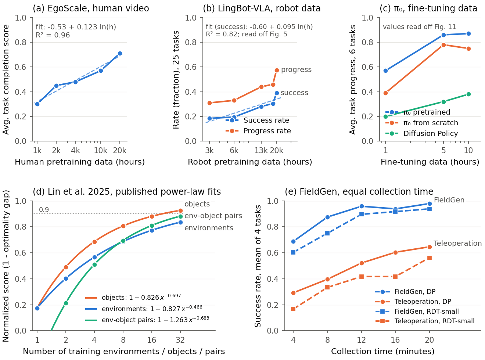
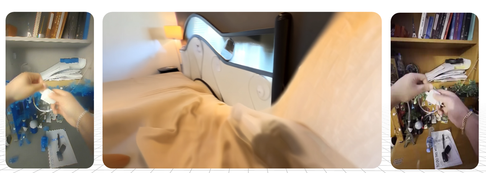

# SYNTHETIC VIDEO GENERATION FOR ROBOT LEARNING USING WORLD FOUNDATION MODELS

Shrey Jha, Skyler Saucedo, and Franklin Tanner

Revision of `oct-19-manuscript.md` (19 October 2026). Changes: the six never-cited references are removed, the Cosmos3-Nano model card is now cited where the model is used, citations are renumbered in order of first appearance, and the Method names the reasoning model consistently as Cosmos 3 Nano. All other text is unchanged. See `oct-19-diff.md` for the itemised changes.

## 1. Abstract

Training successful humanoid robotic manipulation policies within the space of PhysicalAI are bottlenecked by real-world data limitations in size and diversity of environment. Achieving acceptable completion scores for even the most straightforward tasks costs tens of thousands of hours of egocentric data, and with that, there is a sufficient drive for diversity for different objects, surfaces, and lighting to prevent model overfitting. We describe a pipeline that leverages Vision Action Language models from Nvidia Cosmos family, along with Large Language Models like OpenAI's mini-4o to generate variations of real egocentric clips while keeping the recorded actions, scaling a single video into hundreds of permutations.

Our method uses NVIDIA Cosmos 3 Nano to produce the Ontology of each clip, the task of each object's role, and plausible variations, along with OpenAI's Mini-4o to write our prompt to generate scene permutations. Our methodology employs traditional Computer Vision techniques like Boundary detection and Image Segmentation, using Canny Edge detection coupled with Segment Anything 2 (SAM2) to locate the objects we wish to permute, while Cosmos Transfer 2.5 renders the items maintaining realism within the video. This paper describes our process and findings, where structured reasoning about a scene produces robust realistic permutions. We outline limitations and provide best practices for leveraging this, demonstrating that this powerful and economical approach is scalable when solving problems in robot learning.

## 2. Introduction

Training humanoid robots to perform everyday household tasks requires large-scale egocentric data collection. Where humanoid robotic policy training and effectiveness are quantified, the consensus within the PhysicalAI community is that more training data is required, on the order of tens of thousands of hours, and that the diversity of objects within the space (defined as the Ontology) matter for policy robustness. As such, the mean acceptable score, defined as the robot's ability to successfully complete the task it was trained on, scales logarithmically with the hours of egocentric video [1]. Zheng et al, authors of Egoscale, claim over 20,854 hours of egocentric video are needed per task, with upper limits of achieving a mean task acceptable score of 0.71.π0 pretrains on more than 10,000 hours of robot data to perform similar tasks [2]. LingBot-VLA pretrains on about 20,000 hours from nine dual-arm platforms, with success rates still rising at that scale [3].

*Figure 1 - Policy performance against hours of data in three papers. (a) EgoScale: average task completion score on five dexterous tasks after pretraining on 1k to 20k hours of egocentric human video; dashed line is a log-linear fit.[1] (b) LingBot-VLA: average success and progress rate over 25 tasks on three dual-arm robots after pretraining on 3k to 20k hours of robot data [3] (c) π0: average task progress over six tasks against hours of fine-tuning data, for the pretrained model [2] (d) Lin et al. 2025, Mouse Arrangement: normalized score on unseen environments and objects against the number of training environments, objects, or environment-object pairs, drawn from the power-law fits [4] (e) FieldGen: success rate, mean of four pick tasks, against wall-clock collection time for teleoperation and for FieldGen [5].*

Lin et al. collected 40,000 demonstrations and found that a single-task policy's generalization follows a power law in the number of training environments and objects, that additional demonstrations in the same environment stop helping past a threshold, and that 32 environments with one object each were enough for 90 percent success in rooms and on objects never seen [4].

And while over 20k hours of video are needed for a single task, an hour of egocentric video costs anywhere between 3 to 15 USD, so a 20,000+ hours for a single task becomes price prohibitive and economically infeasible for startups and academia labs.

While there are labs addressing this bottleneck, only a handful of solutions offer practical support. MimicGen multiplies 200 human demonstrations into 50,000 by replaying trajectory segments in new object poses, but in simulation and for robot trajectories, not video [6]. FieldGen, a field-guided data generation framework that enables scalable collection, provides a meaningful solution, but provides only a 2.47x increase over a 2hr training example [5].

We propose a method that can effectively 72x the amount of trainable data, where a world foundation model reads the first frame of an egocentric video clip and provides a structured ontology of the scene. Leveraging classical Computer Vision techniques, we identify the items within the ontology and permute their attributes (color, texture, location), effectively creating video variants that describe the same task but provide the diversity a policy needs to perform tasks concerning dextrous hand motions within common environments, like living rooms, kitchens, and office spaces.

### Background

World foundation models are large-scale artificial intelligence systems trained to understand, simulate, and predict the physical world, including how objects move, interact, and follow the laws of physics [7]. NVIDIA Cosmos consists of three families: Predict forecasts future frames from text, an image or a video [8]; Transfer adapts a video across environments under multi-control conditioning on depth, segmentation, edge and blurred-RGB maps [9, 10]; Reason is a vision-language model for physical scene understanding [11]. Cosmos 3 folds the three into one model with a reasoning tower and a generation tower [12]. Transfer descends from ControlNet [13] and Gen-1 [14], which steer a frozen diffusion model with structure maps.

## 3. Method

*Figure 2 - The Pipeline*

Figure 2 shows the pipeline we're using to permute the ontological objects within an egocentric video.

First, the original Egocentric video clip (V) is prepared with NVIDIA's Cosmos Curate. Curate applies TransNetV2 shot-boundary detection, splitting a 29 min video of egocentric data into 116 individual 15-second clips, downsampled to 4 fps at 854x480. Curate uses TransNetV2, a small convolutional neural network trained to detect scene transitions; it's fast and accurate on standard shot-detection benchmarks. [15]

The first frame of each clip is passed to the reasoning tower of Cosmos 3 Nano [12, 16], a vision-language model that returns a structured description of the task, task-relevant objects with bounding boxes and their roles in the task, their current appearance and state, and the variations that are plausible for the task.

This structured understanding (scene, objects, attributes, actions) of the observed scene is what we define as the Ontology. We feed the Ontology (structured JSON) to GPT-4o mini [17], an LLM that writes a text prompt for Cosmos Transfer for variant video generation.

Four guidance maps are generated to preserve item edge, depth, color, and texture. Segmentation masks of all items are provided using SAM2 [18] to maintain item integrity while preserving the task at hand. Finally, Cosmos Transfer [10, 19] renders a synthetic variant (V') of the video, same task, action, and ontology of items, but with permutations to item attributes to increase visual entropy and diversity.

### 3.1 - Reasoning with Structured Ontologies

*Figure 3 - Sample egocentric video, a person wipes a countertop with a bucket and towels.*

As seen in Figure 3, our example video consists of a white bucket on a white countertop, and the task is defined as follows: A human must use a wash cloth from the bucket to clean a countertop. If we wish to train a robot on this task, we will need to augment portions of the video to increase the amount of training data to improve our average task completion score. If we decide to change the color of the bucket, countertop, or rags, how does this affect the outcome of the robot training policy? Whichever model is used, it must learn to associate objects with the broader actions and physical context they participate in. Not just what they look like, but how they behave in the task. This is why reasoning with structured ontologies is critical: we ask a model to understand the scene, objects,states, materials, lighting, and actions before anything else is varied, so that the permutations proposed for an object are ones that are physically plausible for the given task.

*Figure 4 - Reasoning output for the scene with object detection bounding boxes, along with JSON Ontology.*

Cosmos 3 Nano receives the first frame of the clip and a fixed instruction and returns a structured JSON record that defines the observed Ontology. Our pipeline asks for up to ten task-relevant objects, each with bounding boxes, and each object has the following: its role in the task, its current appearance (color, material, texture, condition, size), its current state (position, orientation, interaction with hands) and candidate variations among seven dimensions (color and appearance, material and texture, size and shape, state and position, condition, interaction, brand and style). A parallel block records scene-level variations (lighting, viewpoint, room style, time of day, clutter) and a final block states what training on this clip could potentially miss. Reasoning takes about 130 seconds per clip on one A100.

*\*\*Figure 5 - Sample JSON Ontology.. May be overkill and not needed, real JSON pref*

### 3.2 - From Ontology to Generation-Ready Prompts

In this step, we use OpenAI's GPT-4o mini [17] to prepare the prompt for Cosmos Transfer. We leverage GPT-4o mini for its exceptional speed and cost, averaging about 0.1 cents per 15-second clip. Additionally, GPT-4o provides a reliable structured JSON output and adheres to the Cosmos caption schema. Lastly, GPT-4o is one of the most available LLMs in the market currently. It should be noted that we did not run a comprehensive comparison against other Frontier models at the time.

From our work with this process, three prompt Engineering Principles were discovered:

1. Repeat target attributes: "solid blue countertop", "vivid blue color". More repetition of the changed attribute helps reinforce the change. A single mention of "blue" is one token competing with everything else in the 150 word caption; repeating the attribute in different contests puts more of the prompt's attention mass on the property that has to change.

2. Explicitly preserve unchanged elements "Bucket and paper towels retain their original appearance". This preservation clause reinforces continuity and protects non-target objects. Prior to enforcing this clause, we observed evidence of data leakage (bucket turning blue despite prompting the color change of the counter.)

3. Describe the result, not the change ... if you want the countertop to change color, say, "a person cleaning a solid blue countertop", not "change white countertop to blue..." Why? Cosmos Transfer was trained on captions of videos, not on edit instructions, so "change the white countertop to blue" is out of distribution and names two colors where only one should appear.

### 3.3 - Guiding the Rendering

Before any object attributes are applied, we send Cosmos Transfer four control modalities from the source clip, each control modality comes with tunable parameters to decide how strong the variant is rendered.

1. Edge detection: We use Canny edge detection provided by OpenCV [20]. We choose Canny over Sobel or Laplacian due to the models robustness and ability to clearly distinguish edges in poor lighting conditions. Successful edge detection is important since if the edges are not clearly defined, object geometry could warp during clip permutation.

2. Depth: The depth control is monocular depth video provided by DepthAnything V2 [21], and it provides an emergent layer of pseudo-3-dimensional object spatial positioning. As we permute object attributes, it's important to maintain persistent object ordering within the variant output.

3. Color for lightning: maintaining overall color palette and continuity as we adjust light parameters.

4. Segmentation Mask: All ontological objects are identified pixel-by-pixel. This provides clearly defined classification to which pixels the model can change. If two or more objects spatially relate or overlap, or if there's occlusion, we can render the object in question without affecting the neighboring objects in the scene.

We set our weights to the standard default values.

## 4. Results

Eight recordings of first person videos of household chores were used to generate realistic permutation variants. Tasks were captured egocentrically with a head-mounted camera and include counter wiping, cloth folding, bed making, and cable wrapping. Each task ranges from 4-8mins in total time. Our studies ran on Google Colab Pro+ Notebooks (see appendix for source code) on an A100 80 GB. Per clip, average reasoning time was 130 seconds, Transfer renders averaged about 20 minutes, and Predict2 renderings took about 3.5 minutes. LLM inference by Chat GPT 4o mini only took a few seconds per clip. Every variant was inspected to see how it compared to the matched source.

*Figure 6 - Converting white countertop to blue, rag to blue, bucket to blue and varying the skin color of the human.*

Figure 6 shows that the resultant variant permutes the color of the Ontological objects, while maintaining the hand pose, bucket and table geometry. We observed that the cleaning motion observed in the before video is maintained by the variant, frame by frame. We also observed that the background wall and lighting has changed, adding more entropy as desired.

*Figure 7 - Adding stuffing to a chair pillow*

We see that adding complexity to objects can sometimes add unintended consequences to the variant scene. As observed in Figure 7, we task the data collector to stuff a throw pillow for a chair. Employing the pipeline to produce variants, our only request was that the color of the pillow change to blue. The variant not only changed the pillow blue, but also changed the background chairs blue as well. We found that poor image segmentation results are the cause here, furthering the need to fine-tune Canny edge-gradient parameters.

*Figure 8 - Directional Reversal Experiment*

We did observe some limitations in this process, particularly when requesting permutations in the physics of the scene. In Figure 8, the data collector is taking a phone charger and winding the USB cord about the wall plug in a clockwise direction (with respect to the wall plug.) Next, we ask the pipeline to wind the cord in the opposite direction, counterclockwise. Surprisingly, the resultant variant was unable to maintain this ask, the spooling wire looked like spaghetti, with the cord gaining linear mass and length at times. The hands do in fact maintain the same orientation as the original video, but the variant fails to maintain the physics, violating conservation of mass and continuity. We believe this is an emergent property of VLAs struggling to fully understand the physical world [8].

*Figure 9 - Some examples of variants ... maybe we can find a better example?*

## 5. Closing the gap

From 3, 10-minute video examples, we used our workflow to create 116 clips to generate 72 variations per clip, producing 8,352 synthetic video variations, or about 35 hours of video from 29 minutes of source data. The number of permuted variants depends upon the number of Ontological objects available to change, along with what physical attributes are within the current limit of the NVIDIA World Model suite. One 10-minute video became 4 hours without a new scene or room generated.

Considering the current market rate for raw egocentric data is 8 - 15 USD per hour, we find that this process can quickly scale a sparse dataset into one with sufficient hours, diversity, while maintaining the overall physics of the scene. For every hour processed with our pipeline, we spend 1.20 USD in GPU cloud instance costs and 0.12 in token costs for LLM. For practitioners and academics who have a limited budget for training robot policies on humanoids, this workflow provides a cohesive and practical solution.

@TODO - Add a table that sows cost in time, money, etc...

## 6. Conclusion

We describe a multi-model pipeline on NVIDIA Cosmos that turns a real, limited first-person dataset into task-grounded synthetic training variant clips for humanoid robotic training policy. This workflow provides a scalable solution for academics and practitioners who need more egocentric video to increase the average task completion score. We demonstrate how the workflow is capable of changing appearance for simpler scenes, however more work must be done for complex scenes. Additionally, action-level changes (multiple tasks executed within the video) remain unsolved. Lastly, more questions need to be explored, such as does structured reasoning about a scene produce better variations than random augmentation?

## 7. References

1. Zheng, R., Niu, D., Xie, Y., Wang, J., Xu, M., Jiang, Y., Castañeda, F., Hu, F., Tan, Y.L., Fu, L., Darrell, T., Huang, F., Zhu, Y., Xu, D., Fan, L.: EgoScale: Scaling Dexterous Manipulation with Diverse Egocentric Human Data. arXiv preprint arXiv:2602.16710 (2026). https://arxiv.org/abs/2602.16710

2. Black, K., Brown, N., Driess, D., et al.: π0: A Vision-Language-Action Flow Model for General Robot Control. In: Proceedings of Robotics: Science and Systems (RSS) (2025). https://arxiv.org/abs/2410.24164

3. Wu, W., Lu, F., Wang, Y., Yang, S., Liu, S., Wang, F., et al.: A Pragmatic VLA Foundation Model. arXiv preprint arXiv:2601.18692 (2026). https://arxiv.org/abs/2601.18692

4. Lin, F., Hu, Y., Sheng, P., Wen, C., You, J., Gao, Y.: Data Scaling Laws in Imitation Learning for Robotic Manipulation. In: International Conference on Learning Representations (ICLR) (2025). https://arxiv.org/abs/2410.18647

5. Wang, W., Ye, K., Zhou, X., Chen, T., Min, C., Zhu, Q., Yang, X., Luo, P., Shen, Y., Yang, Y., Yao, M., Mu, Y.: FieldGen: From Teleoperated Pre-Manipulation Trajectories to Field-Guided Data Generation. arXiv preprint arXiv:2510.20774 (2025). https://arxiv.org/abs/2510.20774

6. Mandlekar, A., Nasiriany, S., Wen, B., Akinola, I., Narang, Y., Fan, L., Zhu, Y., Fox, D.: MimicGen: A Data Generation System for Scalable Robot Learning using Human Demonstrations. In: Proceedings of the 7th Conference on Robot Learning (CoRL) (2023). https://arxiv.org/abs/2310.17596

7. NVIDIA, Agarwal, N., Ali, A., et al.: Cosmos World Foundation Model Platform for Physical AI. arXiv preprint arXiv:2501.03575 (2025). https://arxiv.org/abs/2501.03575

8. NVIDIA: Cosmos-Predict2: A Suite of Diffusion-based World Foundation Models Available in 2B and 14B. Hugging Face model card (2025). https://huggingface.co/nvidia/Cosmos-Predict2-2B-Video2World

9. NVIDIA, Abu Alhaija, H., Alvarez, J., et al.: Cosmos-Transfer1: Conditional World Generation with Adaptive Multimodal Control. arXiv preprint arXiv:2503.14492 (2025). https://arxiv.org/abs/2503.14492

10. NVIDIA, Ali, A., Bai, J., et al.: World Simulation with Video Foundation Models for Physical AI. arXiv preprint arXiv:2511.00062 (2025). https://arxiv.org/abs/2511.00062

11. NVIDIA, Azzolini, A., Bai, J., et al.: Cosmos-Reason1: From Physical Common Sense to Embodied Reasoning. arXiv preprint arXiv:2503.15558 (2025). https://arxiv.org/abs/2503.15558

12. NVIDIA: Cosmos 3: Omnimodal World Models for Physical AI. arXiv preprint arXiv:2606.02800 (2026). https://arxiv.org/abs/2606.02800

13. Zhang, L., Rao, A., Agrawala, M.: Adding Conditional Control to Text-to-Image Diffusion Models. In: Proceedings of the IEEE/CVF International Conference on Computer Vision (ICCV), pp. 3836-3847 (2023). https://arxiv.org/abs/2302.05543

14. Esser, P., Chiu, J., Atighehchian, P., Granskog, J., Germanidis, A.: Structure and Content-Guided Video Synthesis with Diffusion Models. In: Proceedings of the IEEE/CVF International Conference on Computer Vision (ICCV), pp. 7346-7356 (2023). https://arxiv.org/abs/2302.03011

15. Souček, T., Lokoč, J.: TransNet V2: An Effective Deep Network Architecture for Fast Shot Transition Detection. arXiv preprint arXiv:2008.04838 (2020). https://arxiv.org/abs/2008.04838

16. NVIDIA: Cosmos3-Nano. Hugging Face model card (2026). https://huggingface.co/nvidia/Cosmos3-Nano

17. OpenAI: GPT-4o mini: Advancing Cost-Efficient Intelligence (2024). https://openai.com/index/gpt-4o-mini-advancing-cost-efficient-intelligence/

18. Ravi, N., Gabeur, V., Hu, Y.T., et al.: SAM 2: Segment Anything in Images and Videos. In: International Conference on Learning Representations (ICLR) (2025). https://arxiv.org/abs/2408.00714

19. NVIDIA: Cosmos-Transfer2.5: A Suite of Diffusion-based World-to-World Models. Hugging Face model card (2025). https://huggingface.co/nvidia/Cosmos-Transfer2.5-2B

20. Canny, J.: A Computational Approach to Edge Detection. IEEE Transactions on Pattern Analysis and Machine Intelligence PAMI-8(6), 679-698 (1986). https://doi.org/10.1109/TPAMI.1986.4767851

21. Yang, L., Kang, B., Huang, Z., Zhao, Z., Xu, X., Feng, J., Zhao, H.: Depth Anything V2. In: Advances in Neural Information Processing Systems (NeurIPS) (2024). https://arxiv.org/abs/2406.09414
