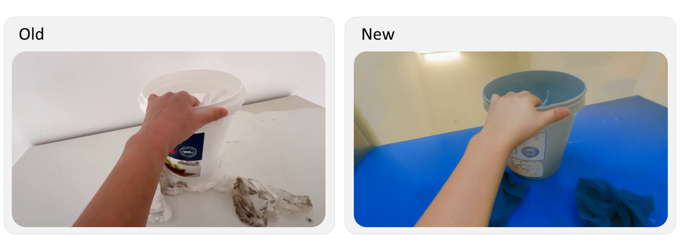
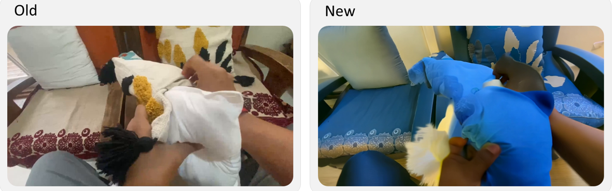
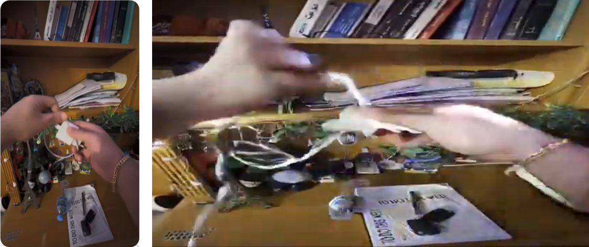
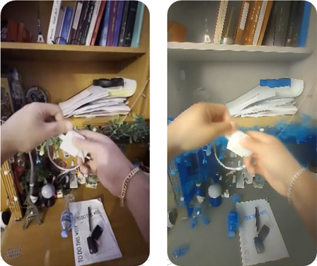

# Synthetic Video Generation for Robot Learning Using World Foundation Models

Shrey Jha¹ (ORCID 0009-0003-5044-4187), Skyler Saucedo² (ORCID 0009-0005-7005-7736), and Franklin Tanner³ (ORCID 0009-0003-6814-2291)

¹ Innodata, Physical AI Intern
² Innodata, Robotics and Physical AI Solutions Architect
³ Innodata, VP Robotics and Computer Vision

## Abstract

Training successful humanoid robotic manipulation policies within the space of Physical AI is bottlenecked by real-world data limitations in the quantity and diversity of environments. Achieving acceptable completion scores for even the most straightforward tasks may require tens of thousands of hours of training data. The training data must include sufficient diversity for different objects, surfaces, and lighting to prevent model overfitting and promote generalization. In this paper, we describe a pipeline that leverages world foundation models from the NVIDIA Cosmos family, along with large language models (LLMs) like OpenAI's GPT-4o mini, to generate variations of real egocentric video clips while keeping the recorded actions, scaling a single video into hundreds of permutations. Our method uses NVIDIA Cosmos 3 Nano to produce an ontology of each clip: the task, each object's role in it, and plausible variations. GPT-4o mini then writes a prompt to generate scene permutations. Our method employs traditional computer vision techniques like boundary detection and image segmentation, using Canny edge detection coupled with Segment Anything 2 (SAM 2) to locate the objects we wish to permute, while Cosmos Transfer 2.5 renders the items, maintaining realism within the video. This paper describes our process and findings, where structured reasoning about a scene produces robust, realistic permutations. We outline limitations and provide best practices for leveraging these tools, demonstrating that this powerful and economical approach is scalable when solving problems in robot learning.

**Keywords:** Synthetic data generation, World foundation models, Egocentric video, Robot learning, Data augmentation

## 1 Introduction

Training humanoid robots to perform everyday household tasks requires large-scale egocentric data collection. Where humanoid robotic policy training and effectiveness are quantified, the consensus within the Physical AI community is that more training data is required, on the order of tens of thousands of hours, and that the diversity of objects within the space (defined below as the ontology) matters for policy robustness. As such, the mean acceptable score, defined as the robot's ability to successfully complete the task it was trained on, scales logarithmically with the hours of egocentric video [1]. Zheng et al., authors of EgoScale, claim over 20,854 hours of egocentric video were used for pre-training their vision-language-action (VLA) model, with upper limits of achieving a mean task acceptable score of 0.71. The π0 model pretrains on more than 10,000 hours of robot data to perform similar tasks [2]. LingBot-VLA pretrains on about 20,000 hours from nine dual-arm platforms, with success rates still rising at that scale [3].

Lin et al. collected 40,000 demonstrations and found that a single-task policy's generalization follows a power law in the number of training environments and objects [4]. While over 20,000 hours of video may be needed for a single task, an hour of egocentric video costs anywhere between 3 and 25 USD, so 20,000 or more hours for a single task becomes cost-prohibitive and economically infeasible for startups and academic labs.

While there are labs addressing this bottleneck, only a handful of solutions offer practical support. MimicGen can simulate 50,000 samples from 200 real human demonstrations by replaying trajectory segments in new object poses, but in simulation and for robot trajectories, not video [5].

We propose a method that can effectively increase the amount of trainable data, where a world foundation model reads the first frame of an egocentric video clip and provides a structured ontology of the scene. Leveraging classical computer vision techniques, we identify the items within the ontology and permute their attributes (color, texture, location), effectively creating video variants that describe the same task but provide the diversity a policy needs to learn tasks concerning dexterous hand motions within common environments, like living rooms, kitchens, and office spaces.

### 1.1 Background

World foundation models are large-scale artificial intelligence systems trained to understand, simulate, and predict the physical world, including how objects move, interact, and follow the laws of physics [6]. NVIDIA Cosmos consists of three model families: Predict forecasts future frames from text, an image, or a video [7]; Transfer adapts a video across environments under multi-control conditioning on depth, segmentation, edge, and blurred-RGB maps [8, 9]; Reason is a vision-language model for physical scene understanding [10]. Cosmos 3 folds the three models into one, with an autoregressive subnetwork that reasons about a scene and a diffusion-based subnetwork that generates video, audio, and actions conditioned on that reasoning [11].

## 2 Method

*Fig. 1. The Pipeline*

Fig. 1 shows the pipeline we are using to permute the objects in the ontology of an egocentric video.

First, the original egocentric video clip (V) is prepared with NVIDIA's Cosmos Curate. Curate applies TransNet V2 shot-boundary detection, splitting a 29 min video of egocentric data into 116 individual 15-second clips, downsampled to 4 fps at 854×480. Curate uses TransNet V2, a small convolutional neural network trained to detect scene transitions. TransNet V2 is fast and accurate on standard shot-detection benchmarks [12]. The first frame of each clip is passed to the reasoning tower of Cosmos 3 Nano [11, 13], a vision-language model that returns a structured description of the task, task-relevant objects with bounding boxes and their roles in the task, their current appearance and state, and the variations that are plausible for the task. This structured understanding (scene, objects, attributes, actions) of the observed scene is what we define as the ontology. We feed the ontology (structured JSON) to GPT-4o mini [14] to write the text prompt that Cosmos Transfer 2.5 uses for variant video generation.

Four guidance maps are generated to preserve item edges, depth, color, and segmentation. Segmentation masks of all items are generated using SAM 2 [15] to maintain item integrity while preserving the task at hand. Finally, Cosmos Transfer 2.5 [9, 16] renders a synthetic variant (V') of the video with the same task, action, and ontology of items, but with directed permutations of item attributes to increase visual diversity.

### 2.1 Reasoning with Structured Ontologies

*Fig. 2. Sample egocentric video, a person wipes a countertop with a towel and a bucket.*

As shown in Fig. 2, our example video consists of a white bucket on a white countertop, and the task is defined as follows: a human must use a washcloth from the bucket to clean the countertop. If we wish to train a robot policy on this cleaning task, we will need to augment portions of the video to increase the amount of training data to improve our average task completion score. If we decide to change the color of the bucket, countertop, or rags, does that permutation affect the outcome of the robot training policy? Whichever model is used, it must learn to associate objects with the broader actions and physical context they participate in: not just what they look like, but how they behave in the task. This requirement is why reasoning with structured ontologies is critical: we ask a model to understand the scene, objects, states, materials, lighting, and actions before anything else is varied, so that the permutations proposed for an object are physically plausible for the given task.

*Fig. 3. Reasoning output for the scene with object detection bounding boxes, along with the JSON ontology.*

Cosmos 3 Nano receives the first frame of the clip together with a fixed instruction, and returns a structured JSON record that defines the observed ontology (Fig. 3). Our pipeline asks for up to ten task-relevant objects, each with a bounding box, and for each object: its role in the task, its current appearance (color, material, texture, condition, size), its current state (position, orientation, interaction with hands), and candidate variations along seven dimensions (color and appearance, material and texture, size and shape, state and position, condition, interaction, brand and style). A parallel block records scene-level variations (lighting, viewpoint, room style, time of day, clutter) and a final block states what training on this clip could miss. Reasoning takes about 130 seconds per clip on one A100.

### 2.2 From Ontology to Generation-Ready Prompts

In this step, we use OpenAI's GPT-4o mini [14] to prepare the prompt for Cosmos Transfer. We chose GPT-4o mini for its speed and low cost, averaging about 0.001 USD per 15-second clip. Additionally, GPT-4o mini provides reliable structured JSON output and adheres to the Cosmos caption schema. Lastly, GPT-4o mini is one of the most widely available LLMs in the market currently. It should be noted that we did not run a comprehensive comparison against other frontier models at the time.

From our work with this process, three prompt-engineering principles were discovered:

1. Repeat target attributes: "solid blue countertop", "vivid blue color". More repetition of the changed attribute helps reinforce the change. A single mention of "blue" is one token competing with everything else in the 150-word caption; repeating the attribute in different contexts puts more of the prompt's attention mass on the property to be modified.
2. Explicitly preserve unchanged elements: "Bucket and paper towels retain their original appearance". This preservation clause reinforces continuity and protects non-target objects. Prior to enforcing this clause, we observed evidence of leakage (the bucket turning blue despite prompting the color change of the counter).
3. Describe the result, not the change: to change the countertop color, the prompt should say "a person cleaning a solid blue countertop", not "change the white countertop to blue...". We conjecture this is because the model was trained on descriptive video captions rather than edit instructions, placing imperative prompts outside its training distribution.

### 2.3 Guiding the Rendering

Before any object attributes are applied, we send Cosmos Transfer four control modalities from the source clip. Each control modality comes with tunable parameters to decide how strongly the variant is rendered.

1. Edge detection: We use Canny edge detection [17], as implemented in OpenCV.
2. Depth: The depth control is monocular depth video from Depth Anything V2 [18], which provides an emergent layer of pseudo-3-dimensional object spatial positioning.
3. Color for lighting: maintaining the overall color palette and continuity as we adjust light parameters. We use a bilateral blur of the input RGB frames.
4. Segmentation mask: All objects in the ontology are identified pixel by pixel. The mask provides a clearly defined classification of which pixels the model can change. If two or more objects spatially relate or overlap, or if there is occlusion, we can render the object in question without affecting the neighboring objects in the scene.

## 3 Results

Eight recordings of first-person videos of household chores were used to generate realistic permutation variants. Tasks were captured egocentrically with a head-mounted camera and include counter wiping, cloth folding, bed making, and cable wrapping. Each task ranges from 4 minutes to 8 minutes in duration. Our studies ran on Google Colab Pro+ notebooks (see appendix for source code) on an A100 80 GB. For Cosmos 3 Nano, the average reasoning time was 130 seconds per clip. Transfer renders averaged about 20 minutes, and Predict2 renderings took about 3.5 minutes. LLM inference by GPT-4o mini took only a few seconds per clip. Every variant was inspected to see how it compared to the matched source.

*Fig. 4. Converting the white countertop to blue, the rag to blue, the bucket to blue, and varying the skin color of the human.*

Fig. 4 shows that the resulting variant permutes the color of the objects in the ontology, while maintaining the hand pose and the bucket and countertop geometry. We observed that the cleaning motion observed in the before video is maintained by the variant, frame by frame. We also observed that the background wall and lighting have changed, adding more entropy as desired.

*Fig. 5. Adding stuffing to a chair pillow*

We see that adding complexity to objects can sometimes add unintended consequences to the variant scene. As observed in Fig. 5, we task the data collector to stuff a throw pillow for a chair. When we employed the pipeline to produce variants, our only request was that the color of the pillow change to blue. The variant not only changed the pillow blue but also changed the background chairs blue. We found that poor image segmentation results are the cause here, suggesting the need to fine-tune Canny edge-gradient parameters.

*Fig. 6. Directional Reversal Experiment*

We did observe some limitations in this process, particularly when requesting permutations in the physics of the scene. In Fig. 6, the data collector is taking a phone charger and winding the USB cord around the wall plug in a clockwise direction (with respect to the wall plug). Next, we ask the pipeline to wind the cord in the opposite direction, counterclockwise. Surprisingly, the resulting variant was unable to maintain this ask: the spooling wire looked like spaghetti, with the cord gaining linear mass and length at times. The hands do in fact maintain the same orientation as the original video, but the variant fails to maintain the physics, violating conservation of mass and continuity. Fig. 7 places the source desk clip and its appearance variant side by side.

*Fig. 7. Variants of the desk clip: the source clip (left) and an appearance variant with the desk and shelf recolored blue (right).*

## 4 Closing the Gap

From three 10-minute video examples, we used our workflow to create 116 clips to generate 72 variations per clip, producing 8,352 synthetic video variations, or about 35 hours of video from 29 minutes of source data. The number of permuted variants depends on the number of objects in the ontology available to change, along with what physical attributes are within the current limit of the NVIDIA World Model suite. One 10-minute video became 4 hours without a new scene or room generated. At the time of publication, the authors have not quantified how much of this synthetic data is useful.

Considering the current market rate for raw egocentric data is 3 to 25 USD per hour, we find that this process can quickly scale a sparse dataset into one with sufficient hours and diversity, while maintaining the overall physics of the scene. For every hour processed with our pipeline, we spend 96 USD for GPU cloud instance costs (80 A100-hours at 20 minutes per clip) and 0.12 USD in LLM token costs. For practitioners and academics who have a limited budget for training robot policies, this workflow provides a cohesive and practical solution.

## 5 Conclusion

We describe a multi-model pipeline on NVIDIA Cosmos that turns a real, limited first-person dataset into task-grounded synthetic training variant clips for humanoid robotic policy training. This workflow provides a scalable solution for academics and practitioners who need more egocentric video to increase the average task completion score. We demonstrate how the workflow is capable of changing appearance for simpler scenes. However, more work must be done for complex scenes. Additionally, action-level changes (multiple tasks executed within the video) remain unsolved. Lastly, more questions need to be explored, such as does structured reasoning about a scene produce better variations than random augmentation? Overall, we have explored NVIDIA Cosmos models and their current capacity for synthetic video generation for egocentric household data.

**Disclosure of Interests.** The authors have no competing interests to declare that are relevant to the content of this article.

## References

1. Zheng, R., Niu, D., Xie, Y., Wang, J., Xu, M., Jiang, Y., Castañeda, F., Hu, F., Tan, Y.L., Fu, L., Darrell, T., Huang, F., Zhu, Y., Xu, D., Fan, L.: EgoScale: Scaling Dexterous Manipulation with Diverse Egocentric Human Data. Technical report, NVIDIA (2026). https://research.nvidia.com/labs/gear/egoscale/
2. Black, K., Brown, N., Driess, D., et al.: π0: A Vision-Language-Action Flow Model for General Robot Control. In: Proceedings of Robotics: Science and Systems (RSS) XXI (2025). doi: 10.15607/RSS.2025.XXI.010. https://roboticsproceedings.org/rss21/p010.html
3. Wu, W., Lu, F., Wang, Y., Yang, S., Liu, S., Wang, F., et al.: A Pragmatic VLA Foundation Model. Technical report, Robbyant (2026). https://technology.robbyant.com/lingbot-vla
4. Lin, F., Hu, Y., Sheng, P., Wen, C., You, J., Gao, Y.: Data Scaling Laws in Imitation Learning for Robotic Manipulation. In: International Conference on Learning Representations (ICLR) (2025). https://proceedings.iclr.cc/paper_files/paper/2025/hash/88b7b2c896506daabc8d3fd587055167-Abstract-Conference.html
5. Mandlekar, A., Nasiriany, S., Wen, B., Akinola, I., Narang, Y., Fan, L., Zhu, Y., Fox, D.: MimicGen: A Data Generation System for Scalable Robot Learning using Human Demonstrations. In: Proceedings of the 7th Conference on Robot Learning (CoRL). Proceedings of Machine Learning Research, vol. 229, pp. 1820-1864. PMLR (2023). https://proceedings.mlr.press/v229/mandlekar23a.html
6. NVIDIA, Agarwal, N., Ali, A., et al.: Cosmos World Foundation Model Platform for Physical AI. Technical report, NVIDIA (2025). https://research.nvidia.com/publication/2025-01_cosmos-world-foundation-model-platform-physical-ai
7. NVIDIA: Cosmos-Predict2: A Suite of Diffusion-based World Foundation Models Available in 2B and 14B. Hugging Face model card (2025). https://huggingface.co/nvidia/Cosmos-Predict2-2B-Video2World
8. NVIDIA, Abu Alhaija, H., Alvarez, J., et al.: Cosmos-Transfer1: Conditional World Generation with Adaptive Multimodal Control. Technical report, NVIDIA (2025). https://research.nvidia.com/labs/cosmos-lab/cosmos-transfer1/
9. NVIDIA, Ali, A., Bai, J., et al.: World Simulation with Video Foundation Models for Physical AI. Technical report, NVIDIA (2025). https://research.nvidia.com/publication/2025-09_world-simulation-video-foundation-models-physical-ai
10. NVIDIA, Azzolini, A., Bai, J., et al.: Cosmos-Reason1: From Physical Common Sense to Embodied Reasoning. Technical report, NVIDIA (2025). https://research.nvidia.com/labs/cosmos-lab/cosmos-reason1/
11. NVIDIA: Cosmos 3: Omnimodal World Models for Physical AI. Technical report, NVIDIA (2026). https://research.nvidia.com/labs/cosmos-lab/cosmos3/
12. Souček, T., Lokoč, J.: TransNet V2: An Effective Deep Network Architecture for Fast Shot Transition Detection. In: Proceedings of the 32nd ACM International Conference on Multimedia (MM), pp. 11218-11221. ACM (2024). doi: 10.1145/3664647.3685517
13. NVIDIA: Cosmos3-Nano. Hugging Face model card (2026). https://huggingface.co/nvidia/Cosmos3-Nano
14. OpenAI: GPT-4o mini: Advancing Cost-Efficient Intelligence (2024). https://openai.com/index/gpt-4o-mini-advancing-cost-efficient-intelligence/
15. Ravi, N., Gabeur, V., Hu, Y.T., et al.: SAM 2: Segment Anything in Images and Videos. In: International Conference on Learning Representations (ICLR) (2025). https://proceedings.iclr.cc/paper_files/paper/2025/hash/45c1f6a8cbf2da59ebf2c802b4f742cd-Abstract-Conference.html
16. NVIDIA: Cosmos-Transfer2.5: A Suite of Diffusion-based World-to-World Models. Hugging Face model card (2025). https://huggingface.co/nvidia/Cosmos-Transfer2.5-2B
17. Canny, J.: A Computational Approach to Edge Detection. IEEE Transactions on Pattern Analysis and Machine Intelligence PAMI-8(6), 679-698 (1986). doi: 10.1109/TPAMI.1986.4767851
18. Yang, L., Kang, B., Huang, Z., Zhao, Z., Xu, X., Feng, J., Zhao, H.: Depth Anything V2. In: Advances in Neural Information Processing Systems (NeurIPS) 37 (2024). https://proceedings.neurips.cc/paper_files/paper/2024/hash/26cfdcd8fe6fd75cc53e92963a656c58-Abstract-Conference.html
