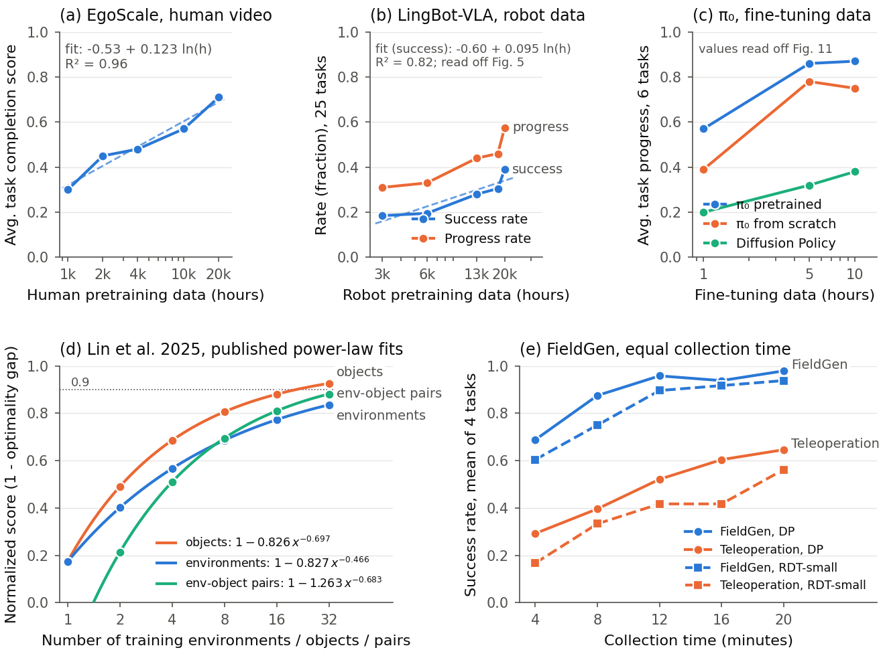
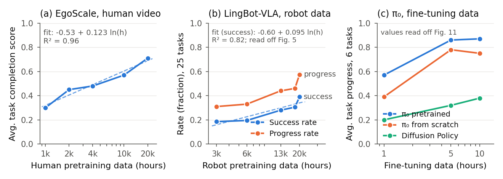
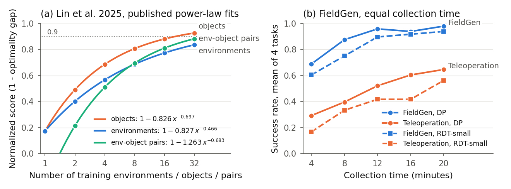

# Policy performance against data amount: compiled claims and our own figure

Written 2026-10-18. Purpose: replace Figure 1 of draft 5, which is a screenshot of EgoScale's Fig. 5, with a figure drawn from published numbers that we can reproduce without permission, and give the Introduction's data-scaling sentences exact sources. Everything here comes from the six PDFs in `references/`. Where a number was read off a plotted figure rather than taken from text or a table, the row says so and the value carries about one point of uncertainty.

Files:

| Path | What it is |
|---|---|
| `data/*.csv` | One file per paper with the numbers used, named by source table or figure |
| `make_plots.py` | Draws the figures from the CSVs and writes `figures/fits.json` |
| `figures/policy_vs_data_amount.{pdf,png}` | The paper's Fig. 1: one figure, panels (a) to (e), combining Figures A and B below |
| `figures/policy_vs_hours.{pdf,png}` | Figure A: performance against hours of data (EgoScale, LingBot-VLA, pi0), panels (a) to (c) of the combined figure |
| `figures/diversity_and_collection_time.{pdf,png}` | Figure B: performance against environment and object count (Lin et al.) and against collection time (FieldGen), panels (d) and (e) of the combined figure |
| `figures/fits.json` | Our fitted parameters |

Run `python make_plots.py` to regenerate. The PDFs are vector and sized for an LNCS text width (6.6 in wide, 8 pt type).

---

## 1. Claims compiled from the references

| Paper | What was scaled | Metric and setting | Numbers | Shape of the relation | Where | Status |
|---|---|---|---|---|---|---|
| EgoScale, Zheng et al. 2026 (arXiv 2602.16710) | Hours of egocentric human video used for pretraining: 1k, 2k, 4k, 10k, 20k | Average task completion score after post-training, 5 dexterous tasks on a 22-DoF hand, 2 seeds, 10 trials | 0.30, 0.45, 0.48, 0.57, 0.71 | Monotone, "no signs of saturation in the explored regime". Human-action validation loss follows L = 0.024 - 0.003 ln(D), R² = 0.9983 | Sec. 3.3, Fig. 5, Eq. 1 | Exact, from text |
| EgoScale | Pretraining present or absent | Success rate on the same tasks | +54 percent over the no-pretraining baseline | Single comparison | Abstract, Fig. 4 | Exact, from text |
| LingBot-VLA, Wu et al. 2026 (arXiv 2601.18692) | Hours of real dual-arm robot data used for pretraining: 3k, 6k, 13k, 18k, 20k | Average success rate and progress rate over 25 tasks on Agibot G1, AgileX and Galaxea R1Pro | Success about 18.5, 19.5, 28, 30.5, 39 percent; progress about 31, 33, 44, 46, 57.5 percent | "Consistent upward trend", "no signs of saturation even at the 20,000-hour mark" | Sec. 5.5.1, Fig. 5 | Read off Fig. 5 |
| pi0, Black et al. 2024 (arXiv 2410.24164) | Hours of fine-tuning data per task: 1, 5, 10, after pretraining on over 10,000 hours | Average task progress across 6 tasks | Pretrained pi0 about 0.57, 0.86, 0.87; pi0 from scratch about 0.39, 0.78, 0.75; Diffusion Policy about 0.20, 0.32, 0.38 | Gains flatten after 5 hours; pretraining "frequently better than the non-pre-trained model, sometimes by as much as 2x" | Sec. VI.C, Fig. 11 | Read off Fig. 11 |
| Data Scaling Laws, Lin et al., ICLR 2025 (arXiv 2410.18647) | Number of training environments, objects, and environment-object pairs: 1, 2, 4, 8, 16, 32, with 50 demonstrations each | Normalized score on unseen environments and objects; optimality gap = 1 - score; Pour Water and Mouse Arrangement | Mouse Arrangement fits: objects gap = 0.826 x^-0.697 (r = -0.991); environments 0.827 x^-0.466 (r = -0.966); pairs 1.263 x^-0.683 (r = -0.942). Pour Water: 0.825 x^-0.703, 1.180 x^-0.844, 1.068 x^-0.579 | Power law in the number of environments and objects; no clear law in the number of demonstrations once environments and objects are fixed (performance plateaus) | Sec. 4.2, Fig. 5, Fig. 7 | Exact, fit equations from the figure legend |
| Lin et al. | Data collection strategy derived from the law | Success rate on 8 unseen environments and objects for two new tasks | About 90 percent with 32 environments, one object each, 50 demonstrations each, collected in one afternoon by four people; 40,000 demonstrations and 15,000 rollouts in the study overall | Verification of the strategy | Sec. 1, Sec. 5 | Exact, from text |
| MimicGen, Mandlekar et al., CoRL 2023 (arXiv 2310.17596) | Demonstrations per task: 10 human source demos against 1,000 generated | Success rate, 3 seeds, image-based BC, 16 tasks | For example Square 11.3 to 90.7, Threading 19.3 to 98.0, Stack Three 0.7 to 92.7; full table in `data/mimicgen_source_vs_generated_fig4.csv` | Large gain from 10 to 1,000 | Fig. 4 left | Exact, from the table |
| MimicGen | Generated demonstrations: 200, 1,000, 5,000 | Success rate on 5 task variants | "Large jump in performance from 200 to 1000, but not much from 1000 to 5000" | Diminishing returns past 1,000 | Sec. 6.3, Fig. 4 bottom right | Qualitative, from text |
| MimicGen | Source human demonstrations: 1, 10, 50, 200 | Success rate on Square and Three Piece Assembly variants | "Did not result in significant agent improvement" | Flat | Fig. 4 top right | Qualitative, from text |
| FieldGen, Wang et al. 2025 (arXiv 2510.20774) | Wall-clock collection time: 4, 8, 12, 16, 20 minutes, teleoperation against FieldGen | Success rate over 12 placements, mean of 4 pick tasks, Diffusion Policy (DP) and RDT-small | DP teleop 29.2, 39.6, 52.1, 60.4, 64.6; DP FieldGen 68.8, 87.5, 95.8, 93.8, 97.9; RDT teleop 16.7, 33.3, 41.7, 41.7, 56.2; RDT FieldGen 60.4, 75.0, 89.6, 91.7, 93.8 | Rising with time for both; FieldGen above 80 percent in all settings after 20 minutes | Sec. IV.B, Table I, Fig. 4a | Exact, from Table I |
| FieldGen | Operator effort | Collection Time Ratio and throughput | 66.73 percent against 27.07 percent (2.47x); 1203 against 569 frames per minute (2.11x) | Single comparison | Sec. IV.E | Exact, from text |

Two things the table makes plain. Every paper that varies hours finds performance still rising at the largest amount it tried, and none of them states a per-task requirement; EgoScale's 20,854 hours is a pretraining corpus across many tasks and environments. And the one paper that separates hours from diversity (Lin et al.) finds that the number of distinct environments and objects, not the number of demonstrations, is what the power law runs on.

## 2. The figures

The combined figure above is the one placed in the paper as Fig. 1. Its panels are the same as Figures A and B below, lettered (a) to (e) in one sequence.

**Figure A.** Policy performance against hours of data in three papers. (a) EgoScale: average task completion score on five dexterous tasks after pretraining on 1k to 20k hours of egocentric human video; dashed line is our log-linear fit. (b) LingBot-VLA: average success and progress rate over 25 tasks on three dual-arm robots after pretraining on 3k to 20k hours of robot data; values read off the paper's Fig. 5. (c) pi0: average task progress over six tasks against hours of fine-tuning data, for the pretrained model, the same architecture trained from scratch, and Diffusion Policy; values read off the paper's Fig. 11. The x axes are logarithmic. The three y axes are different metrics and are not comparable across panels.

**Figure B.** (a) Lin et al. 2025, Mouse Arrangement: normalized score on unseen environments and objects against the number of training environments, objects, or environment-object pairs, drawn from the power-law fits published in the paper's Fig. 5 (markers at the six fitted counts, 1 to 32; the pairs fit is clipped at zero). The dotted line marks the 0.9 score the paper reports reaching with 32 environments. (b) FieldGen: success rate, mean of four pick tasks, against wall-clock collection time for teleoperation and for FieldGen, with two policy classes; from Table I.

Vector versions: [policy_vs_hours.pdf](figures/policy_vs_hours.pdf), [diversity_and_collection_time.pdf](figures/diversity_and_collection_time.pdf).

## 3. Our fits and readings

| Quantity | Value | Basis |
|---|---|---|
| EgoScale, score against ln(hours) | score = -0.53 + 0.123 ln(h), R² = 0.96 | Our least-squares fit to the five published points. EgoScale's own log-linear law (R² 0.9983) is on validation loss, not on the score |
| EgoScale, gain per doubling of hours | about 0.085 score | 0.123 x ln 2 |
| EgoScale, hours for a score of 0.9 under the fit | about 110,000 | Extrapolation five times beyond the data; illustration only, not for the paper |
| LingBot-VLA, success against ln(hours) | success = -0.60 + 0.095 ln(h), R² = 0.82 | Our fit to five values read off the figure; the 3k and 6k points are nearly equal, which is why R² is lower |
| LingBot-VLA, gain per doubling | about 6.6 points of success rate | 0.095 x ln 2 |
| Lin et al., score at 32 (Mouse Arrangement) | objects 0.93, pairs 0.88, environments 0.84 | Evaluating the published fits at x = 32 |
| Lin et al., pairs needed for 0.99 | 1,191 | The paper's own extrapolation, Sec. 4.2 |
| FieldGen at 20 minutes, DP | FieldGen 0.98 against teleoperation 0.65 | Table I |
| FieldGen at 4 minutes against teleoperation at 20 | 0.69 against 0.65 | Table I; four minutes of FieldGen collection matches twenty of teleoperation |
| pi0, gain from 1 to 5 hours, pretrained | 0.57 to 0.86; 5 to 10 hours adds 0.01 | Read off Fig. 11 |

## 4. What this supports in the paper

Sentences the compiled numbers support, written for the Introduction. Citation keys follow `draft-4-skyler/introduction.md` (egoscale, lingbotvla, pi0, lin2025scaling, mimicgen, fieldgen).

- "EgoScale pretrains on 20,854 hours of egocentric human video and finds average task completion on a dexterous hand rising from 0.30 at 1k hours to 0.71 at 20k hours, with no sign of saturation [egoscale]."
- "LingBot-VLA sees the same shape on about 20,000 hours of robot data from nine dual-arm configurations, with success rates still rising at the largest scale [lingbotvla]; pi0 pretrains on over 10,000 hours [pi0]."
- "Across the published points, performance grows roughly linearly in the logarithm of hours (Fig. 1a, b), so each doubling of data buys a fixed increment and the next increment costs twice as much."
- "Lin et al. collected 40,000 demonstrations and found that a policy's generalization follows a power law in the number of training environments and objects, that additional demonstrations in the same environment stop helping, and that 32 environments with one object each were enough for about 90 percent success in rooms and on objects never seen [lin2025scaling] (Fig. 1c)."
- "MimicGen turns 10 human demonstrations into 1,000 in simulation and lifts success on Square from 11 to 91 percent, with diminishing returns past 1,000 [mimicgen]; FieldGen automates the approach phase of collection and matches twenty minutes of teleoperation with four [fieldgen]. Neither produces new appearances of a real scene."

Caption for the replacement figure in the paper, if Figure A (a) and Figure B (a) are used as the two panels:

"**Fig. 1.** Why more data, and which data. (a) Task completion on a dexterous hand against hours of egocentric human pretraining video, from the five points reported by Zheng et al. [egoscale]; the dashed line is a log-linear fit (R² = 0.96). (b) Generalization to unseen rooms and objects against the number of training environments, objects and environment-object pairs, from the power-law fits reported by Lin et al. [lin2025scaling]. Hours buy a fixed increment per doubling; distinct environments and objects are what the power law runs on."

Statements in draft 5 that the numbers do not support:

- "over 20,000+ hours of egocentric video are needed per task": the hours are a pretraining corpus across tasks; no paper states a per-task requirement.
- "upper limits of achieving a mean task acceptables score of 0.71": 0.71 is the value at the largest scale tried, and the paper says there is no sign of saturation.
- "FieldGen ... provides only a 2.47x increase over a 2hr training example": 2.47x is the increase in Collection Time Ratio, an operator-effort measure, not a data or performance multiplier.
- "the mean acceptable score ... scales logarithmically": the log-linear law EgoScale fits is on validation loss; the score rises with it but was not fitted. Our fit to the score has R² 0.96 and can be cited as ours.

How the compiled numbers bear on our pipeline: Lin et al. is the strongest argument for permuting the ontology, because the quantity that drives their power law is distinct environments and objects, and a rendered appearance variant is a candidate for a new object or surface at no collection cost. Whether a rendered variant counts as a new environment in their sense is untested, since layout, geometry and motion are unchanged and no policy was trained; the Discussion should say so.

## 5. Caveats

- The five panels use five different metrics (task completion score, success rate, progress rate, normalized score, success over placements) on five different task sets. They cannot be placed on one axis, and the figures do not do so.
- LingBot-VLA and pi0 values were read off plotted figures, not tables. Treat them as about one point uncertain. If either paper's authors publish the numbers, replace the CSVs.
- The hour-based fits rest on five and three points. They describe the published data; they do not predict beyond it.
- Lin et al.'s fits are on the optimality gap with a 100 percent fraction of demonstrations and six points per curve; the underlying per-point scores are not in the text, so Figure B (a) draws the fits, not the raw points. The pairs fit gives a negative score at one pair and is clipped at zero.
- Data amounts differ by three orders of magnitude between papers (minutes of collection for FieldGen, tens of thousands of hours for EgoScale and LingBot-VLA). The common finding is the shape, not the scale.
- None of the six papers reports a per-hour cost of egocentric video. The 8 to 15 USD figure in draft 5 still needs its own source.
